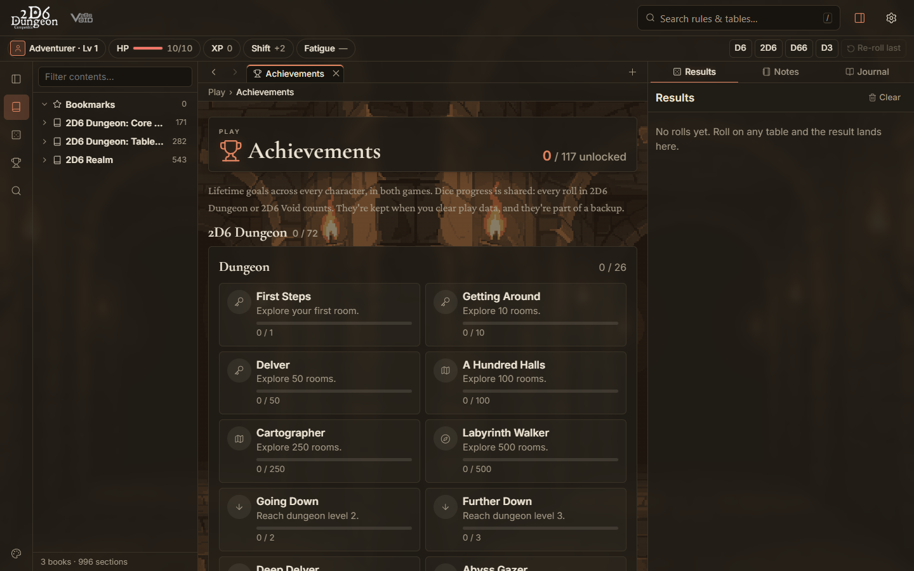
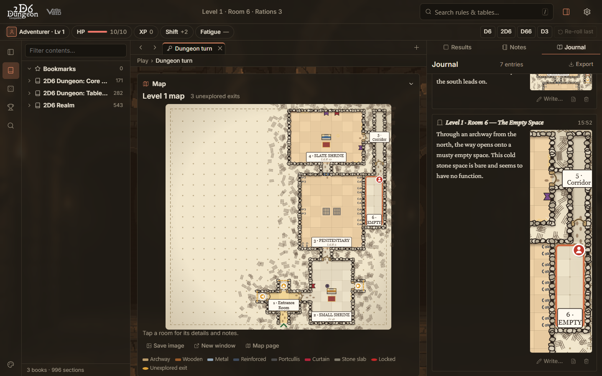

# Achievements and Journal

## Achievements

Lifetime goals across every character, in both games, on one page (trophy icon in the rail, or Play → Achievements). There are **117** in total, 72 of them for Dungeon.

| Game | Groups |
|---|---|
| 2D6 Dungeon | Dungeon, Combat, Realm, Character, Legendary Rewards |
| Both games | Dice (shared: every roll in either game counts) |
| 2D6 Void | The Dark Hulk, Combat, Survivor, Hero of the Void |

- Each card shows a progress bar and count, or the unlock date once earned.
- **Secret** achievements hide their title and blurb until unlocked (for example Fallen Hero, "Lose a fight. It happens to everyone.").
- Unlocking one shows a toast.
- Examples: *First Steps* (explore a room), *Cartographer* (250 rooms), *Bottom of the World* (dungeon level 10), *Lockpicker* (10 locks), *Prime Time* (10 Prime Attacks), *Boxcars* (a double six), *Hot Hand* (three double sixes in a row, secret).
- The *Legendary Rewards* group tracks the six rewards from the Core Rules table rolled in town after completing level 10.
- Progress is kept when you clear play data, and is included in backups.

## Journal

The Journal tab in the right panel writes the story of your run for you as you play, oldest first like a book (it opens at the newest entry).

- Each dungeon room gets an entry when you roll it, filled in as you learn more: room type and description, the door you came through, exits, patrols and interruptions, door and lock results, the stairs. **Finish room** freezes it.
- Fights appear inside the room they happened in (foes, rounds, win or loss, XP banked, treasure).
- Going down a level, levelling up, eating a ration, finding an exit shaft, exploring a realm plot and the end of a realm month all get entries.
- A new dungeon (the level-1 entrance) starts a new chapter, titled with the realm date if you have a realm.
- Room entries carry a small map picture of the area as it was at the time. Tapping it opens the Map page on that room when it is on the current level.
- **Edit** an entry's story (clear it to get the written story back), add your own words with **Write…**, or delete an entry.
- **Export** downloads the whole journal as a printable web page, chapters starting on new pages.
- It records in the background whichever tabs are open, and a dot on the tab means new entries.
- The newest 500 entries are kept, and the Journal is included in backups.
