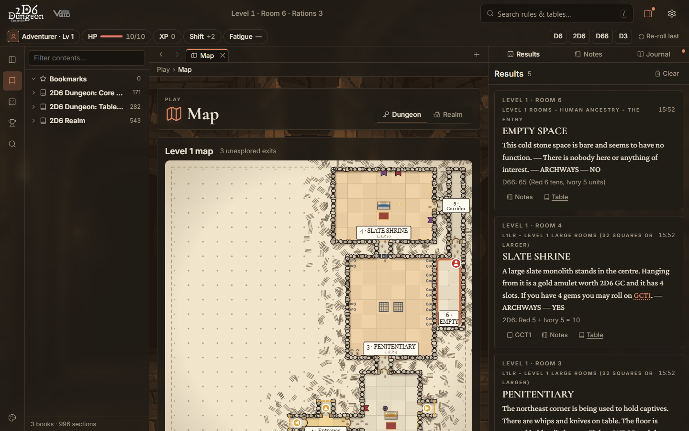
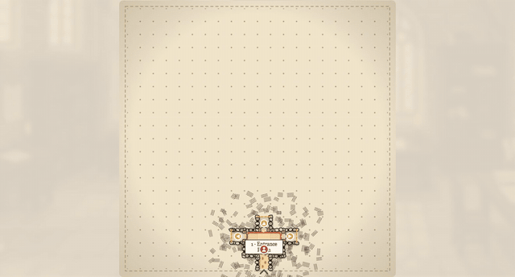
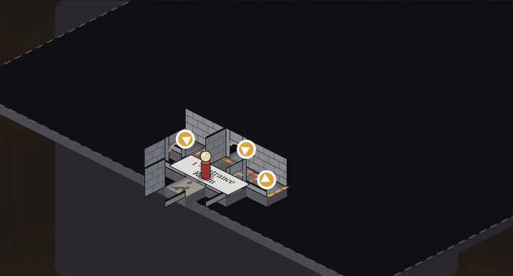
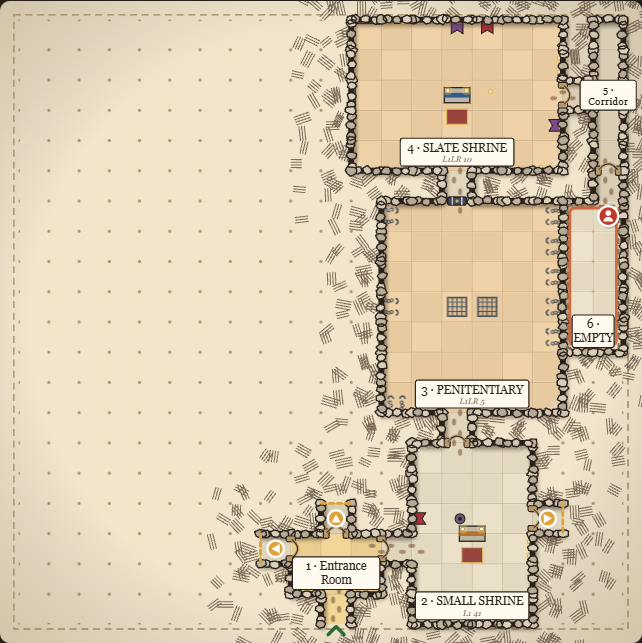
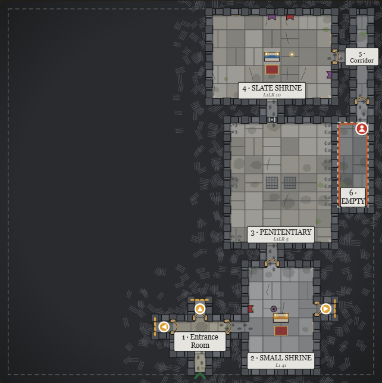
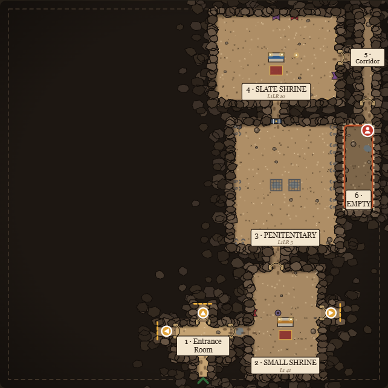
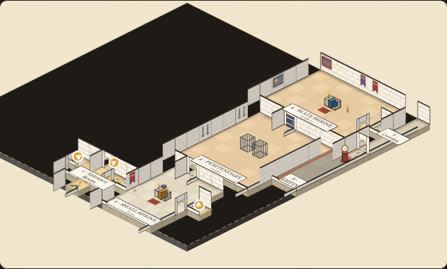
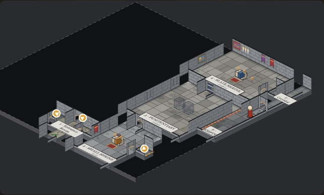
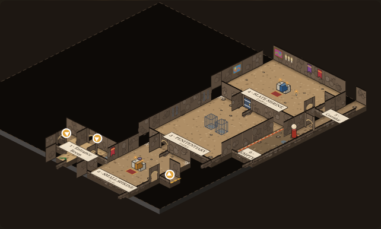

# The dungeon map

The map is drawn as you play, in a hand-drawn style. It is the feature that changed most on `master` recently: three tile sets, a top-down and an isometric view, and rooms dressed from their names.

## Using it

- Rooms are placed beyond the exit you tap and squeezed to fit, the way you would draw them on paper.
- Exits follow the clockwise D6 rule. Each door type has its own symbol and colour, locked doors get a red padlock, and hovering an exit shows its type. You can put the down stairs in any room.
- Tap a room for its table row and your own notes (a pencil marks rooms with notes).
- **Save image** saves the map as a PNG. **New window** opens it in its own browser window for a second screen: it updates live, and tapping an exit there picks it in the main window.
- A footprint trail and a token show where you are.
- The **Map** page (Play → Map, or **+** → Map) is the large version. Dungeon turn shows a smaller one beside its steps.

## Watch it draw itself

Each room appears as you roll it, placed beyond the exit you chose and squeezed to fit. Doors, exits and the room's name label are added as the rolls come in, and the room's dressing is picked from its name.

The same run in the isometric view with the Dungeon tile set:

## Tile sets

Chosen in **Settings → Map tiles & view**, separate from the colour theme.

| Paper | Dungeon | Caves |
|---|---|---|
|  |  |  |
| Hand-drawn parchment, stone-block walls, cross-hatched rock | Dingy grey brick walls, worn flagstones, grime and moss | Rough rock walls, earthen floors, pebbles and stalagmites |

## Isometric view

The isometric view raises rooms as slabs, stands the back walls up (with doors, paintings, banners and torches on them) and cuts the front walls away so you can see in. Furniture stands up in 3D.

| Paper | Dungeon | Caves |
|---|---|---|
|  |  |  |

## Rooms are dressed from their name

Bookshelves in a library, a sarcophagus and bones in a crypt, beds in barracks, a feast table in a kitchen, pillars and a throne in a throne room, cages in a jail, and mist, water or fungus where the name suggests them.

