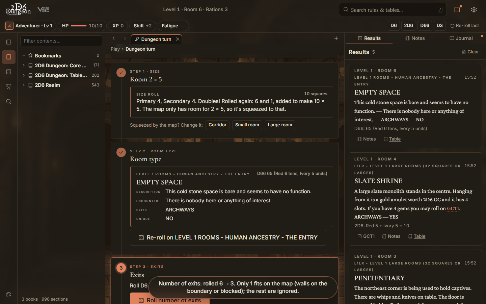
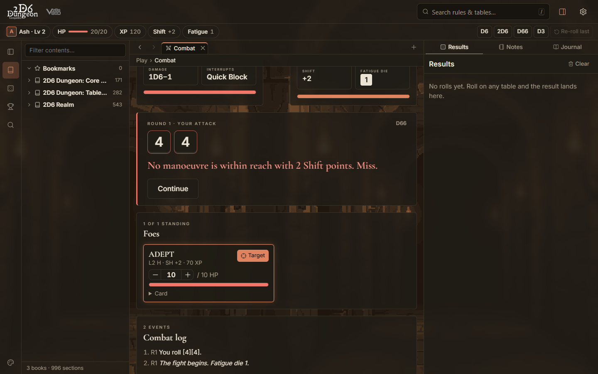
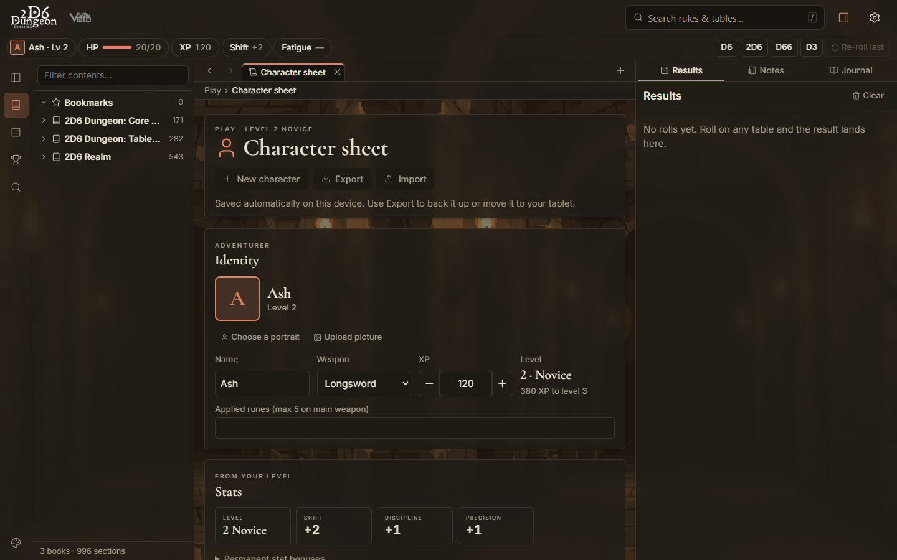
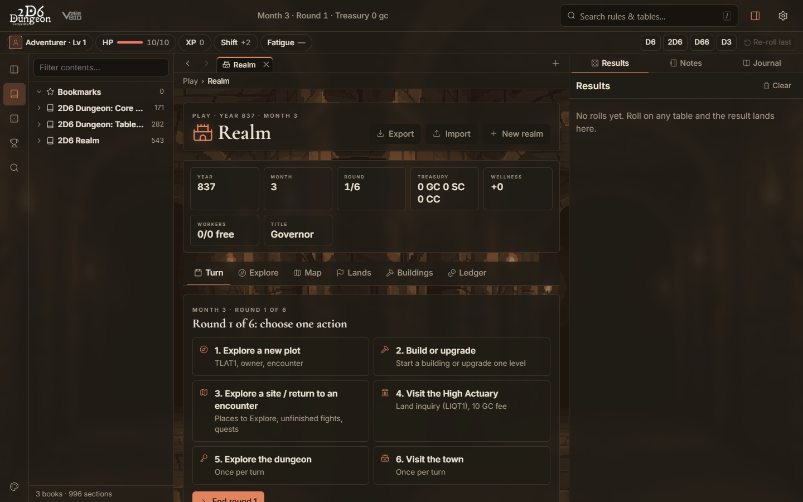

# 2D6 Dungeon

Four play tools (plus the [Map page](Dungeon-Map.md)) follow the rules of the books. 
## Library and search

Three books are indexed: **Core Rules**, **Tables Codex** and **Realm** (996 sections in the current build). Search covers text and table codes. Cross-links in text turn table codes and titles into links, and a section shows "Referenced by N sections". Pages that were pictures in the PDF were transcribed by hand and have a **Show original page** link so you can check them. A mistake can be fixed on the spot (Page tools → Fix mode).

## Dungeon turn

Walks one room at a time through the book's flowchart and draws the map as you go.

1. **Size roll**: doubles, corridors, and the level 8 and 10 dice changes. If the map has no room for the roll, the room is squeezed to fit and you can switch it to Corridor, Small, Regular or Large.
2. **Room table**: the right table for the level and size, with unique-room checks (including the duplicate and 60% special-unique warnings). Level 8 large rooms get the mini-maze note, level 10 the Dungeon Lord sequence.
3. **Exits**: the number of exits, placed by the clockwise D6 rule, then the exit type (EXTn) when the table says RANDOM.
4. **Encounter**: patrol (LxP) and interruption (IAUT) rolls with follow-on buttons, and a **Fight** button that opens Combat in a new tab.
5. **Doors**: wooden, metal and reinforced doors, portcullis (POLT1) and stone slabs. Locked doors can be picked (2D6 + Precision).
6. **Finish room** adds it to the level's list.
7. **Stairs**: eat a ration on the stairs (+2 × level HP, asks about a bandage), skip the ration (lose half HP, max 20), search for an exit shaft, go down a level.

The map sits beside the steps when the page is wide enough (above them, collapsible, when narrow). Tap an exit on it, or use the **Next room through** chips. The level is a 20×20 grid (25×25 on level 10). Progress survives a reload.

## Combat

Pick creatures from **151 transcribed stat cards** (search by name, or `L3` for level 3), add several, and fight.

- Each round you roll your D66 attack. The helper shows the manoeuvres you can reach with your Shift points and handles Exact Strikes (+Shift), [1][1] automatic misses and [6][6] Prime Attacks (every manoeuvre offered, no interrupt allowed).
- A creature's interrupt reduces your damage, once per round.
- Creatures attack back, shifting to their strongest reachable manoeuvre. Your armour deflects a hit when the dice match a piece's dice set.
- The Fatigue die adds Shift at 4, 5 or 6. A kill in round 1 gives +2 Shift in round 2.
- Your HP stays in sync with the character sheet. Victory offers the XP and the treasure rolls, and defeat offers the recovery table (RFUT1).
- A combat log lists each event, and the fight survives a reload.

## Character sheet

Every field from the book's sheet. Level, stats and baseline HP come from XP through the Adventurer Levels table, with a level-up message. It has a manoeuvre picker for your weapon, up to three armour pieces and five potions, scroll casting (with the FTCCT1 fail roll), favour calls, Bloodied and Soaked trackers, coins (with "change up coins"), large items, notes, loot lockup and Legend status. New character, Export and Import are built in.

## Realm

- **Turn**: month and round tracker with the six actions (Explore, Build, Site, Actuary, Dungeon, Town).
- **Explore**: roll TLAT1, then size, owner (D6 or LAIT1) and the land encounter, FIVEPT1 for 5+ squares. Add the result to your Land Log or the Unclaimed Land Log, or discard it.
- **Map**: tap an empty square to explore it. Unique plots take that square, areas grow into 1 + D6 touching squares, and strings (road, river, cliff, wall, chasm) walk by D6 over the free sides (left 1–2, straight 3–4, right 5–6) and pass through other plots. Your land has a gold border, unclaimed land is hatched with a cross, buildings show as a count badge, and the map zooms to the explored area.
- **Lands**: land logs with taxes and title.
- **Buildings**: all 26 building cards, HP ticks per round, workers, unrest and income.
- **Ledger**: treasury, wellness and temporary modifiers, Kaladear and landowner gifts and threats.
- **End-of-month checklist**: income, taxes, health, wellness, RMEVT1, building rolls, YEEVT1 and title retainer.
- Export, Import and "New realm" are built in.
