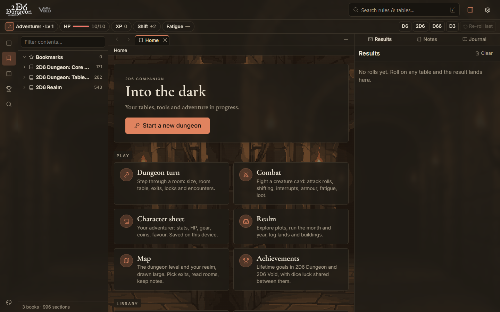

# 2D6 Companion: Dungeon and Void

2D6 Companion is a private, local, searchable reference and play-aid for the **2D6 Dungeon**, **2D6 Realm** and **2D6 Void** tabletop books. It runs in the browser (PC, tablet or phone), keeps everything on the device, and adds clickable roll tables, 3D dice and a set of play tools that follow the books' flowcharts.

The app holds **two separate games**. The logos at the top left switch between them: the big one is the game you are in, the small dimmed one switches to the other. Nothing is shared between them except the shell (layout, sound levels, backdrop) and the dice-luck achievements.

| | 2D6 Dungeon | 2D6 Void |
|---|---|---|
| Setting | Fantasy dungeon crawl, plus a realm to run | Sci-fi: a derelict ship, the Dark Hulk |
| Books in the library | Core Rules, Tables Codex, Realm | The whole Void book |
| Play tools | Dungeon turn, Combat, Character sheet, Realm, Map | Hulk turn, Hulk map, Combat, Character sheet |
| Colour themes | 9 plus "Match device" | 8 |
| Map styles | Paper, Dungeon, Caves | Hull Plating, Grated Deck, Infested, Blueprint |
| Saves | Separate | Separate |

## Contents

1. [The interface](Interface.md): the UI overhaul (rail, tree, tabs, panels, character bar)
2. [2D6 Dungeon](Dungeon.md): Dungeon turn, Combat, Character sheet, Realm
3. [The dungeon map](Dungeon-Map.md): tile sets, isometric view, room dressing
4. [2D6 Void](Void.md): unlocking with your book, Hulk turn, Hulk map, Combat, Character sheet
5. [Themes and settings](Themes-and-Settings.md): themes, dice, sound and the music playlist, map styles, backups, the site tour
6. [Achievements and Journal](Achievements-and-Journal.md)
