The app looks like a small browser with its own tools. This page names every part of the screen and says how to use it. Open the app on a computer to follow along; the last section covers tablets and phones.

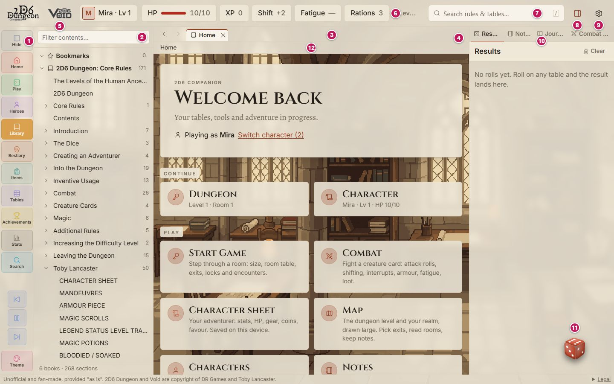
<em class="cap">1 icon rail, 2 contents filter and list, 3 tabs, 4 new tab button, 5 game logos, 6 character bar and status line, 7 search, 8 side panel button, 9 Settings, 10 side panel, 11 dice button, 12 page header.</em>

## The icon rail

The column of icons down the far left is your main menu. Hover an icon for its name. From top to bottom:

| Button | What it does |
|---|---|
| **Hide** | Hides the contents list to give the page more room. The button then reads **Show**; press it again to bring the list back. |
| **Home** | Opens the Home page, with a card for every tool. |
| **Play** | Switches the contents list to the play tools: Start Game, Combat, Character sheet, Map, Notes, Journal, Settings and your Bookmarks. |
| **Heroes** (**Crew** in Void) | Opens a small list of your characters. The one you are playing is marked **PLAYING**. Click that one to open their sheet, click another to switch to them (the app reloads into that character's own tabs), **New character** makes one, **All characters...** opens the [Characters](characters.html) page. |
| **Library** | Switches the contents list to the books. |
| **Bestiary**, **Items**, **Tables** | Open those [reference tools](bestiary.html). |
| **Achievements**, **Stats** | Open [Achievements](achievements.html) and [Statistics](statistics.html). They only appear in a game that has the page. |
| **Search** | Opens search. |

At the bottom of the rail are three small music buttons (previous song, pause or play, next song) and **Theme**. The music buttons are greyed out when music is off in Settings. **Theme** opens a grid of colour themes to click (in Dungeon: Match device, Parchment, Dungeon, Midnight, Forest, Blood moon, Arcane, Sea glass, Bone and High contrast). More about themes and sound in [Look, dice and sound](settings-look-and-sound.html).

**Library** and **Play** are the two modes of the contents list. Pressing the mode that is already active hides or shows the list, just like **Hide**.

## The contents list

Next to the rail is the contents list. In Library mode it shows each book as a folder of chapters and sections, with the number of entries beside it. Books you have not unlocked show a padlock at the bottom of the list. At the bottom of the list a line such as "6 books · 268 sections" tells you what you have loaded.

- **Open something.** Click an entry. It opens in a **new tab**, so your current page stays where it is.
- **Open and close folders** with the small arrow next to a name, or with the left and right arrow keys. The up and down arrows move between entries.
- **Filter.** Type in the **Filter contents...** box at the top. The list shrinks to the chapters and sections that match, with their folders opened. Press **Esc** in the box, or the x at its right, to clear it.

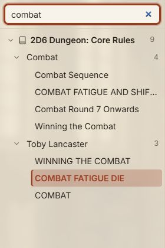

## Tabs

Every page opens in a tab above the page, like a browser. Your open tabs are remembered, so you pick up where you left off.

- Click a tab to show it. Click the x on a tab, or middle-click the tab, to close it.
- The **back** and **forward** arrows at the left of the tab bar move through the pages you have visited in the current tab.
- The **+** button at the right opens a menu of things to open in a new tab: Home, Start Game, Combat, Character sheet, Map, Characters, Notes, Journal, Bestiary, Items, Tables, Achievements, Statistics, Settings and **Search the books...**. Use the up and down arrows and Enter, or click. Esc closes the menu.

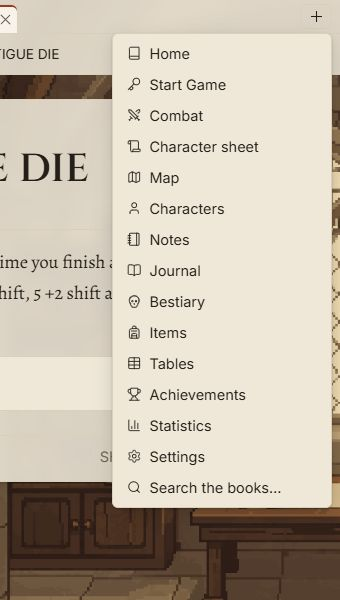

## The top bar

From left to right:

- **The logos.** The big logo is the game you are in; the small one next to it switches to the other game.
- **The character bar.** The chips that show your character at a glance. See the next section.
- **The status line.** Once you have started a dungeon it shows where you are, for example "Level 1 · Room 1 · Rations 3". In the Realm it shows the month, round and treasury. Click it to open that tool. When the window is narrow the line is cut short; hover it to see the full text.

  
- **The search box.** See below.
- **The side panel button** (a square with a bar at its right) shows or hides the side panel.
- **The Settings button** (the cog) opens Settings in a tab.

## Search

Press **/** or **Ctrl+K** (**Cmd+K** on a Mac) from anywhere, or click the search box, or press **Search** in the rail. A search window opens. Type any word, or a table code such as ENAT1. Results list the section's title, which book it is from, and a snippet with your words highlighted.

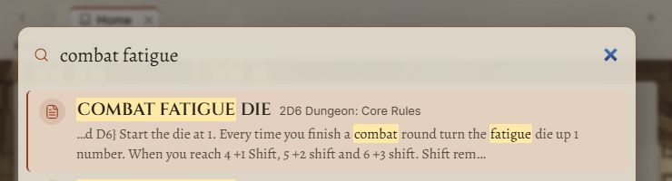

- **Up** and **Down** move through the results.
- **Enter** opens the result in a new tab.
- **Ctrl+Enter** opens it in the current tab.
- **Esc** closes the window.

> **Note:** If your cursor is in a text box, **/** just types a slash. Click somewhere neutral first, or use **Ctrl+K**.

## The character bar

The chips beside the logos show your current character: a name chip, then **HP**, **XP**, **Shift**, **Fatigue** and **Rations**.

- **Name chip.** Hover it and a card opens with your XP, HP, Shift, Discipline, Precision, Fatigue, armour, weapon, coins and rations, with buttons **Open full sheet** and **Switch character**. Click or press Enter on the chip to keep the card open; press Esc to close it. The **Shift** chip opens the same card.

  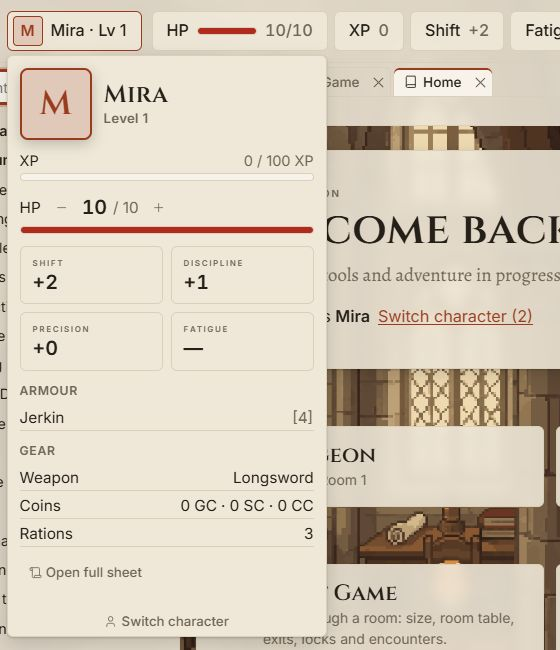
- **HP, XP, Rations and Fatigue.** Click a chip for a small box with **-** and **+** buttons. The HP box also has **HP bonus**, and **+ Bloodied** and **+ Soaked** buttons. The XP box has a number field. **Fatigue** can only be changed while a fight is on.

  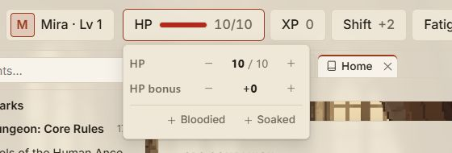

Changes you make here are saved to your character straight away. If you want the chips on a lower bar or in another order, use the **Top bars** section of Settings.

## The side panel

The panel at the right has tabs: **Results**, **Notes**, **Journal**, and a **Combat log** tab that appears while a delve is under way. A small dot on a tab means something new landed there while you were looking at another tab.

- **Results** shows every dice and table roll as a card, newest first. See [Rolling dice](dice-and-rolls.html).
- **Notes** is a scratchpad that follows you from page to page. It has **This room** notes, a **Capture a moment** box with an **Add** button, and the log of what you did, with an **Export** button.

  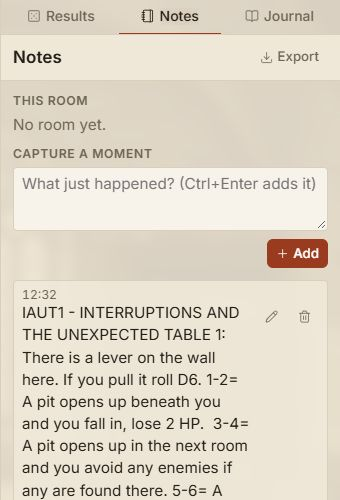
- **Journal** is the story of your run, written as you play. You can add your own lines with **Write...** and export it.

Notes and Journal are covered fully in [Notes and Journal](notes-and-journal.html).

## Page tools on book pages

When you open a book section (see [The library and search](library.html)), the page header shows a breadcrumb, a **Fix text** button and a **...** button called **Page tools**. Its menu has **Bookmark** (or **Remove bookmark**), **Show original page** when a scan is available, **Fix mode**, and **Find in page...**. A bookmarked page shows a star beside the breadcrumb. Play tool pages such as Home and Start Game have no page tools.

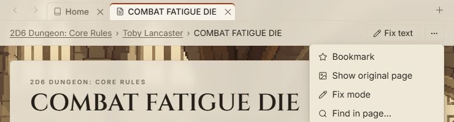

## How links open

| What you do | Where it opens |
|---|---|
| Click an entry in the contents list | A new tab |
| Click a result in search, or press Enter | A new tab |
| Press Ctrl+Enter in search | The current tab |
| Click a rail button (Home, Bestiary, Items, Tables...) or a card on Home | The current tab |
| Click a link inside a page | The current tab |
| Ctrl-click (Cmd-click on a Mac) or middle-click a link | A new tab, which you switch to |
| Pick something from the **+** menu | A new tab |

## Keyboard shortcuts

| Keys | Action |
|---|---|
| **/** or **Ctrl+K** | Open search |
| **Up**, **Down**, **Enter**, **Ctrl+Enter**, **Esc** | Move through, open, and close search |
| **Up**, **Down**, **Left**, **Right** | Move and open or close folders in the contents list |
| **Esc** | Close a menu, popup or search; on a small screen, close an open drawer |
| **Arrow keys** on the dice button | Move it (hold **Shift** for bigger steps) |
| **Ctrl+click** or **middle-click** a link | Open it in a new tab |

## Tablets and phones

The layout changes with the window width.

- **Wide (1280 px and up).** Everything is on screen: rail, contents, tabs and the side panel.
- **Medium (900 to 1279 px).** The side panel folds into a thin strip of tab icons at the right. Press the side panel button (or an icon in the strip) to slide it open over the page; press Esc to close it. The search box shows only an icon if space is short.

  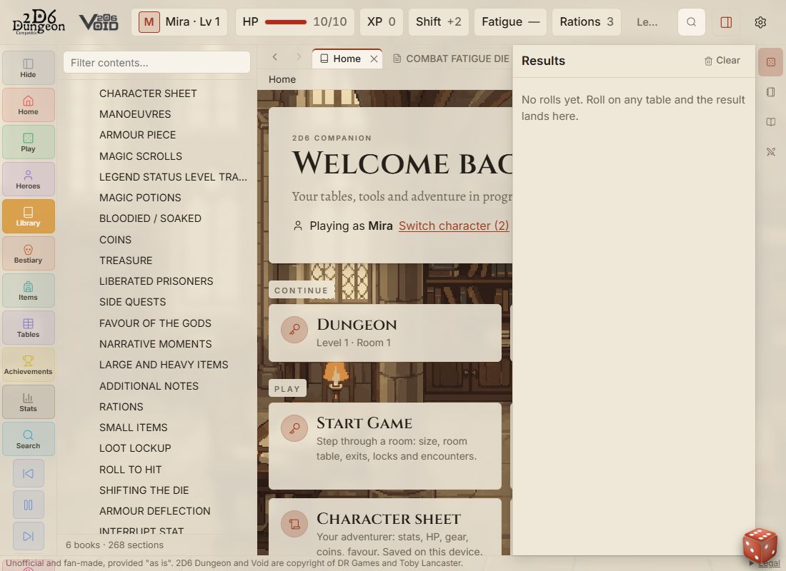
- **Narrow (under 900 px, which includes phones and some tablets held upright).** The rail and contents list move into a drawer. A **Contents** button (three lines) at the top left opens it. The side panel becomes a drawer from the right, opened with the side panel button. Press Esc, or tap the dimmed page, to close a drawer. The character bar drops into a lower bar that shows only the **HP** chip; tap it for the **-** and **+** box. The name card that opens on hover is not used on narrow screens. At phone width (390 px) the search box becomes a magnifier icon.

  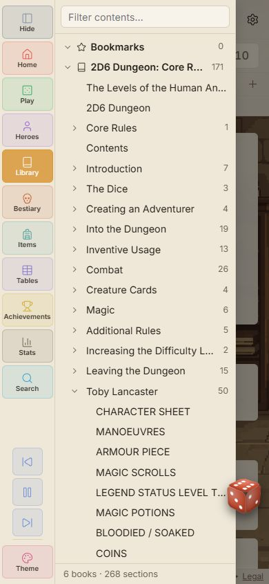

  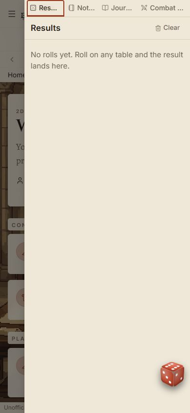

The dice button stays on screen at every width. Press it to open the dice, or drag it to a better spot; see [Rolling dice](dice-and-rolls.html).

## Tips

- Open several tabs, for example Start Game, Map and the rules section you need, and switch between them.
- Your layout (which panel tab, whether the contents are hidden) is remembered between visits.
- If you press **Esc** and nothing seems to happen, a menu or dialog probably took the key first; press it again.
