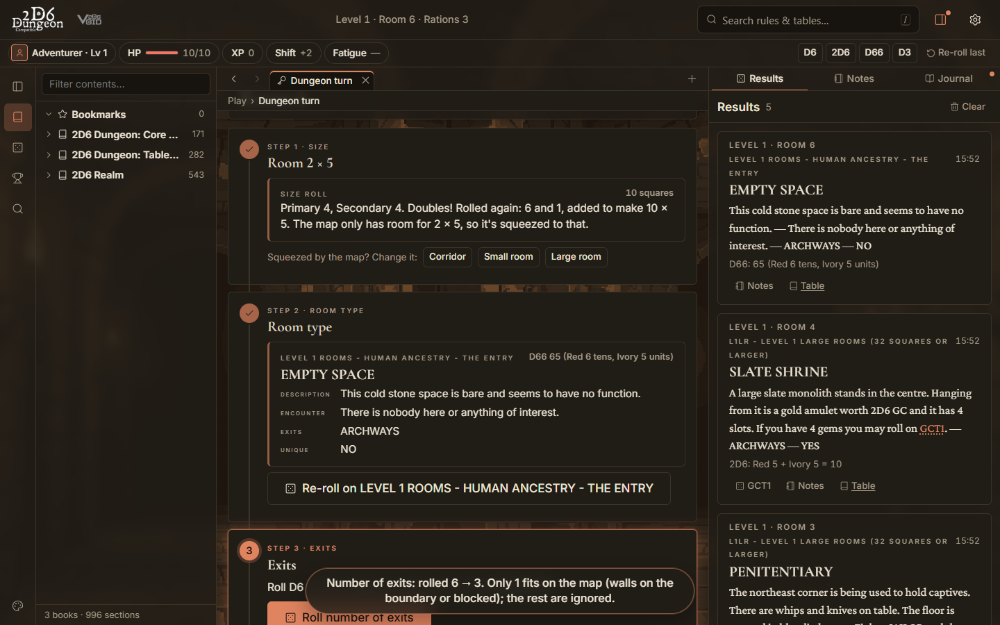
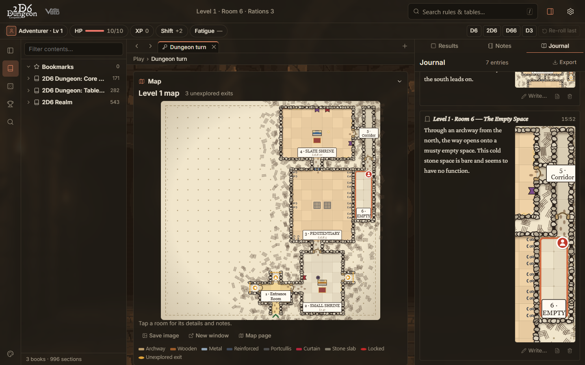
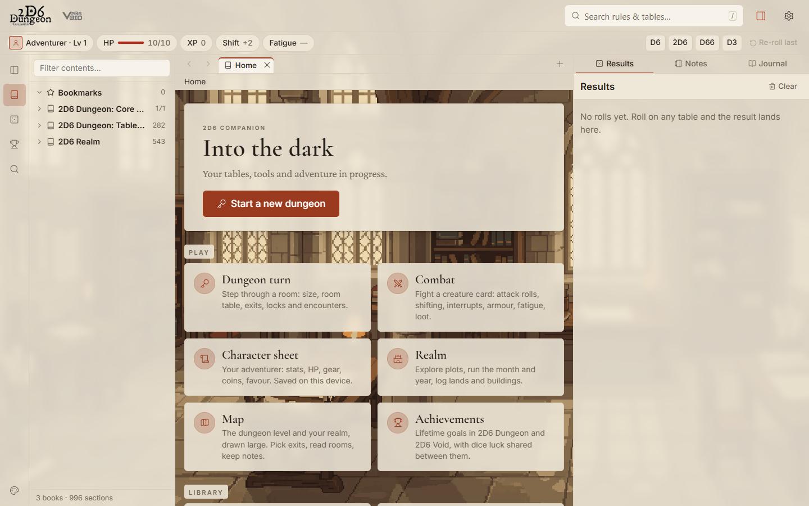

# The interface (UI overhaul)

The UI overhaul replaced the old single-column page with a workspace-style shell: an icon rail, a contents tree, a tabbed centre, a tabbed right panel, and a character bar. The goal was a polished visual identity where every existing feature keeps working, a tool and a rules table can sit side by side, and roll results, the map, notes and the character are always visible. The design took the *patterns* of a reference layout only; the names, logo and art are the project's own.

## The parts

| Part | What it does |
|---|---|
| **Icon rail** (far left) | Top: **Collapse** (hide or show the tree), **Library**, **Play**, **Achievements**, **Search**. Bottom: a quick **Theme** picker. Tapping the active mode collapses the tree. |
| **Contents tree** | Books, chapters and sections in Library mode; the play tools and Settings in Play mode. **Bookmarks** sit at the top. A filter box narrows it, and open groups are remembered. |
| **Tabs** (centre) | Every page opens in a tab. Pages stay mounted while hidden, so a tool keeps its place. Tabs are restored on reload, and each has its own back and forward. |
| **+ button** | A menu: Home, each tool, Settings and "Search the books…". Choices open in a new tab (or switch to the tab already showing it). |
| **Top bar** | Logo (Home), a live status line ("Level 2 · Room 4 · Rations 3", tap to go there), search, the side-panel button and Settings. |
| **Character bar** | Editable chips for the name, HP, XP, Shift and Fatigue, plus the quick dice and **Re-roll last**. |
| **Right panel** | Three tabs: **Results**, **Notes**, **Journal**. |

### Tabs and links
- Clicking a tree item opens it in a **new tab**, or switches to the tab that already shows it.
- Links inside a page (cross-references, breadcrumbs, Home's cards) open in the same tab. `Ctrl`-click or middle-click opens a new tab. Middle-click a tab to close it.
- The URL hash names the active tab (`#/s/<section>`, `#/play/<tool>`), so back, forward and shared links still work.
- A page's **⋯ Page tools** menu holds Bookmark, Show original page, Fix mode and Find in page.

### Search
`/` or `Ctrl+K` opens search. `Enter` (or a click) opens the result in a new tab, or switches to the tab already showing it. `Ctrl+Enter` opens it in the current tab.

## Right panel

- **Results**: every roll lands as a card, newest first (the last 100 are kept). Follow-on rolls nest inside their parent. **Notes** copies a card to the session log, **Table** opens its table, **Clear** empties the list. A dot on the tab means something new arrived.
- **Notes**: notes for the current dungeon room, a "capture a moment" box, and an editable, exportable session log.
- **Journal**: the story of the run, written for you as you play. See [Achievements and Journal](Achievements-and-Journal.md).

## Character bar

Hover the name chip (with your portrait) for a compact sheet with HP − / + and **Open full sheet**; click, tap or press `Enter` to keep it open. This works in both games: in Void the card shows your survivor (profession, XP, HP, Shift, Technical, Coding, Marksmanship, Bloodied, Stunned, armour and gear). The chips have the same square corners as the dice buttons.

- **HP** opens − / + for HP and the permanent HP bonus, plus **+ Bloodied** and **+ Soaked** (shown as chips, red at 8).
- **XP** has − / + and a box to type a value. Level changes show the level-up message.
- **Fatigue** is the combat Fatigue die, editable only during a fight.
- The portrait is set by clicking the picture on the Character sheet. There is a gallery of 50 fantasy portraits for Dungeon and 20 survivors in four art styles (Anime, Cyberpunk, Realistic, Steampunk) for Void.

## Things the overhaul removed

These were deliberate:

- The **hotbar** (pinned-table slots along the bottom) and "Hide UI".
- The **floating pop-out map**. The map is now a centre **Map** page, shown beside Dungeon turn's steps when the page is wide enough.
- The old **Roll log** drawer, folded into the Results panel.
- The right panel's separate Map and Character tabs (the name chip's flyout replaces the latter).

## Light and dark

Every theme passes WCAG contrast for text. Light themes get a frosted band behind page heads so they stay readable over bright backdrops. See [Themes and settings](Themes-and-Settings.md).

