# Themes and settings

Open **Settings** from the top bar (or Play → Settings).

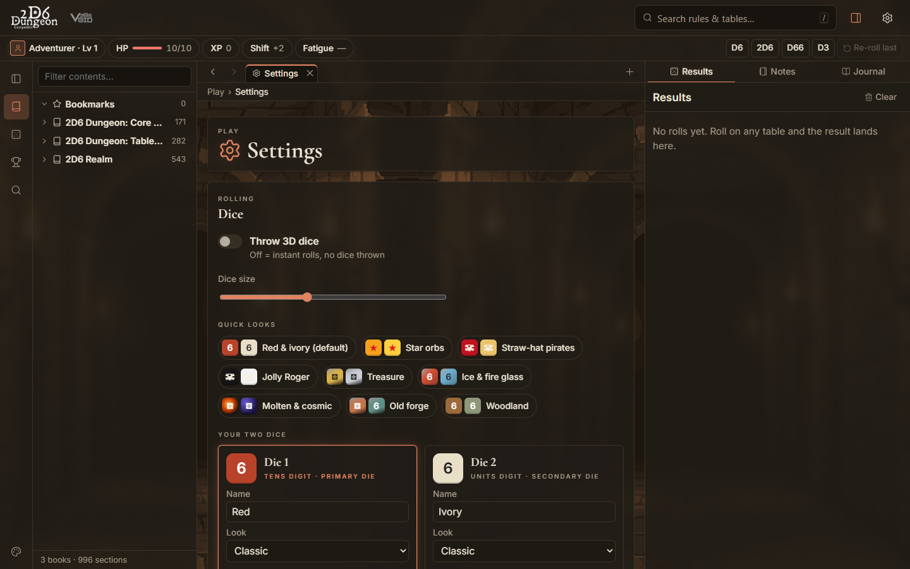

## Colour themes

A theme is a palette plus a painted backdrop behind the translucent panels. All of them pass WCAG contrast for readable text. 

**Dungeon:** Match device, Parchment, Dungeon, Midnight, Forest, Blood moon, Arcane, Sea glass, Bone, High contrast.

| Midnight | Forest | Blood moon |
|---|---|---|
| 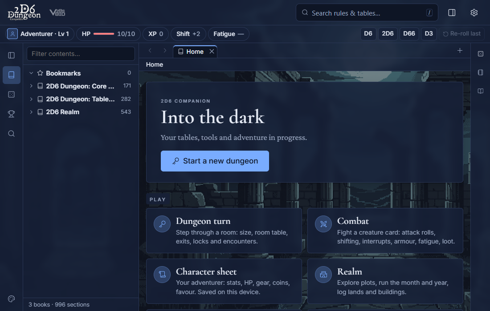 | 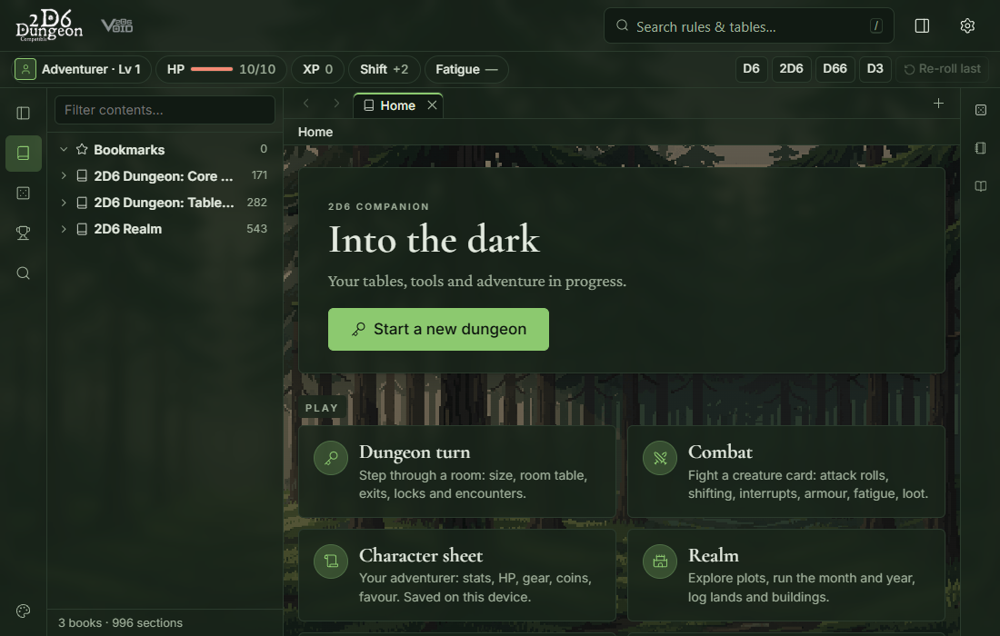 | 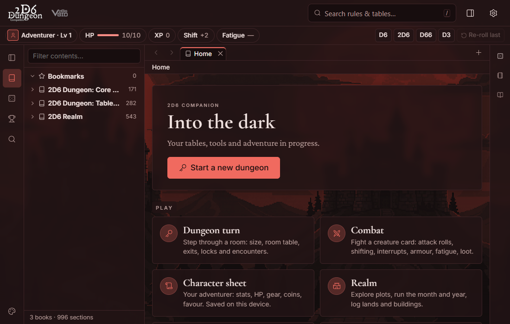 |
| **Arcane** | **Sea glass** | **Bone** |
| 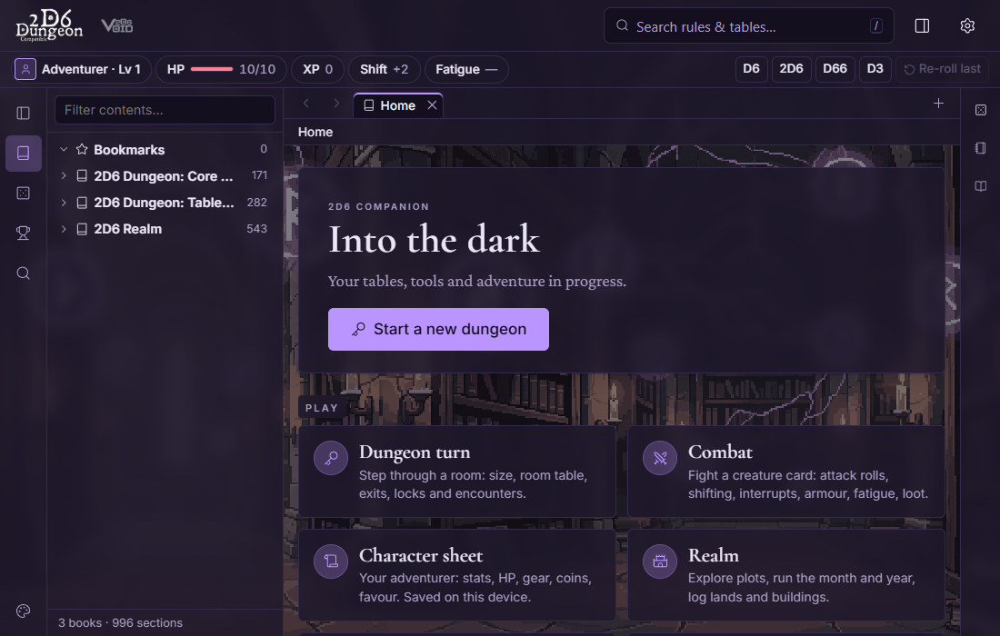 | 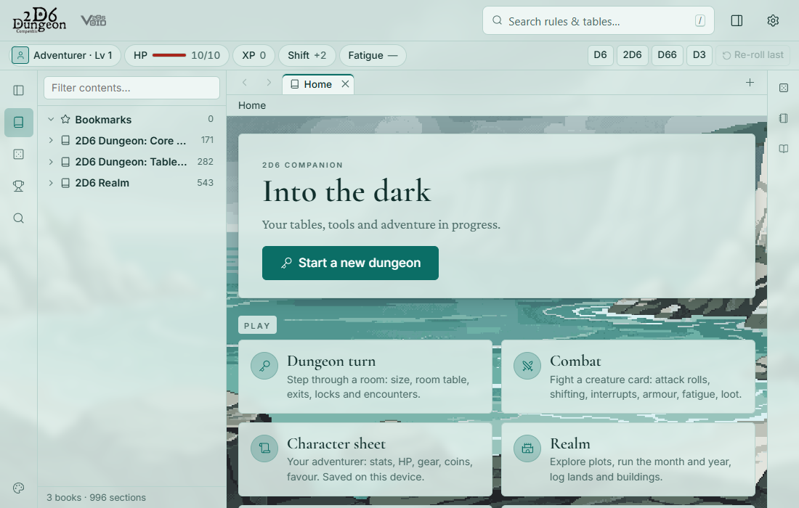 | 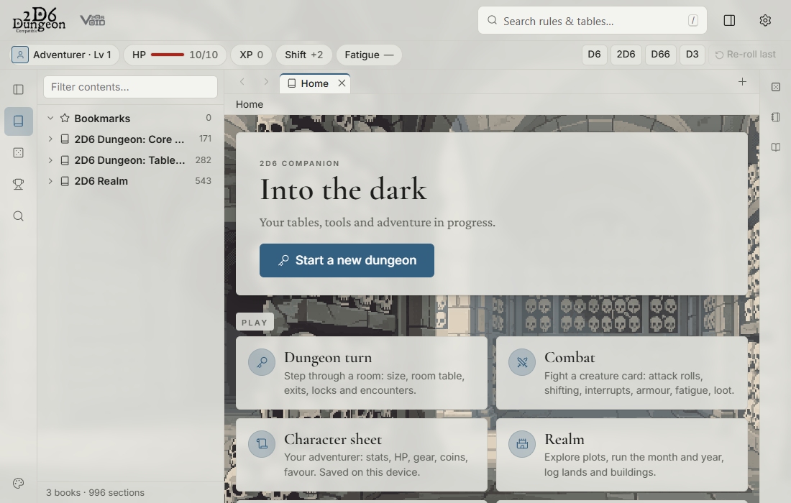 |

**Void:** Deep Space, Hull Steel, Neon, Reactor, Biohazard, Brass, Clean Lab, High contrast.

| Hull Steel | Neon | Reactor |
|---|---|---|
| 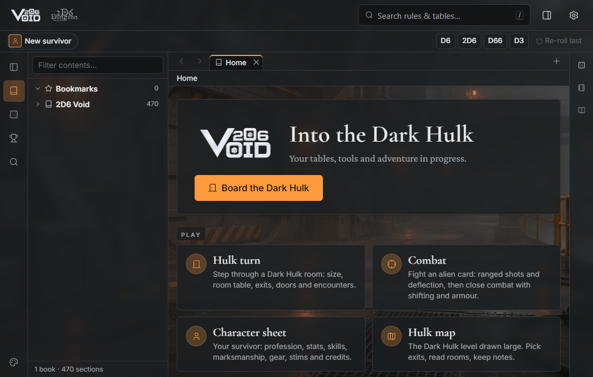 | 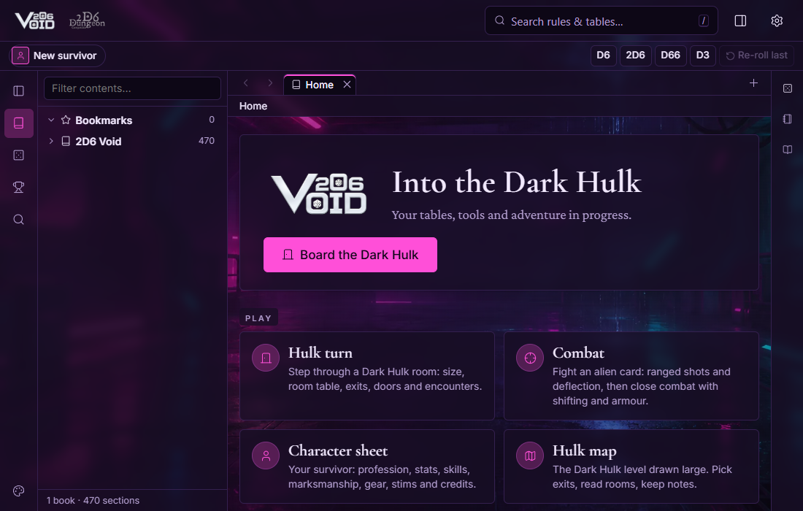 | 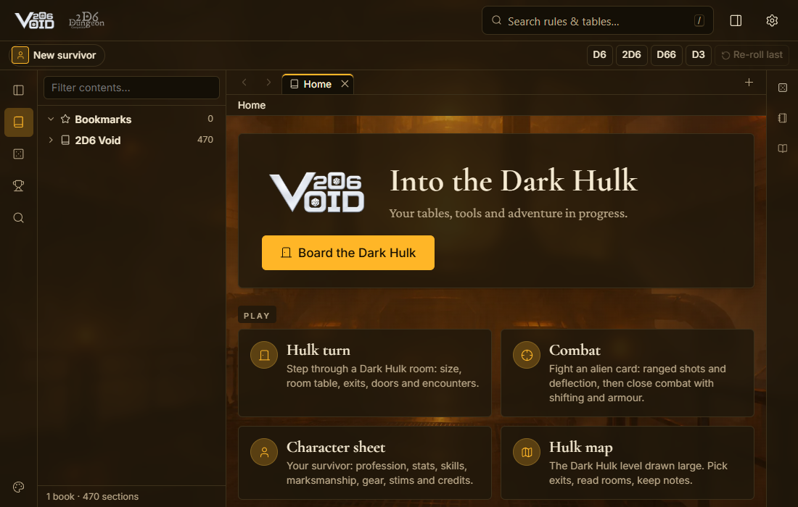 |
| **Biohazard** | **Brass** | **Clean Lab** |
| 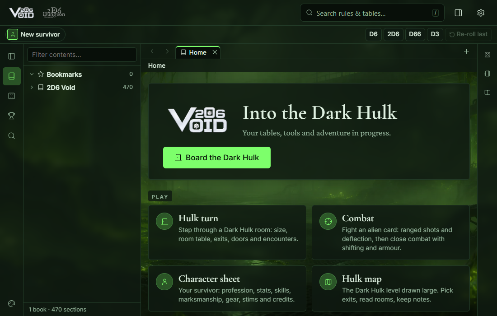 | 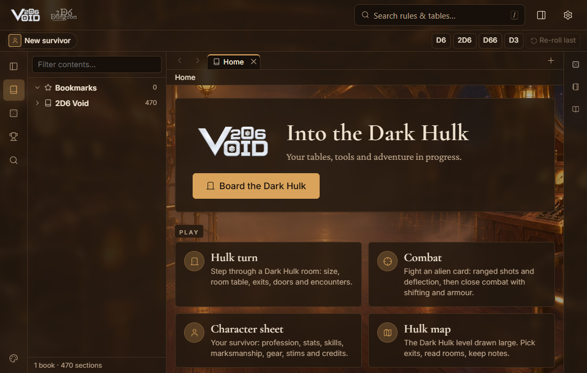 | 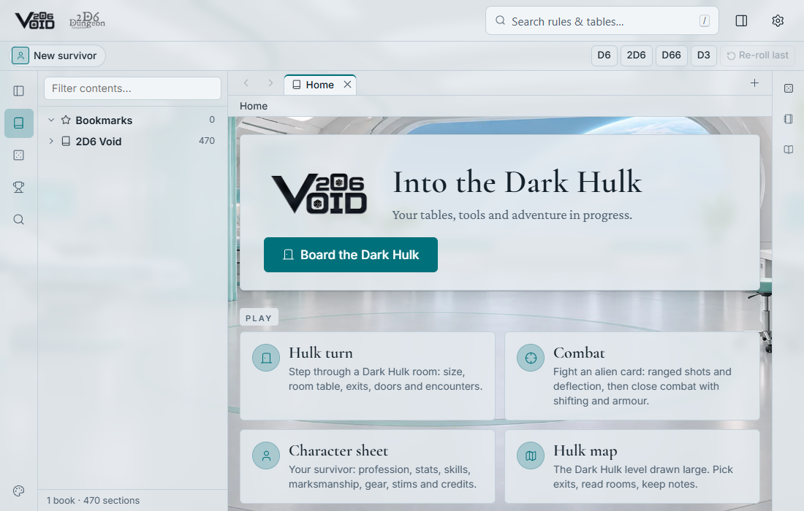 |

## Display

- **Backdrop image** (off gives a plain gradient in the theme's colours).
- **Reduce transparency** (solid panels).
- Text size.

## Dice

- Pick a look and colour for each of your two dice: classic, pips, glass/crystal, rainbow marble, galaxy, lava, gold, silver, copper, weathered metal, rust, stone, wood, star orb and pirate skulls, with one-tap presets. Void has ten of its own skins with landing effects.

A few of the sets, mid-roll:

| Gold and silver | Lava and galaxy |
|---|---|
| 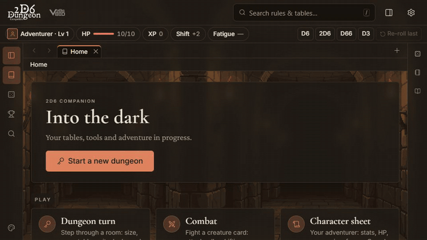 |  |
| **Pirate skulls** | **Fire and ice glass** |
| 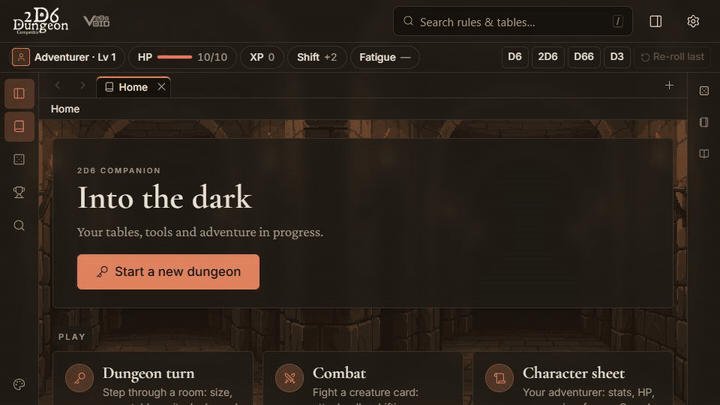 | 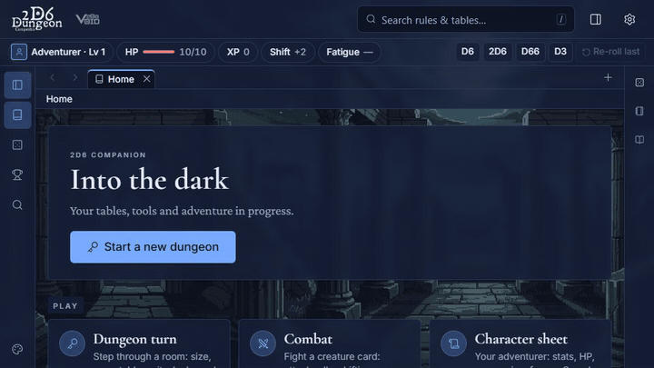 |

- Choose which die is the **tens digit** for D66 (that die is also the Primary die).
- Change the dice size, or switch 3D off for instant rolls.

## Map tiles and view

The tile set and Top-down or Isometric choice, each with a live preview, separate from the colour theme. See [The dungeon map](Dungeon-Map.md).

## Sound

Effects and music each have an on/off switch and a volume. Dungeon has music for the dungeon, combat, the realm and the tavern, plus victory and defeat stings; effects cover dice, doors, locks, hits, level-ups and more. Void has its own pack. There is no sound while browsing library pages.

The music follows what is happening, not which screen you are on: it changes for a fight (or a deeper level in Void), not when you click to another page.

### Playlist

Under the sound switches is a **playlist** of the game's songs.
- Switch any song off with its toggle and it never plays.
- **Add your own songs** from audio files on your computer. They are kept in this browser only and are not part of backups.
- For each of your songs choose where it plays: everywhere, exploring or fights.
- With several songs on they play one after another, and the skip buttons on the rail move through the ones that are on. With one song on, it loops. If every fight song is off, the exploring songs carry on through a fight.

## Automatic backups

Everything you save lives in this browser, so the app can back it up for you. Every 10 minutes while the app is open it writes a copy to a folder you choose and keeps the newest 10. A copy is only written when something changed.

- The first time you visit, you are asked to choose a folder. Pick one inside **OneDrive**, **Google Drive** or **iCloud Drive** and your backups are copied to the cloud automatically.
- Browsers that cannot choose a folder (anything other than Chrome or Edge) keep the 10 copies inside the browser instead.
- A backup holds your characters, realm and dungeon progress, notes, bookmarks, journal, achievements, content fixes and settings for both games. It never holds the book itself.
- After a restart the browser may ask you to allow the folder again: use **Reconnect** in Settings → Automatic backups.
- To restore, use **Import a backup** and pick one of the files from your backup folder.

You can also **Export everything** or **Import a backup** by hand, or clear play data (bookmarks and settings are kept). The app reloads after an import or a clear.

## Site tour

A short, skippable tour of the site itself (the rail, contents and search, tabs, the side panel, the character bar, settings, the two games and backups) runs on your first visit. Take it again any time from **Settings → Site tour**.
