# 2D6 Void

2D6 Void is the second game in the app. Its tools follow the Void rulebook.

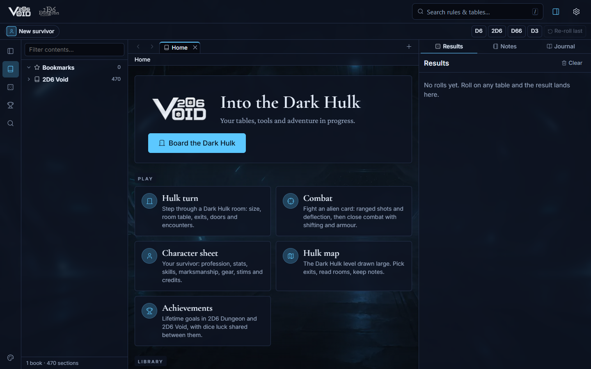

Void has its own library (rules, every level's tables, **80 alien cards**, ranged weapon and reference cards, sheets), themes, map styles, portraits, music, sound effects and saves.

## Unlocking 2D6 Void

2D6 Void is a paid game, so the app contains none of its book. The first time you open Void a short popup explains this, with links to [DR Games](https://drgames.co.uk/) and [DR Games on DriveThruRPG](https://www.drivethrurpg.com/en/publisher/15325/dr-games).

To use Void you open **your own copy of the 2D6 Void core rulebook** (the PDF) in **Settings → Books**. It is read on your device only, never uploaded, and kept in this browser, separately from Dungeon's books. Until then every Void screen except Settings sends you back to Settings, and **About 2D6 Void** there reopens the popup. Switching to 2D6 Dungeon always works.

Some table cells are matched against the book with on-device text recognition. Cells that could not be confirmed are marked, and the page image is shown beside them so you can check them.

## Hulk turn

The Dark Hulk room flowchart on a **17×28 hull**: room size, exits, room tables by level and size, encounters, and the ship's own doors and hazards.

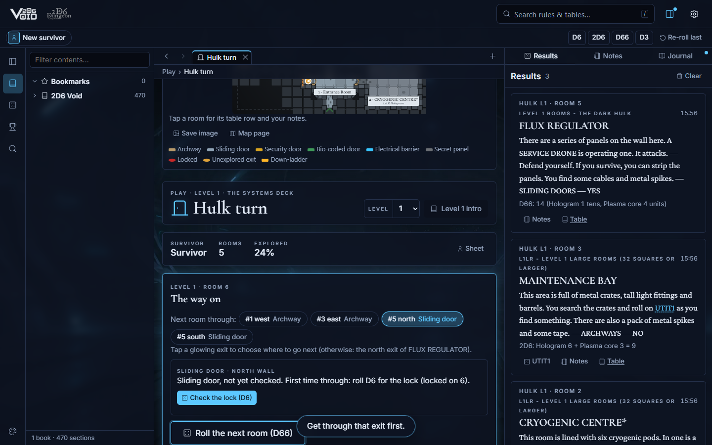

- Room size (D66) and the right room table for the level and size.
- Sliding, security and bio-coded doors, with a "check the lock" roll on first use.
- Electrical barriers, secret panels (one-way), the Camo Tent (limited uses per level), alarm checks (from the levels that have them) and backtracking through explored rooms.
- Alien encounters with patrols (LxP).
- **Level 9**: Void Portals, and the Void Chamber step-through.
- **Level 10**: the room chain to the Escape Pod Room, ending in a "Hero status" victory.
- Rations, descending, and restarting a level.

## Hulk map

The level drawn large, with the same exit-picking, room cards and notes as the dungeon map. The four map styles:

| Hull Plating | Grated Deck |
|---|---|
| 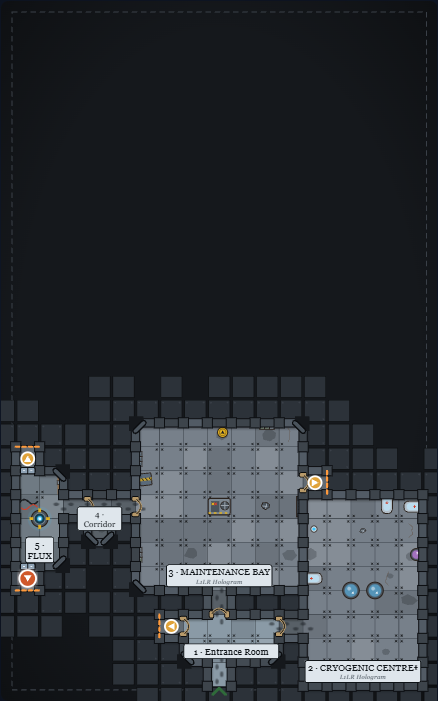 | 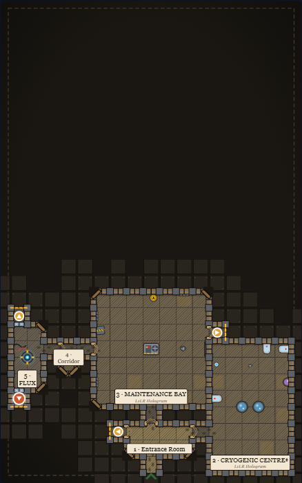 |
| **Infested** | **Blueprint** |
| 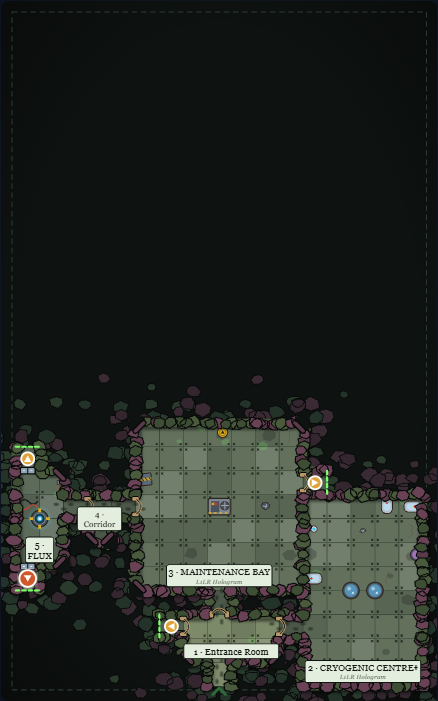 | 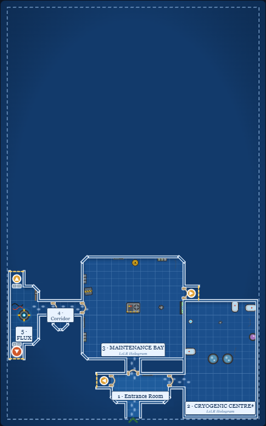 |

Watch a level build up as rooms are rolled:

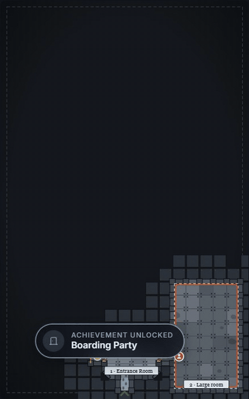

Rooms and corridors are chamfered ("Dark Hulk" shape) rather than square, and the isometric view works here too:

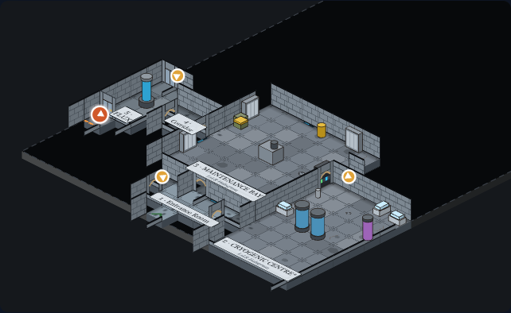

## Combat

A ranged phase (Shot and Deflection rolls, using the alien card's red-boxed interrupt numbers) followed by close combat.

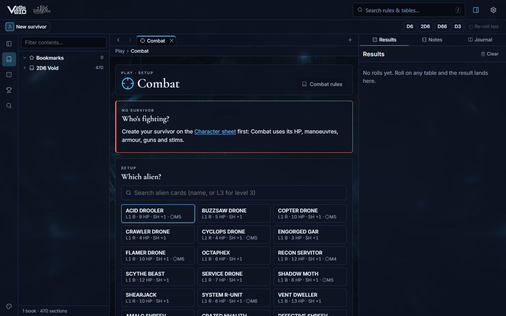

## Character sheet

Profession, skills, marksmanship, stims, gear and credits, with the level-up and HP rules from the book. Portraits come from a gallery of 20 survivors in four art styles.

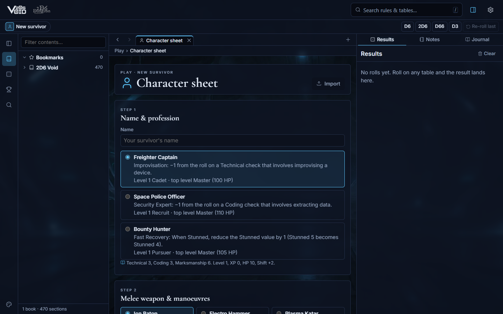

## Look and sound

- **Themes**: Deep Space, Hull Steel, Neon, Reactor, Biohazard, Brass, Clean Lab and High contrast, each with its own painted backdrop.
- **Dice**: ten Void dice skins with landing effects. A few of the looks, mid-roll:

| Neon grid and glitch chrome | Light blades |
|---|---|
| 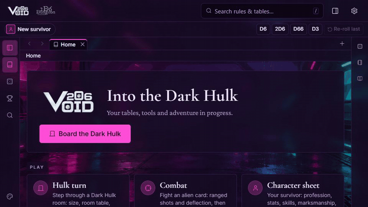 | 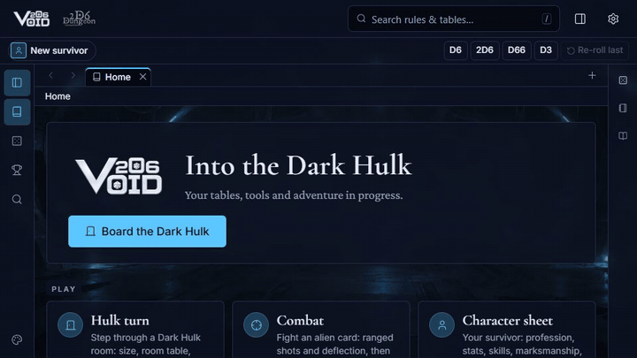 |
| **Clockwork brass and aether copper** | |
| 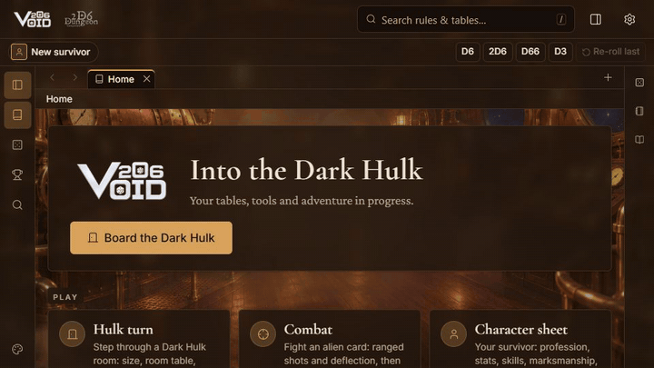 | |

- **Sound**: ship-bay, hulk, fight, Null Void (level 9) and AI Hive (level 10) music loops plus sci-fi effects for shots, doors, hacking and stims, made with PixelLab.
- **Achievements**: Void has its own groups (The Dark Hulk, Combat, Survivor, Hero of the Void), and dice progress is shared with Dungeon. See [Achievements and Journal](Achievements-and-Journal.md).

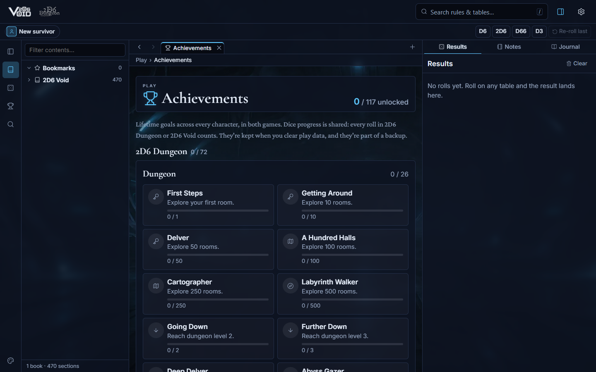
