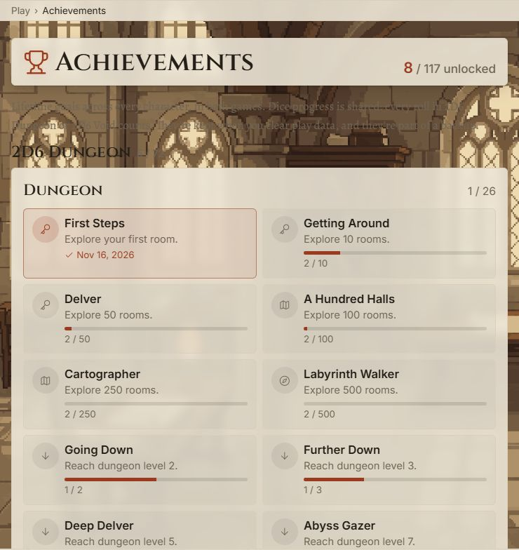
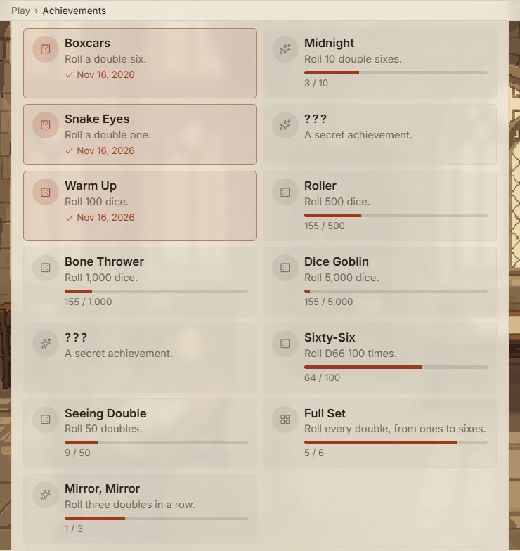
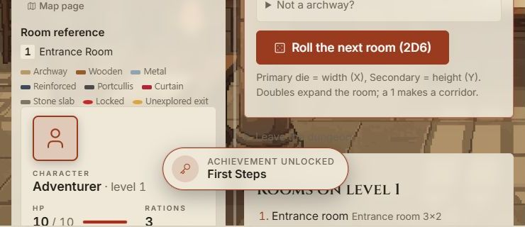

Achievements are lifetime goals that fill in as you play: explore rooms, win fights, roll doubles, reach new levels. They are just for fun. Nothing in the rules changes when you unlock one.

The app tracks them for you. You never have to tick anything.

## Step by step

1. Press **Achievements** in the left rail.
2. The top right shows how many you have unlocked, for example "8 / 117 unlocked".
3. Scroll down. Goals are grouped under a heading for each game, then by theme (Dungeon, Combat, Realm, Character, Legendary Rewards, Dice, then the 2D6 Void groups).
4. Each card shows its name, what to do, and either a progress bar with a count (such as 2 / 10) or the date you unlocked it.

The page only shows progress. You cannot click a card to unlock or change it.

## How the cards work

- **Ladders.** Related goals sit together from the smallest to the biggest ("Explore 10 rooms", then 50, then 100). One counter feeds the whole ladder, so a single room counts toward every card on it.
- **Unlocked cards** are highlighted and show the date.
- **Counts that only go up.** Most goals count things you do (rooms, fights, dice). Some keep your best result instead, such as the deepest level or the highest character level you have reached.
- **Streaks.** A few goals are about runs, such as fights won in a row or doubles in a row. A miss resets the run, but the best run is kept.

## Secret achievements

A few cards are secret. They appear as **???** with the words "A secret achievement." and no progress bar. The name and the goal are revealed when you unlock them. There is no hint on the card, so just play and see.

## The unlock toast

When you unlock one, a small card slides up at the bottom of the screen: "Achievement unlocked", then the name. If several unlock at once they show one after another. Click the card to open the Achievements page. Hover it to see what the goal was.

Each unlock is also added to your [Journal](notes-and-journal.html) as a line in the current chapter.

## Both games, and shared dice

Achievements cover [2D6 Dungeon](dungeon-start-game.html) and [2D6 Void](void-start-game.html) on one page. Each game's rooms, fights and levels count only toward its own cards. The Dungeon cards are separate from the Void ones, even when they look similar.

**Dice are shared.** Every roll counts toward the Dice group, whichever game you are playing: rolls with the dice at the bottom of the screen, and rolls made by tools like combat or room generation. A double six in Void counts toward Boxcars. See [Dice and Rolls](dice-and-rolls.html).

## What is kept

- Achievements belong to the whole device, not to one character. They count across all your characters.
- **Clear play data** (in Settings) does not touch them.
- They are part of a backup, and come back when you restore one. See [Backups](settings-backups.html).
- To start again, use **Reset achievements…** in Settings (Backup section). It asks you to confirm, wipes all progress and reloads the app. Export a backup first if you want a copy.

## Tips

- Dungeon depth and character level are only counted when you reach them by playing. Importing a character or creating a new one does not unlock level achievements.
- Character level goals keep your highest level ever, so a new hero only adds to them once they pass it.
- Some Legendary Reward cards need you to reach the end of the dungeon first, then roll for the reward in the Results panel, so rolling early does not unlock them.

## Common questions

**I did something but no toast showed.** Check the page. Counts update even if you were busy, and toasts queue up when several fire together.

**The numbers in Statistics and Achievements differ.** Statistics are kept per game. Achievements are lifetime and shared across games for dice. See [Statistics](statistics.html).
