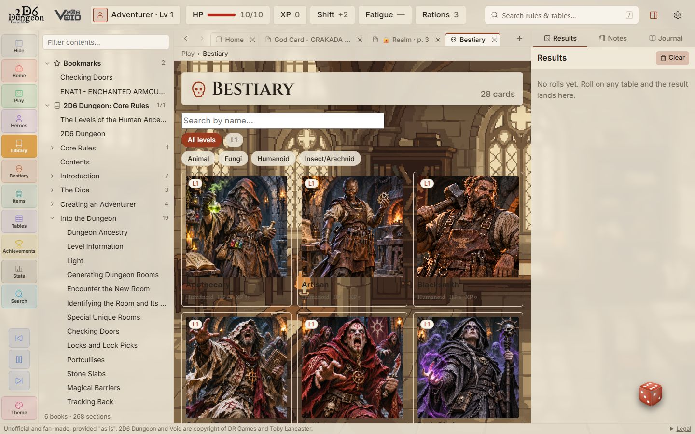
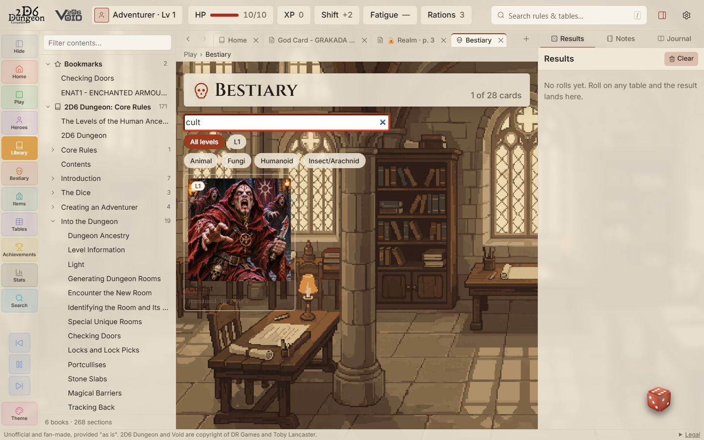
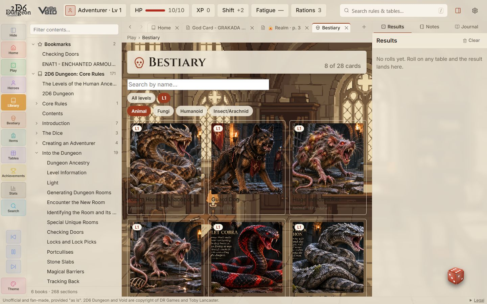
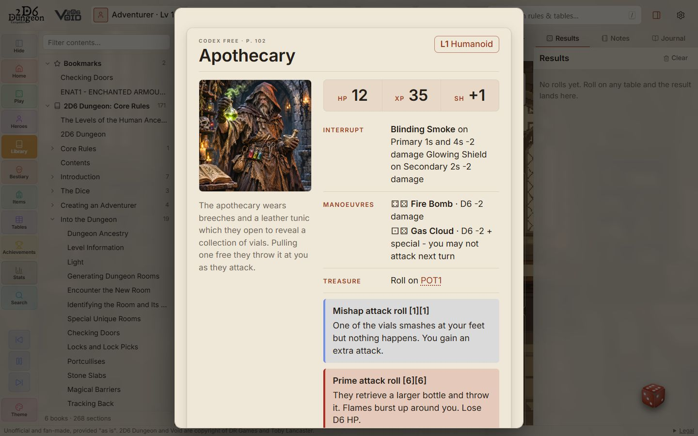
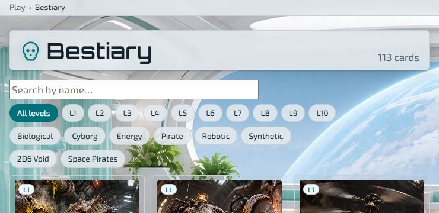

The Bestiary shows every creature, NPC and alien card from the books you have open, as a gallery. Use it to look up a foe before a fight, or to see what is waiting on a level. It is read-only: you look, you do not change anything.

## Before you start

Only cards from open books appear. The Codex Free includes a set of level 1 creatures. Unlock more books in [Books settings](settings-books.html). With nothing open the page says so and points you there.

## Step by step

1. Press **Bestiary** on the left rail.
2. The header shows the number of cards ("28 cards").
3. Scroll the gallery. Each tile shows a picture, the level in the corner, the name, the type, and HP and XP.
4. Press a tile to open the whole card.
5. Press **Escape** or click outside the card to close it.

## Search

Type in **Search by name...**. The gallery narrows as you type, and the count changes ("1 of 28 cards").

## Filters

- **Level**: **All levels**, or L1, L2 and so on. Only levels with cards are shown.
- **Type**: for example Animal, Fungi or Humanoid. Press again to clear.
- **Book**: appears when you have more than one book with creatures.

Filters and search combine. If nothing matches you see "No card matches".

## The card

A card shows, from the top:

- the book and page, the name, and the level with its type
- the picture, and a short description beside it
- **HP**, **XP** and **SH** (shift)
- rows such as **Interrupt**, **Manoeuvres** and **Treasure**
- the **Mishap** and **Prime attack** boxes at the bottom

Table codes inside a card (for example in Treasure) are links to that table.

At the bottom, **Open in the book** takes you to the card's section in the library. See [The library and search](library.html).

> **Note:** There is no button on a card to start a fight. To fight a creature, go to [Combat](dungeon-combat.html) and pick it there.

If a tile says "Needs verification", some of its numbers were not checked against the book. The card warns you and the page scan lets you compare.

## Pictures

Cards with artwork show it on the tile and on the card. A card without a picture shows the first letter of its name instead.

## 2D6 Void

Switch game with the logo at the top left (press the 2D6 Void logo). The Bestiary then lists Void creatures, with levels up to L10 and types such as Biological, Cyborg, Energy, Pirate, Robotic and Synthetic. It works exactly the same.

See [Void combat](void-combat.html) for fighting them.

## Tips

- Your search and filters reset when you leave the page.
- Press **/** to search the whole library instead; see [The library and search](library.html).
