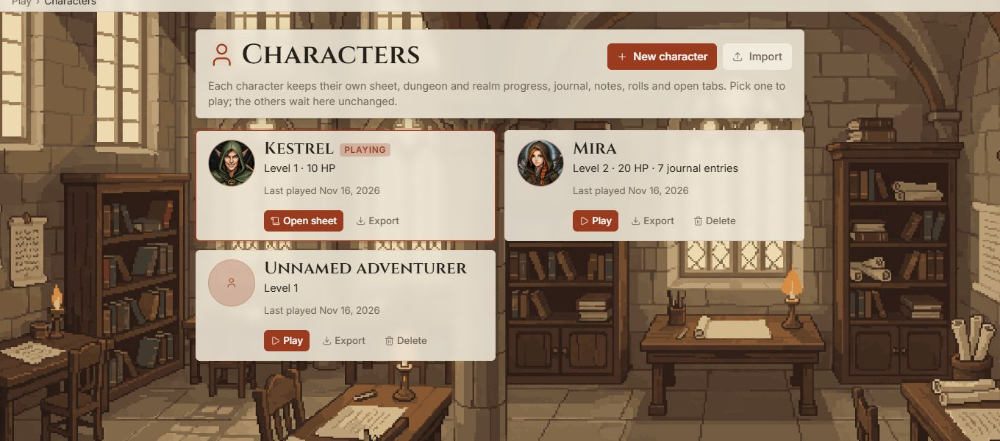
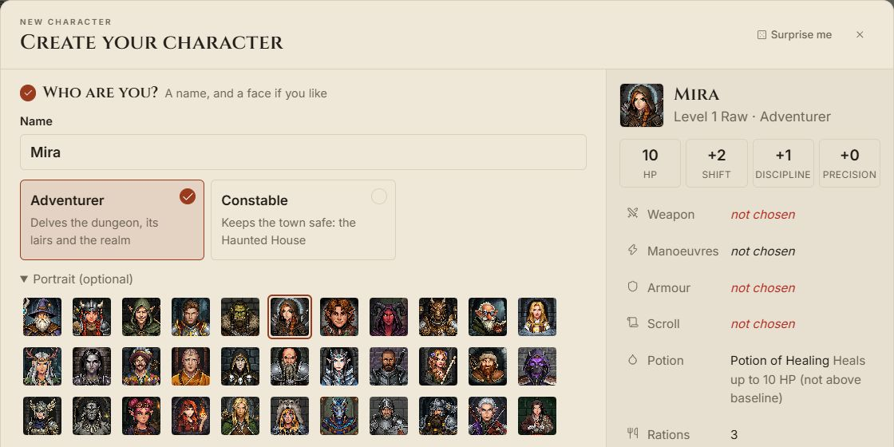
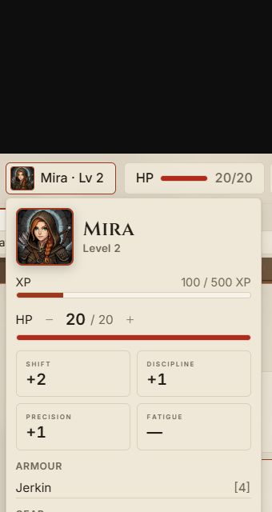

You can keep as many characters as you like. Each one has their own sheet, progress, journal, notes, rolls and open tabs, and the others wait untouched until you switch back. This page covers the Dungeon view. In 2D6 Void the same page is called "Survivors" and works the same way.

Open it from the Play menu (**Characters**).

## What each card shows

Each character has a card with their portrait, name, level, HP, how far into a dungeon they are, how many journal entries they have and when they were last played. The one you are using has a **Playing** badge.

- **Play** switches to that character. A message tells you who you are now playing.
- **Open sheet** (on the playing character) goes to their [sheet](dungeon-sheet.html).
- **Export** downloads that character as a file.
- **Delete** removes the character and everything saved with them, after a confirmation. It cannot be undone, so export first if you want a copy. You cannot delete the character you are playing, or the last one.

## Create a new character

1. Press **New character**.
2. Type a **Name**. If you have the Lairs book unlocked you can also choose **Constable** instead of **Adventurer**.
3. Optional: open **Portrait (optional)** and press a face. Press it again to deselect.
4. Choose a **Weapon**. Hover an option to see more.
5. Pick your two starting **Manoeuvres** from the level 1 ones for that weapon.
6. Choose one starting **Armour** piece.
7. Choose one **Magic scroll**.
8. If you have add-on books unlocked, tick the **Expansions** this character plays with. You can change these later on the sheet. Animal Companions adds a companion card, which you fill in on the sheet.
9. Check the summary on the right. It shows level, HP and stats, and lists what is still missing. Pressing a row jumps to that choice.
10. Press **Create character**. The button is disabled until everything is chosen. You land on the new character's sheet.

Press **Surprise me** at the top to fill every choice at random, and then change anything you like. Nothing is saved until you press **Create character**; **Cancel** (or Esc) throws the choices away.

The creator gives every new character the standard starting kit (a healing potion, three rations and basic gear) with no coins.

## Switch characters

- On the Characters page, press **Play** on any other card.
- Or open the name chip's flyout in the character bar and press **Switch character**.

## Import a character

Press **Import** and choose a character file. It is added to the list; press **Play** to switch to it. A file from the other game (a Void survivor in Dungeon, or the reverse) is refused with a message: switch games first.

## Rename and portraits

There is no rename on this page. Rename a character or change their portrait on the sheet: press **Edit character** (see [Character sheet](dungeon-sheet.html)).

## The character bar

The bar across the top shows the playing character as a row of chips.

- **Name chip.** Portrait, name and level. Hover or click it to open the flyout (below).
- **HP.** Shows a small bar and current/baseline. Press it for HP − / +, HP bonus − / +, and **+ Bloodied** / **+ Soaked**.
- **Bloodied and Soaked.** These chips only appear while the condition is above 0. Press one for − / + and **Clear**.
- **XP.** Press it to step XP by 1 or type a value. It shows how far to the next level, and a level change gives the same message as on the sheet.
- **Shift.** Your current Shift. Pressing it opens the flyout too.
- **Fatigue.** Shows a dash until a fight is on. During a fight, press it to change the Fatigue die from 1 to 6.
- **Rations.** Press for − / +.

### The name flyout

Hovering the name chip shows a compact card: portrait, XP progress, HP with − / +, Shift, Discipline, Precision and Fatigue, armour, weapon, coins and rations. Click the chip to keep it open. Press **Open full sheet** to go to the sheet, or **Switch character**. Esc or a click elsewhere closes it. It is hidden on very narrow screens.

## Tips

- Everything is stored on this device. Use **Export** to keep a copy or move a character to another device (see also [Backups](settings-backups.html)).
- Switching characters reloads the page with the other character's data.
- In Void, **New survivor** makes a blank survivor straight away instead of opening the creator.
