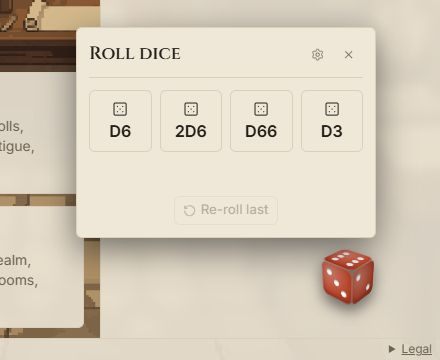
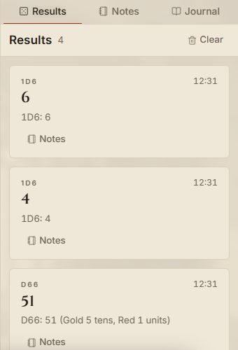
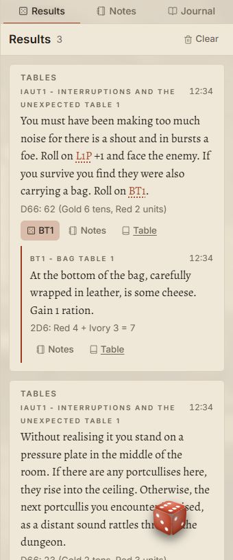
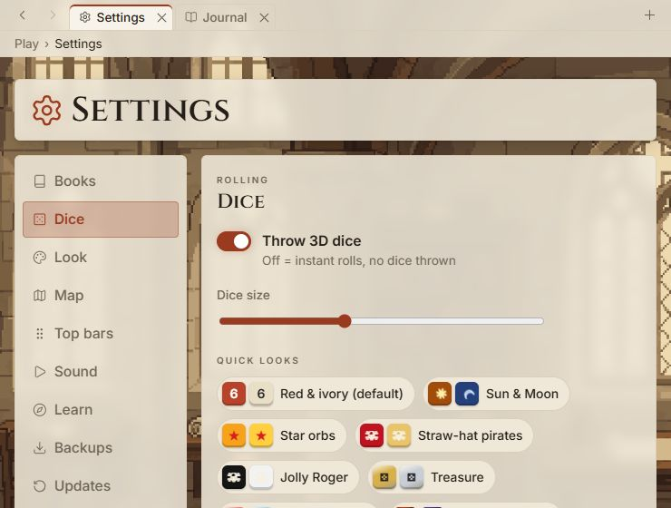
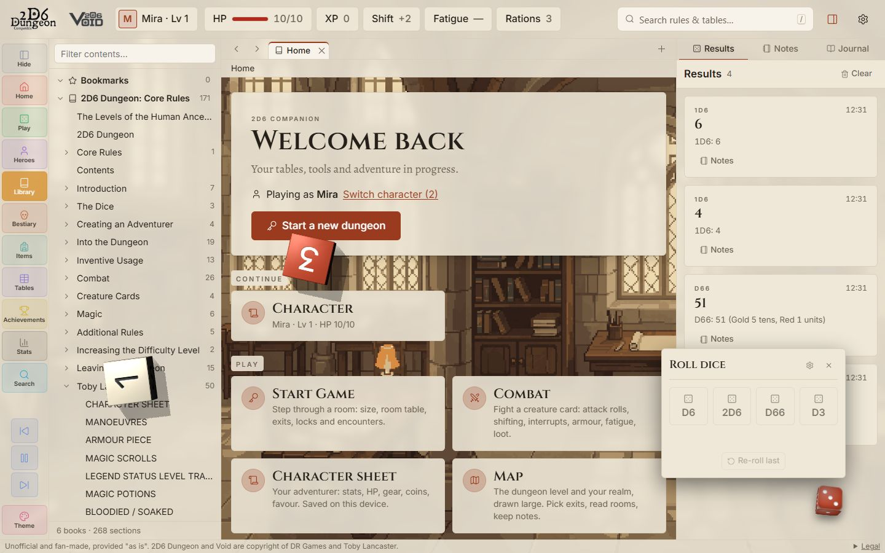

The app rolls for you. You can throw a die from the floating dice button, or press a **Roll** button on a table or a game tool, and every roll is written down as a card in the Results panel. This page shows how each kind of roll works and what the cards offer.

## The dice button

A round button with a die on it floats over the page, at the bottom right to begin with.

1. Press the dice button. A small **Roll dice** window opens with four tiles: **D6**, **2D6**, **D66** and **D3**.
2. Press a tile to roll. The dice are thrown across the screen, and when they settle the result appears under the tiles and as a new card in the Results panel.

   
3. Press the button again, press the x in the window, click elsewhere on the page, or press **Esc** to close it.

While a roll is in progress the tiles are greyed out; wait for the dice to stop before the next roll.

**Moving the button.** Drag it anywhere you like; it stays where you leave it, even after a reload. If it has keyboard focus, the arrow keys move it (hold **Shift** for bigger steps). It keeps itself on screen if you resize the window.

**The cog** in the corner of the window opens Settings at the dice section, where you choose how your dice look; see [Look, dice and sound](settings-look-and-sound.html).

## What each roll gives you

| Tile | What you see | Notes |
|---|---|---|
| **D6** | `1D6: 5` | One die. |
| **2D6** | `2D6: Red 3 + Ivory 2 = 5` | Two dice, added together. Each is named by its colour or skin. |
| **D66** | `D66: 13 (Gold 1 tens, Red 3 units)` | Two dice read side by side as a two-digit number from 11 to 66. |
| **D3** | `D3: 1 (d6 showed 2)` | A D6 halved and rounded up: 1 or 2 gives 1, 3 or 4 gives 2, 5 or 6 gives 3. |

**D66 and the tens die.** A D66 throws a dedicated **tens die** first. Its value is the first digit. **Die 1** (the red die by default) is thrown second and gives the second digit, the units. In the example above, the Gold die showed 1 and the Red die showed 3, so the roll is 13. The result line names both dice, so you can always tell which is which. The tens die is always shown in a different colour or skin from Die 1.

**Die 1 and Die 2.** The 2D6 roll throws Die 1 and Die 2. Die 1 is the "Primary" die and Die 2 is the "Secondary" die that some game steps refer to (for example, one gives a room's width and the other its height). You can restyle all three dice in Settings.

## Rolling a table

Most of the time you will not press a tile at all. Tools and tables roll for themselves:

- On [Start Game](dungeon-start-game.html), buttons such as **Roll the entrance room (D66)** and **Roll the next room (2D6)** throw the right dice for that step.
- On the [Tables](tables.html) page, each table row has a **Roll** button. Pressing it rolls at once and opens the row, which then shows a **Modifier** box (type a number to add to the next roll) beside a second **Roll** button. The row that came up is highlighted in the table.
- On a book page, a table that can be rolled has a dice badge such as "2D6" in its header. Press it to roll that table.

Whichever way you roll, the result lands in the Results panel as a card.

## The Results panel

The **Results** tab of the side panel holds your rolls, newest first, with a count beside the heading. If the panel is closed, open it with the side panel button at the top right (see [Finding your way around](interface.html)). A dot on the **Results** tab tells you a roll landed while you were looking at another tab.

Each card shows:

- A small label (the die, such as `1D6`, or `TABLES`) and the time.
- The result in large type, with the table's name above it for table rolls.
- A detail line for dice rolls, such as which die showed what.
- Buttons along the bottom.

### Card buttons

- **Notes** copies the card into your session log in the Notes tab, and a short message says "Added to Notes".
- **Table** (table rolls only) opens the whole table in the current tab. Ctrl-click it to open in a new tab.
- **Follow-on buttons** appear when the result tells you to roll on another table, for example `BT1`. Press one to roll that table. The new card is nested inside the first one, indented under it, so you can see which roll led to which. Follow-ons nest under the original card even if you press them several levels deep.

### Clear

**Clear**, at the top right of the panel, removes every card. The panel then says "No rolls yet." The app keeps your latest 100 cards, and they are still there after a reload.

## Re-roll last

Press **Re-roll last** in the Roll dice window to repeat your most recent roll. It repeats a dice roll as the same die, and a table roll on the same table with the same modifier. The window says "Rolled again. See Results for the outcome." and a new card appears. The button is greyed out until you have rolled something since the page loaded.

## 3D dice or instant rolls

By default the dice are physically thrown in 3D, and the result is read from where they land. If you would rather not wait, or the 3D dice do not work on your device, you can switch them off:

1. Open **Settings** (the cog at the top right) and choose **Dice**.
2. Switch **Throw 3D dice** off. The note beside it reads "Off = instant rolls, no dice thrown".

Rolls then come up immediately, with the same kinds of cards and the same wording. If the browser cannot show 3D dice at all, the app falls back to instant rolls by itself. In the same section you can change **Dice size**, pick a **Quick look** (a pair of dice styles), restyle **Die 1**, **Die 2** and the **Tens die**, and try them with **Test 2D6** and **Test D66**.

## Typing a result by hand

I found no place in the app where you can type in a result from your own physical dice. Every roll in the app comes from its own dice, 3D or instant. If you roll real dice at your table, look up the result in the book section or the [Tables](tables.html) page yourself. The **Modifier** box on a table is the only number you can type before a roll. (Combat and the Realm let you enter a creature or a building by hand, but that is a different thing.)

## Tips

- Dice rolls from the button are logged like any other roll, so you can send them to Notes with the **Notes** button.
- To keep a long record, copy important cards to Notes before you press **Clear**.
- The look of the dice, sound effects and music are all in [Look, dice and sound](settings-look-and-sound.html).
