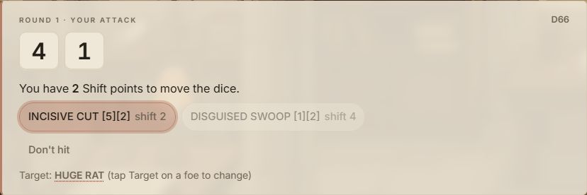
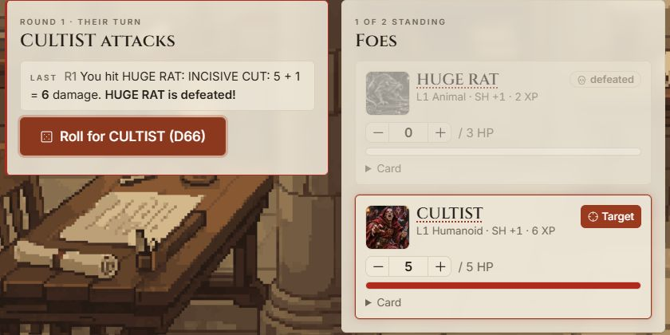
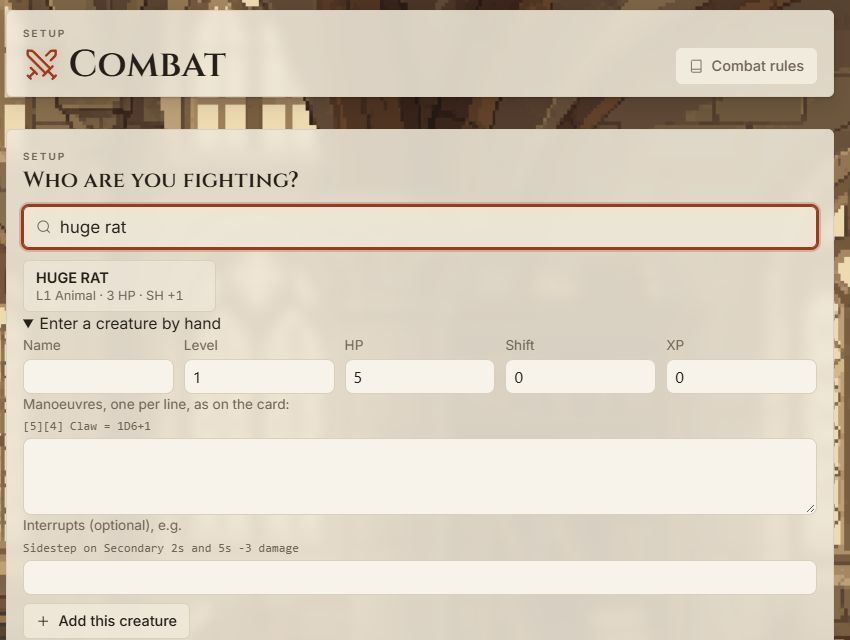
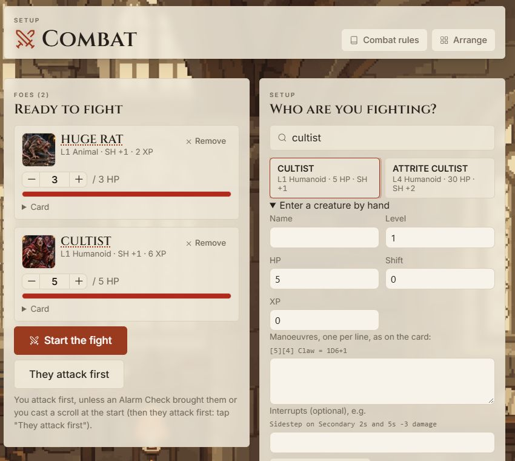
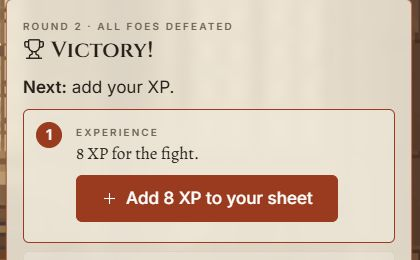
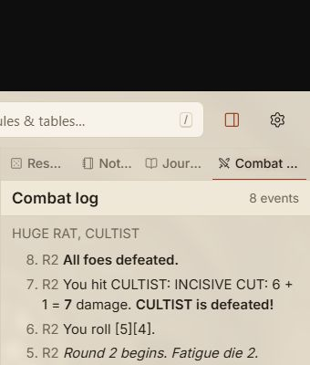

The Combat tool runs a whole fight for you. It rolls the D66 for each side, shows which of your manoeuvres you can reach, applies damage and armour, tracks the Fatigue die, and keeps a log. You make the choices; the tool does the arithmetic. Your HP is shared with the [character sheet](dungeon-sheet.html), so nothing has to be copied across.

## Before you start

- You need a character with at least one manoeuvre that has a dice set on the [sheet](dungeon-sheet.html). The tool offers those manoeuvres when you hit.
- Creatures come from the books you have open. The free Core Rules and Codex Free creatures are always there. For anything else, unlock the book in [Books settings](settings-books.html) or use "Enter a creature by hand" (below).

## Getting to Combat

There are two ways in:

- From the Play menu, open **Combat**.
- From [Start Game](dungeon-start-game.html), press a room's **Fight** button (for example "Fight Huge Rat"). Combat opens in a new tab with that creature already added. When the fight is over, **Continue playing** takes you back to where you came from. Start Game also has an **Open Combat** button if you want an empty setup.

## Step by step: a fight

1. **Pick your foes.** On the setup screen, type in the search box ("Search creatures"). You can search by name, or by level, for example `L3`. Press a creature to add it. Add as many as you like; each one appears in the "Ready to fight" list on the left.
2. **Adjust if needed.** Each foe has HP − / + buttons. Press **Remove** to drop one. Open its **Card** to see its manoeuvres in the book.
3. **Start.** Press **Start the fight** if you attack first. Press **They attack first** if the book says the creatures go first (for example after an Alarm Check, or if you cast a scroll at the start).
4. **Roll your attack.** Press **Roll your attack (D66)**. The 3D dice roll and the two faces appear on an attack card.
5. **Choose a manoeuvre.** The card lists every manoeuvre on your sheet.
   - Chips you can use are bright. Each shows **exact** if the dice already match, or **shift 1**, **shift 2**, and so on, which is how many Shift points it costs to move the dice onto that manoeuvre.
   - Chips that cost more than your Shift are greyed out ("Out of reach").
   - Press a chip to hit with it. The tool rolls the damage, applies it to the target and writes it in the log.
   - Press **Don't hit** to pass.
6. **Their turn.** Each living foe in turn gets a **Roll for (name) (D66)** button. Press it. The tool rolls, works out which of the foe's manoeuvres it can reach with its Shift, rolls the damage, takes off any armour that applies, and lowers your HP.
7. **Next round.** After every foe has attacked, a new round starts and the Fatigue die goes up.
8. Repeat until every foe is defeated or your HP reaches 0.

<em class="cap">Mira rolled 4 and 1. One manoeuvre is two Shift points away and can be chosen; the other is out of reach.</em>

## Setup in more detail

### Fighting several creatures at once

Add several creatures before you press Start. During the fight, press **Target** on a foe's card to choose who you hit. If you do not choose, the tool targets the first one standing. When the target is defeated, the next one standing is chosen for you.

### Enter a creature by hand

If a creature is not in your books, open **Enter a creature by hand** under the search results and fill in:

- Name, Level, HP, Shift and XP.
- **Manoeuvres**, one per line, written as on the card, for example `[5][4] Claw = 1D6+1`.
- **Interrupts** (optional), for example `Sidestep on Secondary 2s and 5s -3 damage`.

Press **Add this creature**. If something is missing, a message tells you (a name, HP of 1 or more, and at least one manoeuvre are required). The form stays open so you can add another.

## What the tool does for you

### Exact Strikes

When your D66 matches a manoeuvre's dice set exactly, the card says **Exact Strike!** and your Shift is added to the damage. The log marks it.

### Automatic miss

If you roll [1][1], the card says it is an automatic miss. Press **Continue**. If nothing on your sheet is within reach of your Shift, the card says so and you press **Continue** too.

### Prime Attack

On a [6][6], the card offers every manoeuvre on your sheet as a chip. Pick one and the tool applies it, adds your Shift, and skips the creature's interrupts.

### Creature interrupts

Many creatures have interrupts. If the creature's card is written in the usual form, the tool applies the one that hurts you most, automatically, and shows it in the log line. If an interrupt has no simple number, the log says "Interrupt: ... (apply its effect)" and you apply it by hand with the − / + buttons on the foe or on your HP.

### Armour

When a creature hits you, the tool compares the dice it ended on with the dice sets of the armour on your sheet. If one matches, it takes off that armour's reduction (the best single piece applies). The log says which piece deflected the blow. Keep your armour rows filled in on the sheet for this to work.

### Fatigue die

The Fatigue die starts at 1 and goes up by 1 each round, to a maximum of 6. At the higher values it adds Shift for everyone; a badge ("+1 Shift to all" and so on) appears in the round bar when it does. From round 7, a warning reminds you that some interrupts stop working. You can also change the Fatigue die by hand from the **Fatigue** chip in the character bar (it is only active during a fight).

### Round 1 kill bonus

If you defeat a foe in round 1, round 2 shows a **Fearful momentum +2 Shift** badge and your Shift is higher for that round.

### Editing HP by hand

Your HP has − / + buttons on your card; each foe has the same on its card. Use them for effects the tool does not apply itself. Taking your HP to 0 ends the fight as a loss. Taking the last foe to 0 ends it as a win.

## Ending a fight

### Victory

When the last foe falls, a **Victory!** card lists what is left to do, in order:

1. **Add XP to your sheet.** The button shows the total ("Add 8 XP to your sheet"). A level reached now gives its extra HP straight away.
2. **Treasure, one step per creature.** Press the roll button (for example "Roll RPT1") and the tool rolls on that table. Coins are rolled and added to your sheet. Potions go into your potion rows. Anything else is written under small items. Where a creature gives a fixed item, the button reads "Add it to your sheet". If the table is in a book you have not unlocked, use **Rolled it in my book** after you have rolled it yourself, then write down what you found.
3. When all steps are done, press **Continue playing** to go back to the page you started from, or **Stay on Combat**.

> **Note:** If your character plays with the Lairs expansion (a tick on the sheet's "Expansions this character plays with"), creatures below your level give no XP. The toast tells you how many gave none.

To start another fight without finishing the steps, press **New fight** at the top.

### Defeat

If your HP reaches 0, the card says **You've fallen**. A **RFUT1 (recovery)** button rolls the recovery table for cases where something other than a creature brought you to 0. Check the Core Rules for which applies. Press **New fight** to clear the screen.

### Ending early

Press **End fight** at the top. The app asks you to confirm and clears the fight.

## The combat log

Every roll, hit, interrupt and round change is written to a log. Press **Combat log (n)** at the bottom of the fight screen to open it in the side panel. The newest line is first; each starts with its round (R1, R2). The Combat log tab also appears in the side panel whenever you are in a dungeon level or a fight is on.

## Tips

- A fight survives a reload or closing the browser. Open Combat again and you are in the same round with the same HP.
- HP is the sheet's HP. Changing it in Combat, in the sheet, or in the character bar changes it everywhere at once.
- The **Combat rules** button at the top opens the combat sequence in the Core Rules.
- **Arrange** lets you move and resize the cards on the page.
- With the Animal Companions book and a companion on the sheet, a companion panel appears during the fight with its HP, its combat abilities and a checkbox for killing blows.
- The Journal records how each fight went (see [Notes and Journal](notes-and-journal.html)).

## Common questions

**A manoeuvre I know is greyed out.** It needs more Shift points than you have. Your Shift is on the character bar and in the Shift line of your card. The Fatigue die adds to it in later rounds.

**The tool did not apply an interrupt.** Interrupts that need a judgement call, or that the tool cannot read from the card, are listed in the log for you to apply by hand.

**There is no armour deflection in the log.** Check the Armour card on the sheet has a dice set on each piece you wear.
