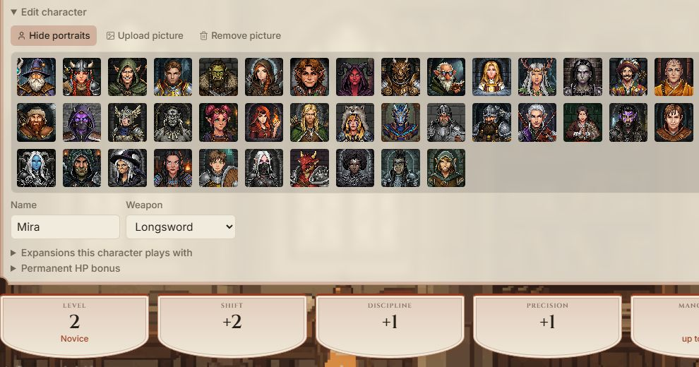
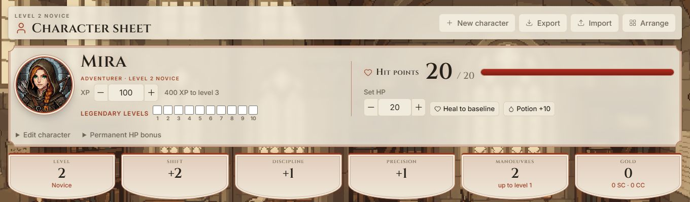
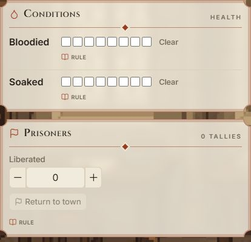
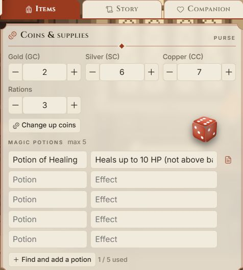

The Character sheet holds everything about your adventurer. It saves as you type, on this device. The character bar at the top, Combat and the other tools all read from it, so you only enter things once. Open it from the Play menu, or by pressing **Open full sheet** in the name flyout.

At the top of the page are three buttons: **New character** (see [Characters](characters.html)), **Export** and **Import** (below), plus **Arrange** to move the cards around.

## Name, portrait and Edit character

Press **Edit character** under your portrait to open a small fold:

- **Choose a portrait** shows a gallery of pixel-art faces. Press one to use it. **Upload picture** lets you use your own image, and **Remove picture** clears it.
- **Name** and **Weapon** are edited here. The weapon is a drop-down.
- **Expansions this character plays with** appears if you have any of the add-on books unlocked. Tick the ones this character uses. Ticking Animal Companions adds a **Companion** tab. Ticking Lairs turns on the rule in Combat that creatures below your level give no XP.

Clicking the portrait itself also lets you choose a picture.

## XP and levels

The XP box has − / + buttons (each step is 10) and you can type a number. Beside it the sheet shows how many XP you need for the next level.

**To level up:** just raise your XP. When it passes the threshold, a message appears ("Level up! ... +10 HP"), the stat shields change, and your HP goes up by the extra amount. If you lower XP below a threshold by mistake, the level and HP come back down. The level also shows in the header and on the character bar.

**Legendary levels** is a row of ten tick boxes. Tick one for each Legendary Dungeon level you have finished.

## Stats

Six shield tiles sit under the top panel: Level, Shift, Discipline, Precision, Manoeuvres and Gold. Hover (or tab to) a tile to see where its number comes from: the level, a permanent bonus, or equipped gear.

To add a permanent bonus (for example from a god's gift), open **Permanent stat bonuses** under the tiles and use the Shift, Discipline and Precision steppers. For permanent extra HP, open **Permanent HP bonus** near your portrait; it raises your baseline.

## Hit points

The big number is your current HP over your baseline. Change it with the **Set HP** box, with − / +, or with the HP chip on the character bar.

- **Heal to baseline** sets HP to the baseline (it never lowers it).
- **Potion +10** heals 10, but not above the baseline. It does not use up a potion row; clear the row yourself (see "Drink a potion" below).

## Conditions, prisoners and favour (left column)

- **Bloodied and Soaked.** Each has eight boxes. Tick a box for each room, and **Clear** empties them. A short **Rule** note under each says what happens after eight. The character bar shows a chip for either once it is above 0.
- **Prisoners.** Use − / + to tally liberated prisoners. **Return to town** rolls the Liberating Prisoners table once for each tally, then clears the tallies.
- **Armour.** Up to three pieces. Each row has the piece, its dice set and its modifier. Combat reads these to deflect blows.
- **Favour.** One row per god with six boxes. Tick boxes as you earn favour points. **Call** rolls a D6 (it asks for any modifier first) and tells you the result. A success clears that god's boxes.

## Weapon, runes and scrolls (middle column)

- **Weapon and manoeuvres.** The card is headed with your weapon. Type your manoeuvres into the rows (name, dice set, damage). Open **(Weapon) manoeuvres you can learn** to see the ones available at your level and press **Add** to copy one into the next free slot. The tool will not add one you already know, and tells you when the slots are full.
- **Applied runes.** Up to five. **Find and add a rune** opens a searchable list from your books.
- **Scrolls.** Up to three, each with Scroll, Orbit, Dispel doubles and Effect fields. **Find and add a scroll** fills them from the book. **Cast** rolls a D66 and tells you whether it worked; it adds XP for the attempt, offers to roll the failed-cast table if it failed, and asks whether to remove the used scroll.

## Items tab: coins, potions and the pack

The panel on the right has tabs: **Items**, **Story**, and **Companion** (only with the Animal Companions expansion ticked).

### Coins and rations

Gold, Silver, Copper and Rations each have − / + buttons. **Change up coins** turns every ten copper into a silver and every ten silver into a gold.

### Large items, small items and treasure

Each list has a **Find and add** button that opens a searchable picker of items from your books, and also lets you type your own. Entries appear as chips. Hover a chip for details, click for its card, press × to remove it. Large items have ten slots. Small items are unlimited. Treasure holds gems and valuables. **Edit as text** folds let you type directly, one item per line.

## Step by step: common jobs

### Equip a weapon
1. Open **Edit character**.
2. Pick the weapon in the **Weapon** drop-down.
3. Fill in your manoeuvre rows, or use **Add** in the "manoeuvres you can learn" list.

### Add armour
1. Press **Find and add armour** on the Armour card.
2. Search or scroll the list and press the piece you want. It fills the next empty row with its dice set and modifier.
3. You can edit the row afterwards. The button is disabled when all three rows are used; clear one first.

### Wear a found item for its bonuses
1. Add the item to a Large or Small items list with **Find and add**.
2. If it can be worn or wielded, its chip has an Equip toggle. Press it. A message lists the bonuses and the stat tiles update.
3. Press it again to take the item off.

### Drink a potion
1. Press **Potion +10** in the HP area if it is a healing potion. HP goes up, capped at your baseline.
2. For any potion, clear its row on the Items tab (delete the text) once used. The list holds five.

### Add a potion
1. Press **Find and add a potion** and pick one. It goes in the first empty row.

### Level up
1. Raise XP in the XP box. The sheet announces the new level.
2. Use the "manoeuvres you can learn" list to take a new manoeuvre if you have a free slot.

### Spend coins
1. Lower Gold, Silver or Copper with the − buttons or by typing.
2. **Change up coins** only combines (10 copper into a silver, 10 silver into a gold). It does not break a gold coin into silver, so if you need change, lower Gold and raise Silver by hand.

## Story tab

Two cards of free text:

- **Side quests** and **Narrative moments**.
- **Additional notes** and **Loot lockup (town storage)**, for items you leave in town.

## Export and Import

- **Export** downloads this character as a file. Use it as a backup or to move to another device.
- **Import** loads a character file and replaces the sheet of the character you are currently playing. To keep your current one, make a new character first (see [Characters](characters.html)), or import from the Characters page instead, which adds a new entry.

## Tips

- Everything saves automatically. There is no Save button.
- The sheet and the character bar are the same data. HP, XP, Bloodied and Soaked changed in either place show in both.
- Hover a row that matches a book item to see its details, and press the small card button to open the full card.
- The **Companion** tab holds your animal companion's whole sheet, with pickers for animal and temperament, and a **Share damage with companion** button for harm taken outside combat.
