Start Game is the tool that runs a dungeon level for you, one room at a time. It rolls the dice, asks for the next thing you need to do, and draws the map as you go. Every step is a button you press when you are ready.

Open it from the **Play** rail, then **Start Game**. When a fight comes up it hands the creature over to [Combat](dungeon-combat.html).

## Before you start

- Pick or create your adventurer first, so HP and rations are right. See [Characters](characters.html) and the [Sheet](dungeon-sheet.html).
- The room tables come from the books. If a book is not unlocked, the tool still works: it shows a locked card where the table would be and offers a **Rolled it in my book** button, so you roll on paper and tell the tool. See [Books](settings-books.html) to unlock them.

## The page at a glance

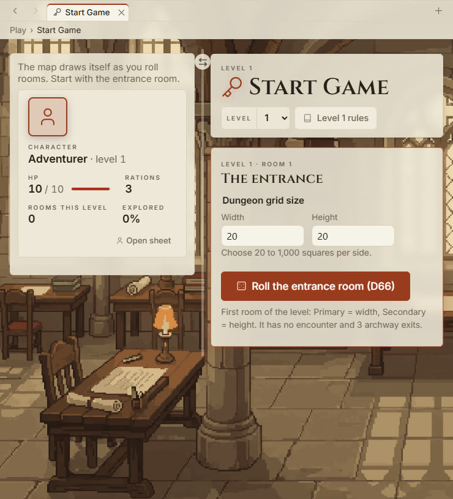

- **Level** (top of the right column): a drop-down from 1 to 10, with a **Level N rules** link that opens that level's rules in the library.
- **The map** (left): it draws itself as you roll rooms. See [Map](map.html) for what you can do with it. On a narrow window the map folds into a **Map** bar you can open and close.
- **The status strip** (under the map): your character name and level, **HP** with a bar, **Rations**, **Rooms this level** and **Explored** (percent of the level drawn). **Bloodied** and **Soaked** counters (out of 8) appear here when you have those conditions. **Open sheet** jumps to your [Sheet](dungeon-sheet.html).
- **The steps** (right): one card for what to do next. Only the next step has a bright button.
- **Rooms on level N** (bottom): a list of the rooms you have finished, with their size.

## Step by step: the entrance

1. Choose the **Level** you are on.
2. Under **Dungeon grid size**, type a **Width** and **Height** for the level. The tool accepts 20 to 1,000 squares per side (level 10 has a higher minimum, and the box tells you).
3. Press **Roll the entrance room (D66)**. The first die is the width and the second is the height. If the room would be too big it is halved, and if it is too small it is raised to 6 squares; the card says which happened.
4. The entrance is always empty and gets three archway exits, which the tool draws for you.
5. Press **Finish room 1**.

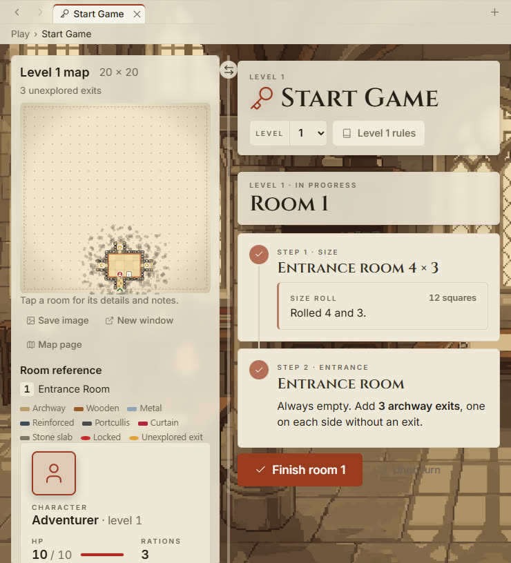

## Step by step: every other room

After a room is finished the card changes to **The way on**.

1. **Pick the exit.** The chips under **Next room through** list every unexplored exit, named by room, wall and type (for example "#1 west archway"). The tool suggests one. Tap a different chip, or tap a glowing exit on the map, to change it. Tap the chosen one again to clear your choice.
2. **Open the way.** If the exit is a plain archway or curtain the card says "Nothing to open: walk through." Doors, portcullises and slabs need a little more; see [Doors, locks and other exits](#doors-locks-and-other-exits).
3. Press **Roll the next room (2D6)**. The first die is the width and the second is the height. Doubles make the room bigger, and a 1 makes a corridor. The room is placed on the map beyond that exit and squeezed to fit.
4. Work down the room's steps in order (below).
5. Press **Finish room N**.

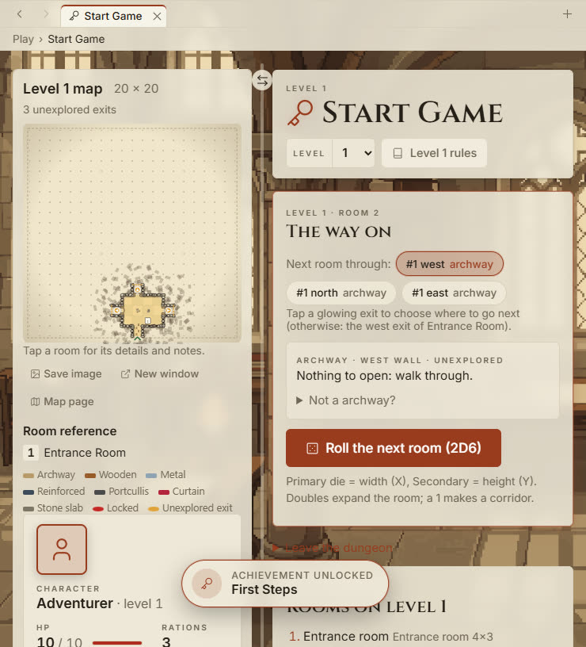

### The steps inside a room

Each room is a short list of numbered cards. A tick means that step is done.

**Step 1, Size.** Shows the size roll and the room's shape, such as "Room 3 × 4". If the map had no room for it as rolled, it says it was squeezed. If the shape does not suit your paper map, open **Doesn't fit as drawn?** and change it to **Corridor**, **Small room**, **Room** or **Large room**.

**Step 2, Room type.** Press the **Roll on** button for the level's table that matches the size (rooms, small rooms or large rooms). The result card shows the room's name and what is in it, and a room description may pop up in a **Room description** window: press **Continue** to carry on. Two warnings can appear:

- A unique room that already exists on this level: re-roll.
- A special room that only appears once enough of the level is revealed: re-roll.

Levels 8 and 10 have no large-room table. The card tells you what to do instead and links to that level's rules.

**Step 3, Exits.** Press **Roll number of exits** (a D6). The card shows how many new exits the room has, or "No new exits (dead end)". If the room's text leaves the type of exit random, a second button, **Roll exit type (EXT1)**, rolls it. If the table is locked it offers **Rolled the exit type in my book** instead. The tool draws the exits for you: one per wall, at most three, never on the wall you came in by or the outer boundary.

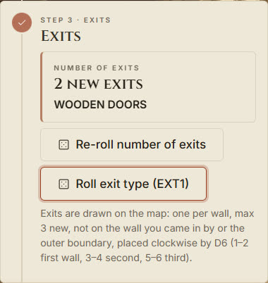

**Step 4, Encounter.** The card shows what the room holds and gives you a button for each thing it names:

- **Fight** plus the creature's name (for example "Fight Warrior"). It puts the creature in the queue and opens [Combat](dungeon-combat.html) in a new tab. Come back to the **Start Game** tab when the fight is over.
- A table button (for example "IAUT1"), which rolls that table and keeps the result on the card.
- **Encounter resolved** when you have dealt with everything, or **Nothing here** when the room is empty.

Under **Other rolls** you will find **Patrol**, **Interruption** and **Open Combat** for the times the room text calls for them without a button.

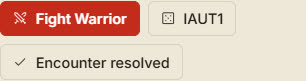

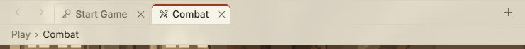

**Corridors and small rooms** are shorter. A corridor has only Size, Corridor and Exits steps, no table and no encounter, and all its exits are archways. A small room has no exit type to roll either.

### Finishing a room, and why it can be blocked

**Finish room N** stays greyed out until the steps before it are done, and says why next to it, for example "Roll the room type first", "Roll the exits first" or "Deal with the encounter first". Next to the reason there is a **Do it anyway** link. It skips the check for that one press, in case you resolved something on paper that the tool cannot see.

The same pattern is used elsewhere: **Roll the next room (2D6)** says "Open the way first", and **Go down** says "Rest on the stairs first".

**Undo turn** sits beside Finish room. It takes the room in progress back off the map and asks you to confirm. This is not in the rules, so use it to fix a mistake. It removes only the room and its rolls: HP, rations and items stay as they are.

## Doors, locks and other exits

When the exit you picked is not a bare archway, a panel appears on **The way on** card telling you what it needs. The map's colour key and the chips show the type.

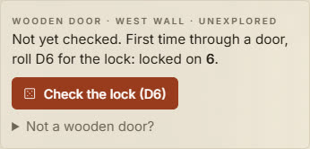

- **Wooden, reinforced and metal doors:** press **Check the lock (D6)** the first time. The result card says **Locked!** or **Not locked.** A locked door gets a red mark on the map.
- **Locked door:** you have one try at the lock. Press **Pick the lock (2D6 + Precision)**. The tool asks two quick questions, "Lock modifier printed in the room" and "Your lock pick bonus", then rolls the lock and your attempt. Type 0 if neither applies.

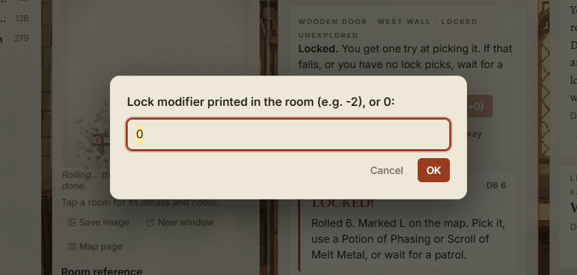

- **If the pick fails, or you have no picks:** press **Wait for a patrol** (after a failed pick the card goes straight to this). Choose **Eat a ration** or **No ration**; the button shows the HP change. Then press **Roll the patrol**, fight it in Combat, and press **Won the fight: the door is open**.

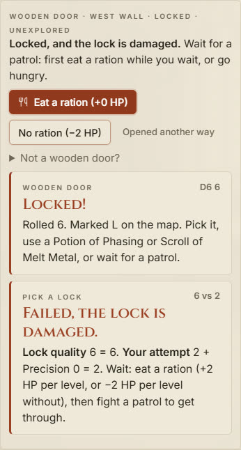

- **Opened another way:** a small button for any lock you got past by other means, such as a potion or scroll. It opens the door without a roll.
- **Portcullis:** it is always down. Use **Pull the lever** (it rolls the lever table, and you can **Pull again**), then press **The portcullis is up**. Without the book it says **Done in my book: it's up**.
- **Stone slab:** press **Tip it over (D6 + Discipline)**. You cannot wait for a patrol here.
- **Archway and curtain:** nothing to do.
- **One door of a different kind:** open **Not a wooden door?** (the name follows the exit) and press **Choose this exit's type**, then pick the right one.
- **Type unknown:** if the exit type was rolled in your book, the panel asks "What kind of exit is this?" with a button for each type.

A one-way door says so on its panel. Once you pass it, you cannot use it to go back.

## When nothing fits or nothing is left

- If the map has no room beyond an exit (it would hit other rooms or the boundary), the tool says so, marks that exit as blocked, and you pick another.
- If there are no open exits and less than half the level is drawn, the card offers **Add a secret door**. It adds a one-way door and a passage to continue.
- If there are no open exits and the level is mostly drawn, put the down stairs in the last room.

## Stairs and going down a level

1. Once about half the level is explored, a button **Last room: put the down stairs here** appears under the room you are finishing. You can also tap any room on the map and press **Put the stairs down here** in its card. **Remove the down stairs** (or **Remove the stairs**) undoes it. Level 10 has no stairs.
2. A **Going down** card appears. On the stairs you must eat or lose HP. Press **Eat a ration**, optionally tick **with a cloth or bandage**, or press **No ration**. The buttons show the HP change first. Your rations count in the status strip goes down by one.
3. Press **Go down to level N**. It asks you to confirm. The level is ticked on your Legend tracker, and the next level starts on a fresh map with its own entrance card.

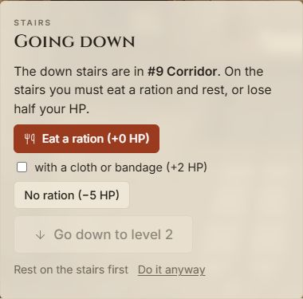

If you try to go down before resting, the button says "Rest on the stairs first" with a **Do it anyway** link.

**Leave the dungeon.** Open **Leave the dungeon** at the bottom of the card to search for an exit shaft. You get one search per level, from a room against the outer boundary: the tool rolls a D6 for each of the room's boundary squares and tells you if a 6 turned up.

## Changing level, starting over

- Use the **Level** drop-down to switch. If you have rooms on the map you are asked "Switch level? This starts a fresh room list and map."
- There is no separate restart button. To start a level again, switch to another level and back. This clears that level's rooms, map, doors and rest.

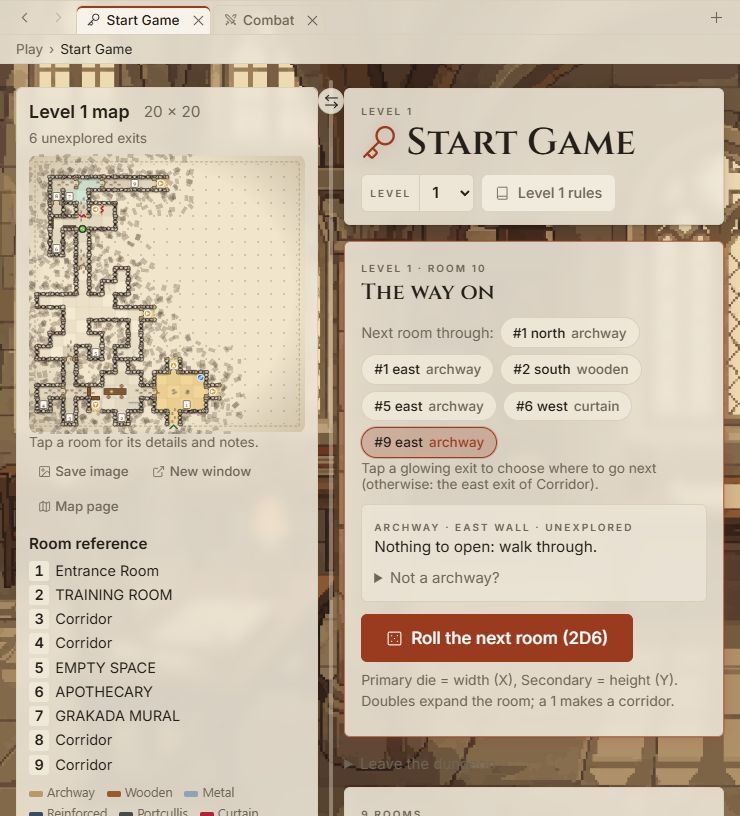

## Tips

- **Everything is saved as you go.** Close the tab, reload or come back tomorrow and Start Game opens on the same room or the same exit choice, with the map, HP, rations and door states intact.
- **The tool rolls its own dice.** Only the steps that come from a book table can be answered from paper, with the **Rolled it in my book** buttons. **Do it anyway** lets you skip a check you settled at the table.
- The map beside the steps is the same map as the [Map page](map.html). Tapping a room there opens its card and your notes, and the Notes panel on the right of the app sees them too. See [Notes and Journal](notes-and-journal.html).
- Every roll you make is also kept in the Results panel, and finished rooms and fights go into the Journal.

## Common questions

**The Roll button is greyed out.** The exit you picked still needs opening. Look at the door panel above the button. Or use **Do it anyway**.

**The room card says "re-roll".** The room is unique and already exists on this level, or it is a special room that is too early. Press the **Re-roll** button on Step 2.

**I clicked Fight and the page changed.** The fight opened in a new tab. Press the **Start Game** tab to get back.
