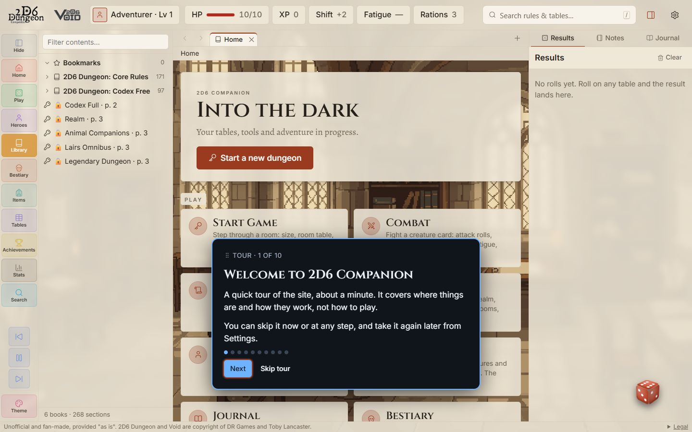
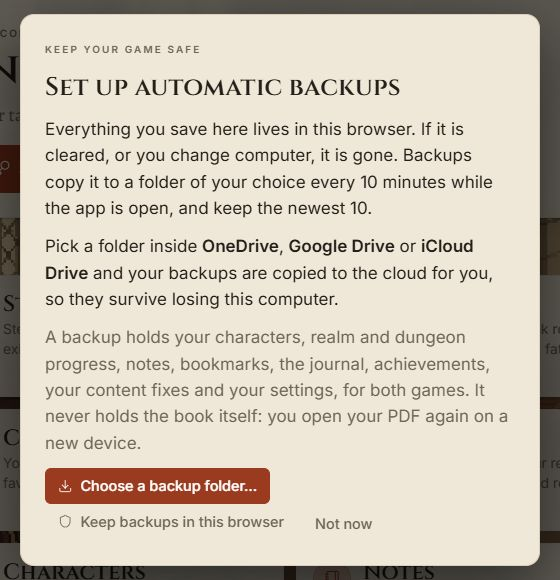
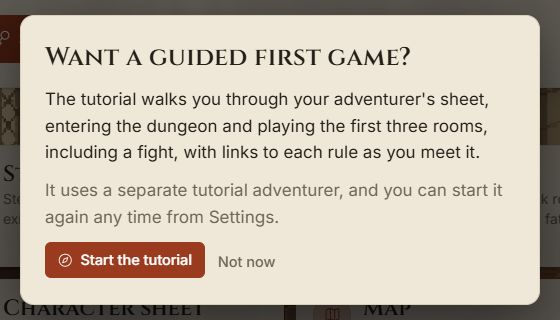
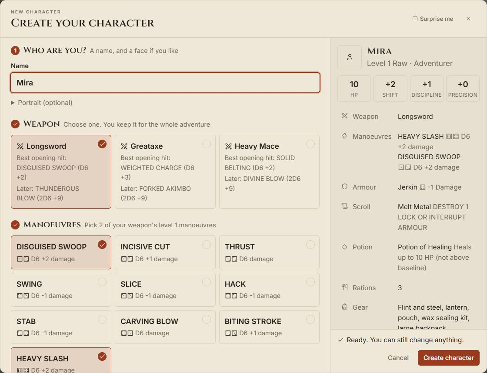
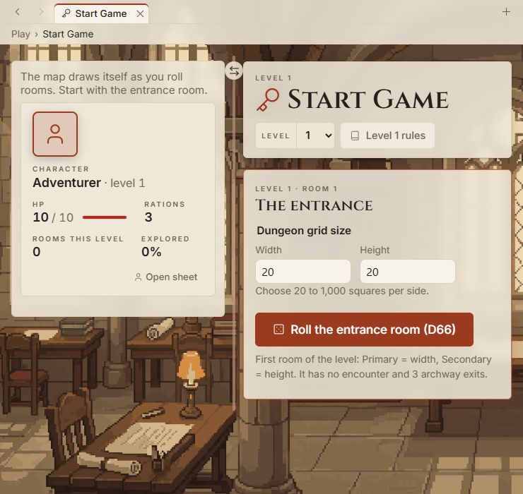
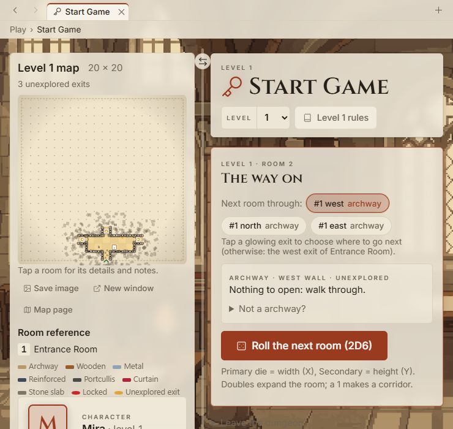

This page walks you through your first visit: what you see when you open the app, how to make a character, what works before you add any books, and how to play your first two rooms. It assumes you are in 2D6 Dungeon, which is the game the app opens in.

## The first visit

1. Open the app's address in a web browser. There is nothing to install, and there is no account or sign-in screen.
2. A card titled **Welcome to 2D6 Companion** offers a quick tour (about a minute). Press **Next** to step through it, **Back** to go back, or **Skip tour** to leave at any point.

   

   The tour has 10 steps. It points out the icon rail, the contents list, tabs, the side panel, the dice button, Settings, the two games and backups. It explains where things are, not how to play. You can take it again at any time from Settings, in the **Learn** section, with **Take the tour**.
3. After the tour (or if you skip it) a card titled **Set up automatic backups** appears. Your saves live in this browser only, so this card offers to copy them to a folder you choose every 10 minutes. You can answer **Choose a backup folder...**, **Keep backups in this browser**, or **Not now**. You can set this up later; see [Backups, tour and updates](settings-backups.html).

   
4. Next comes **Want a guided first game?** Choose **Start the tutorial** for a guided walk through the sheet and the first three rooms (including a fight), using a separate tutorial adventurer so your own character is untouched. Choose **Not now** to skip it. You can start it later from Settings, in **Learn**, with **Start the tutorial**.

   

These cards are for your first visit. You will land on the Home page, which lists the tools as cards: Start Game, Combat, Character sheet, Map, Characters, Notes, Journal and more.

## Choosing a game

The app opens in **2D6 Dungeon**. To change game, click the smaller logo next to the main logo at the top left (its tooltip reads "Switch to 2D6 Void"). The app saves your choice and reloads into the other game. Click the other logo to come back.

2D6 Void is a paid game. Its tools need your own copy of the Void core rulebook PDF: until one is opened in Settings, every Void screen except Settings sends you to Settings. See [Books and unlocking](settings-books.html).

## Making your first character

A starter adventurer (**Unnamed adventurer**, level 1) exists from the start, so you can try things straight away. To make your own:

1. Click **Heroes** in the icon rail on the left (it is called **Crew** in Void, where characters are survivors).
2. In the small list that opens, click **New character**. A **Create your character** window opens.
3. Work down the numbered steps on the left:
   - **1 Who are you?** Type a name. Open **Portrait (optional)** if you want a face.
   - **2 Weapon.** Choose one. You keep it for the whole adventure.
   - **3 Manoeuvres.** Pick 2 of your weapon's level 1 manoeuvres. This unlocks after you choose a weapon.
   - **4 Armour.** Choose one starting piece.
   - **5 Magic scroll.** Choose one.
4. The panel on the right shows your character as it builds (HP, Shift, Discipline, Precision, weapon, manoeuvres, armour, scroll, potion, rations, gear, coins). Under it, a short list tells you what is still missing, for example "Give your character a name".
5. When every step is done the list changes to "Ready. You can still change anything." Press **Create character**.

   

If you would rather not choose, press **Surprise me** at the top right of the window and it fills in every choice at random. You can then still change any of them, and type your own name.

After you create the character the app opens their sheet. A short note from the author may appear; press **Continue** to close it. The character you made is now the one you are playing. See [Characters](characters.html) to switch between several, and [Character sheet](dungeon-sheet.html) for what is on the sheet.

## What works without books

The app comes with two free books, shown in the **Library** list on the left: **2D6 Dungeon: Core Rules** and **2D6 Dungeon: Codex Free**. With just these you can:

- Read the rules and search them (see [The library and search](library.html)).
- Make characters and use the character sheet.
- Run Start Game, roll rooms and exits from the free tables, and watch the map draw itself.
- Roll any of the free tables (61 of them) from [Tables](tables.html).
- Use Combat with the free creatures, and enter any other creature by hand.
- Keep notes and a journal, and earn achievements.

Other books appear in the Library with a padlock and the words "Unlock it with your own PDF". They are **Codex Full**, **Realm**, **Animal Companions**, **Lairs Omnibus** and **Legendary Dungeon**. Tools built on them (the Realm, Lairs and Haunted House pages, for example) need that book. The app never contains the paid books: you open your own PDF once in Settings, it is read on your device only, and you can lock it away again. All of this is explained in [Books and unlocking](settings-books.html).

## Your first session

1. On Home, press **Start a new dungeon**, or press **Play** in the rail and click **Start Game**. You land on the Start Game page. See [Start Game](dungeon-start-game.html) for every step in detail.

   
2. Under **The Entrance**, the **Dungeon grid size** is Width 20 and Height 20 by default (you can choose from 20 to 1,000 squares per side). Leave it for now.
3. Press **Roll the entrance room (D66)**. The dice are thrown across the screen and the page shows the room's size and what the entrance gives you. The result also lands in the Results panel on the right. See [Rolling dice](dice-and-rolls.html).
4. Follow the steps the page shows, then press **Finish room 1**.
5. The page now shows **The way on**: a row of exit buttons (for example "#1 west archway"). Click one, or tap a glowing exit on the small map beside it, to choose where to go next.
6. Press **Roll the next room (2D6)**, and carry on room by room.

   

The map to the left of the steps draws itself as you go. Open the full version from **Map page**, or from **Play, Map**; see [Map](map.html). When a room has a creature, use [Combat](dungeon-combat.html). While a delve is under way, the top bar shows a short line such as "Level 1 · Room 1 · Rations 3"; click it to jump back to Start Game.

## Where your data is stored

Everything you save (characters, dungeon progress, notes, journal, bookmarks, achievements and settings) is stored **in this browser, on this device**. That has two consequences:

- Opening the app in a different browser, or on a different computer or phone, shows an empty app.
- Clearing the browser's site data for the app deletes your saves.

To protect yourself, set up backups: the app can copy everything into a folder on a schedule, and restore it later. Your book PDFs are never part of a backup, so you open them again on a new device. Everything about this is in [Backups, tour and updates](settings-backups.html).

## Where next

- [Finding your way around](interface.html): every part of the screen.
- [Rolling dice](dice-and-rolls.html): the dice and the Results panel.
- [Start Game](dungeon-start-game.html) and [Map](map.html): your first dungeon.
