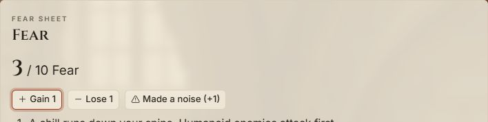
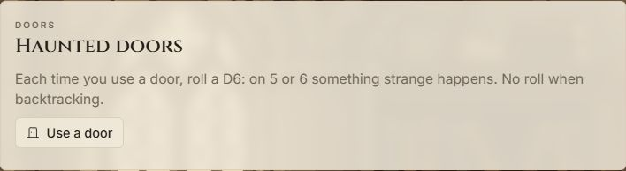
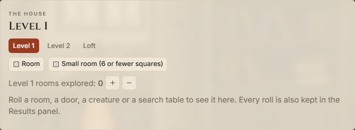
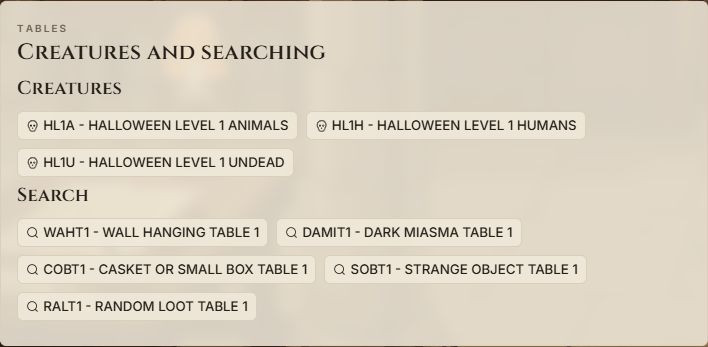

The Haunted House is a short adventure for a town constable, from the Lairs Omnibus. The tool tracks the things that are special to it: your Fear and what it does to you, the haunted-door roll, which floor you are on, the creature and search tables, and the banes you find. It also keeps every roll in front of you.

## Before you start

- Unlock the Lairs Omnibus from your own PDF. See [Books](settings-books.html). The books are sold by DR Games at <https://drgames.co.uk/dr-games-online-shop/>.
- The house is played by a **constable**, not an adventurer. When the Lairs book is unlocked, the character creator offers a class choice, **Adventurer** or **Constable**. Make a new character and pick **Constable**. See [Characters](characters.html). If your active character is an adventurer, the tool shows a card, **This character is an adventurer**, as a reminder.
- Your character must play with the **Lairs** expansion. If it does not, a card called **Lairs not enabled** has a button, **Enable Lairs for this character**. New characters get it ticked automatically when the book is unlocked.
- Open the tool from the **Play** rail, then **Haunted House**.

## Step by step

1. Read **The Haunted House: its rules** and **Rooms and doors in the house** in the **How the house works** card at the bottom. This is your book's text, shown in the app.
2. Start on **Level 1**. Roll a room with **Room**, or **Small room (6 or fewer squares)** for a small one.
3. Each time you go through a door, press **Use a door** (see [Haunted doors](#haunted-doors)).
4. Keep your Fear up to date (see [Fear](#fear)).
5. When a creature appears, roll its table in **Creatures and searching**, then fight it in [Combat](dungeon-combat.html) (see [Fighting](#fighting-and-combat)).
6. Search rooms with the **Search** buttons. Log any bane you find (see [Banes](#banes)).
7. Move to **Level 2**, then the **Loft**, as you go up the house. When the whole house is clear, tick the loft box.

## Fear

The **Fear** card shows your fear out of 10.

- **Gain 1** and **Lose 1** change it by one.
- **Made a noise (+1)** adds one Fear and tells you a scream answers.
- A short message appears each time Fear changes.

Under the count, the card lists the Fear effects now in force. They add up as your Fear rises, so at 3 Fear you see the effects for 1, 2 and 3. At 0 it says **No Fear effects yet**.

At 10 Fear, a warning says you crack and flee the house and this attempt has failed.

## Haunted doors

The **Haunted doors** card does the door roll for you.

1. Each time you use a door, press **Use a door**.
2. The tool rolls a D6. On a 5 or 6 it rolls the Haunted Door table for you and shows the result. On anything else a message tells you the door opens normally.

Do not press it when you backtrack. The rules say no roll then, and the tool trusts you.

## The three floors

The **house** card shows the floor you are on. Its title changes with the floor.

1. Choose **Level 1**, **Level 2** or **Loft**.
2. On Level 1 and 2, press **Room** to roll a room for that floor, or **Small room (6 or fewer squares)**.
3. On the loft, the button is **Loft room**, because the loft is one room.
4. The counter **Level 1 rooms explored** (or Level 2) is yours to move up and down with the plus and minus buttons. It is a reminder, not a rule.
5. When you have cleared the loft, and every room below it, tick **The loft is cleared**. The tool then says **The house is cleared** and that the front door opens.

Each roll is shown at the bottom of the card, and kept in the Results panel. If the result points to another table, a **Roll** button for it appears under the result.

> **Note:** The tool has no map of the house. Keep your floor plan on paper or on the [Map page](map.html).

## Creatures and searching

The **Creatures and searching** card has a button for each table, labelled with its code:

- **Creatures**: three buttons for the house's animals, humans and undead.
- **Search**: five buttons for the places and things you search.

Press one to roll it. The result appears in the house card.

## Fighting and Combat

The Haunted House tool does not send a creature to Combat for you. Instead:

1. Roll the creature on the Creatures buttons. Note its name.
2. Open [Combat](dungeon-combat.html) and search for it by name. The house's creatures are listed there once the Lairs book is unlocked.
3. Play the fight in Combat. When it ends, **Continue playing** returns you to the dungeon page.

Combat records the fight in your [Journal](notes-and-journal.html). The Haunted House tool writes nothing to the Journal itself.

## Banes

Banes are one-use items. The **Banes** card tracks the ones you hold.

1. When you find a bane, press **Found a bane: roll it**. The tool rolls the bane table and adds the result to your list.
2. Each bane appears as its first sentence. Click it to read the rest.
3. When you use one, press **Use (+1 Fear)** next to it. The bane is removed and your Fear goes up by one.

The card reminds you that each bane works once, gives 1 Fear when used, and has no power outside the house.

## Starting again

**Start a new house** at the bottom clears Fear, banes, the floors and the rooms counters. There is no confirmation, so be sure first.

## Tips

- Everything is saved on your device. Reloading the page does not lose Fear, banes or your floor.
- Every roll is also in the Results panel. See [Dice and rolls](dice-and-rolls.html).
- If a table shows a padlock, the Lairs book is not unlocked yet.
- Each character has their own house. See [Characters](characters.html).
