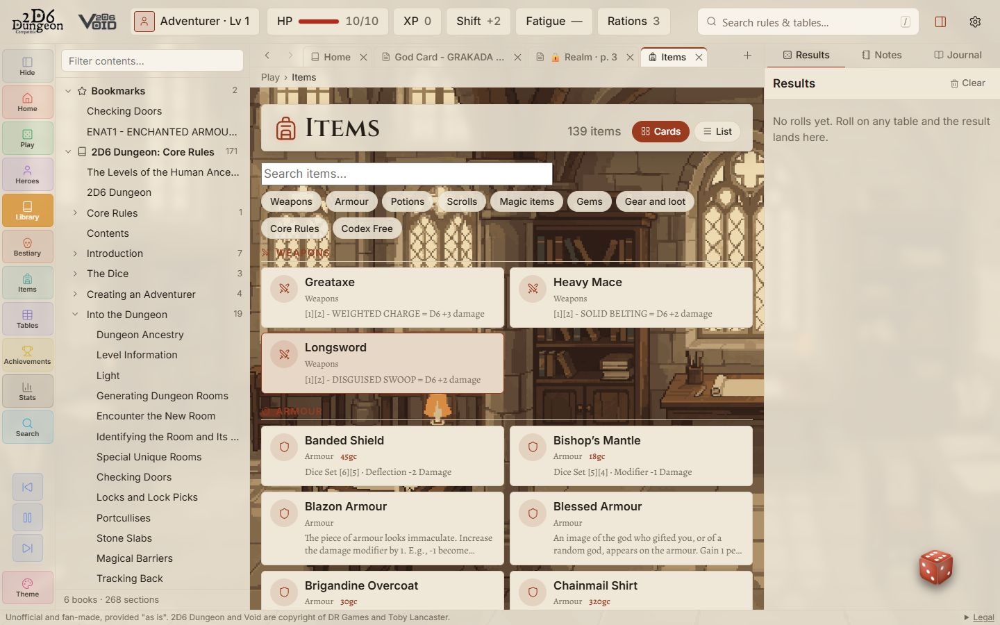
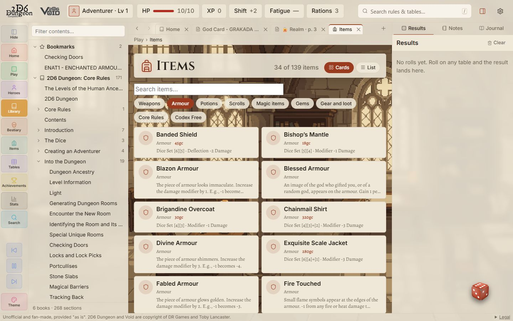
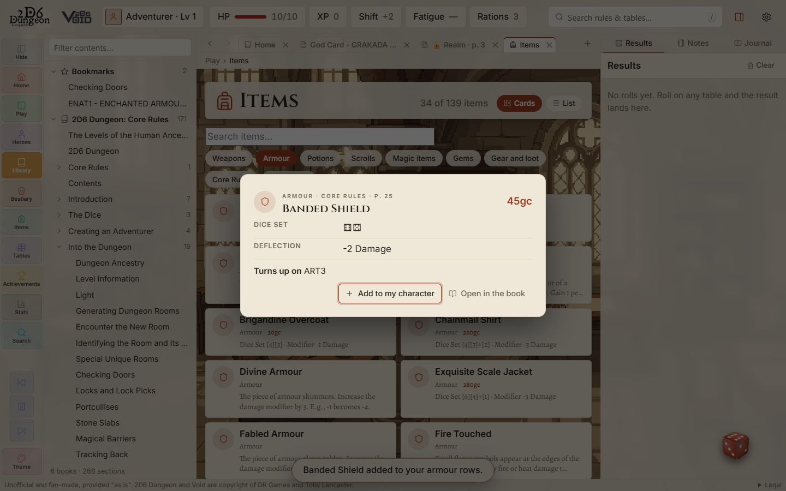
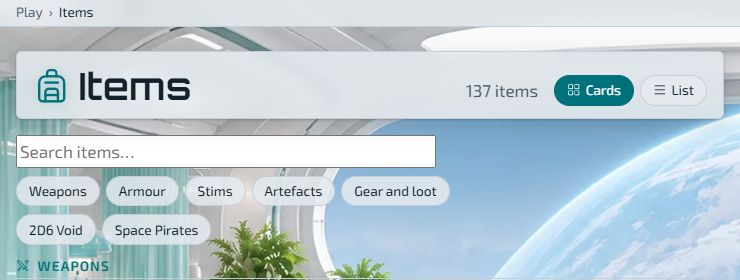

The Items page lists every weapon, armour, potion, scroll, magic item, gem and piece of gear from the books you have open. Use it to look something up, or to add a found item to your character without typing it in.

## Before you start

Only items from open books appear. Core Rules and Codex Free are open from the start; unlock others in [Books settings](settings-books.html). To add an item you need a character: see [Characters](characters.html).

## Step by step

1. Press **Items** on the left rail.
2. Items are grouped under a heading for each kind (Weapons, Armour, and so on). The header shows the total ("139 items").
3. Press a tile to open the item.
4. Read its details. Press **Add to my character** to put it on your sheet, or **Open in the book** to see it in the library.

## Search and filters

- **Search items...** narrows by name and text.
- **Kind** buttons: Weapons, Armour, Potions, Scrolls, Magic items, Gems, Gear and loot. Press again to clear.
- **Book** buttons: only items from that book.

When a kind is chosen, the headings go away and the count reads like "34 of 139 items".

## Cards or list

**Cards** shows large tiles with a short summary. **List** shows one compact line per item. Your choice is remembered.

## Add an item to your character

1. Open the item.
2. Press **Add to my character**.
3. A message tells you where it went, or why it could not.

In 2D6 Dungeon an item goes where its kind belongs on the Character sheet:

- armour into the armour rows (3 rows)
- scrolls into the scroll rows (3 rows)
- potions into the potion rows (5 rows)
- gems into your treasure
- weapons into a free large item slot
- anything else into your small items

If a set of rows is full you get a message ("Clear one first"), and nothing is added. Upgrades are not carried, so you get a message to note them yourself. See [Character sheet](dungeon-sheet.html).

> **Tip:** The window stays open after you add, so you can add more than one.

## 2D6 Void

Press the Void logo at the top left to switch game. The kinds change to Weapons, Armour, Stims, Artefacts, and Gear and loot. **Add to my character** puts armour on as worn, weapons into your ranged weapons, stims in your injectors, and artefacts in your artefacts list. You need a survivor first; otherwise the message says to make one on the Character sheet. Large items and injectors have limits, and you will get a message when they are full. See [Void character sheet](void-sheet.html).

## Tips

- Removing an item is done on the sheet, not here.
- An item's source book and page are shown at the top of its window.
