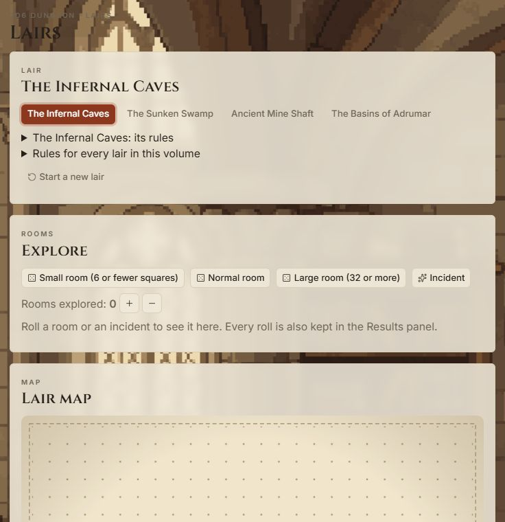
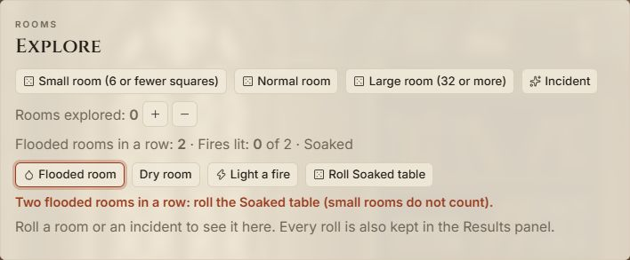
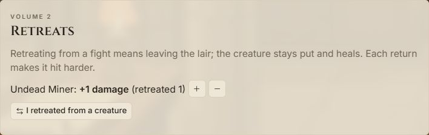
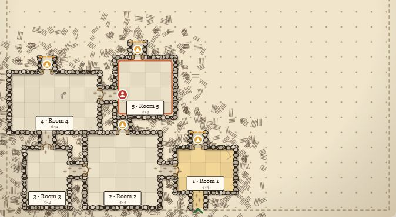
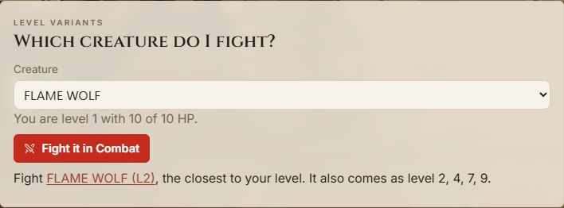

The Lairs tool helps you run a lair from the Lairs Omnibus. You pick the lair, roll its rooms and incidents, draw the lair map as you go, keep the lair's own counters (flooded rooms, fires, retreats), and find which level of a creature you should fight. It then hands that creature to [Combat](dungeon-combat.html).

## Before you start

- The tool only appears once you unlock the Lairs Omnibus from your own PDF. See [Books](settings-books.html). You can buy the books from DR Games at <https://drgames.co.uk/dr-games-online-shop/>.
- Your character must play with the **Lairs** expansion. If yours does not, the tool shows a card called **Lairs not enabled** with the button **Enable Lairs for this character**. Press it once. You can also tick it on the [sheet](dungeon-sheet.html), and new characters get it ticked automatically when the book is unlocked. See [Characters](characters.html).
- Open the tool from the **Play** rail, then **Lairs**.

## Step by step

1. Choose a lair with the four buttons at the top: **The Infernal Caves**, **The Sunken Swamp**, **Ancient Mine Shaft** or **The Basins of Adrumar**.
2. Open **its rules** and **Rules for every lair in this volume** if you want to read them. This is your book's own text, shown in the app.
3. In the **Explore** card, roll for each room you enter. Pick the button that matches the room's size: **Small room (6 or fewer squares)**, **Normal room** or **Large room (32 or more)**. Press **Incident** when you need an incident.
4. The result appears in the card, and in the Results panel. If the result tells you to roll on another table, a **Roll** button for that table appears under it.
5. Draw the room on the lair map (see [The lair map](#the-lair-map)). This also adds 1 to **Rooms explored**.
6. When a creature comes up, use **Which creature do I fight?** (see [Which creature do I fight?](#which-creature-do-i-fight)) and press **Fight it in Combat**.
7. Repeat until the lair is done.

> **Warning:** Choosing a lair, or pressing **Start a new lair**, clears your progress in the lair you had open: rooms explored, map, counters and retreats. There is no confirmation. Finish or note down a lair before you switch.

## Rooms and incidents

The **Explore** card has the room buttons and a counter, **Rooms explored**. The plus and minus buttons correct it if you play a room without drawing it.

Every roll is kept in the card until your next roll, and in the Results panel. See [Dice and rolls](dice-and-rolls.html). Your progress is saved on your device and survives a reload.

The Mine has two extra buttons in the Explore card: **Final room: creature** and **Final room: treasure**. They roll the tables for the mine's last room.

## Flooded rooms (the Swamp)

The Sunken Swamp adds a tracker to the Explore card. It shows **Flooded rooms in a row**, **Fires lit** (out of 2) and whether you are **Soaked** or **Dry**.

- **Flooded room**: adds 1 to the run and marks you Soaked.
- **Dry room**: resets the run to 0.
- **Light a fire**: dries you off and resets the run. It only works if you are Soaked, and only twice. Otherwise a message tells you why not.
- **Roll Soaked table**: rolls the Soaked table.

When two flooded rooms come in a row, a warning reminds you to roll the Soaked table. Small rooms do not count towards the run. The tool leaves it to you to decide which rooms to log as flooded.

## Retreats

What you see depends on the lair's volume.

- **Volume 1** (Caves and Swamp): a card says you can retreat at any point but can never re-enter that lair. Start a new one instead.
- **Volume 2** (Mine and Basins): a **Retreats** card keeps a counter for each creature you fled from.

1. Press **I retreated from a creature**.
2. Type the creature's name and confirm.
3. The creature appears with the extra damage it now deals. Use the plus and minus buttons to change the count.

## The lair map

The **Map** card draws the lair as you explore it. The map is 25 by 25 squares for the Caves, the Swamp and each level of the Mine, and 30 by 30 for the Basins.

### Draw a room

1. Roll the room as above, and work out its size.
2. Under the map, type the room's **Width**, **Height** and number of **Exits** (0 to 3). **Roll exits (D6)** fills **Exits** in for you.
3. Press **Draw the room**.

On an empty Caves or Swamp map, the first room goes in from the bottom edge. After that, each new room is drawn through an open exit. The newest open exit is used unless you tap a glowing exit on the map first. Tap it again to unpick it. The text under the map tells you which exit will be used.

Things to know:

- If the room does not fit at the size you typed, the tool draws it as large as will fit and tells you the size.
- If nothing fits through that exit, it is marked blocked. Choose another exit.
- All exits are archways.
- The line under the map shows how many rooms are drawn and the percentage **explored**.
- **Undo last room** removes the newest room.

### Dead ends

If every exit is used and less than 80% is explored, the tool shows a warning and a button, **Add a secret exit**. Press it to add the extra exit on the newest room that has space.

### Levels and fixed rooms

- The **Mine** has three levels. Use **Level 1**, **Level 2** and **Level 3** to switch maps. Each level has a central shaft that cannot be explored. Level 1 already has its entrance room drawn.
- The **Basins** start with their 2 by 2 entrance room drawn.

## Which creature do I fight?

Lair creatures come in several levels. The last card on the page picks the right one.

1. Choose the creature from the **Creature** list.
2. The card shows your level and HP, and names the variant closest to your level, and the other levels it comes in.
3. Press **Fight it in Combat**.

The tool picks the closest level. If two are equally close, it takes the lower one when you are at half HP or less, and the higher one otherwise. The name is a link to the creature's card.

## How it connects to Combat and the Journal

**Fight it in Combat** puts the creature into the Combat setup and opens Combat. Press **Start the fight** there as usual. After the fight, **Continue playing** takes you back to the Lairs page. If a fight is already under way, the tool says so instead, and you finish that one first.

The Lairs tool writes nothing to the Journal itself. The fight does: when it ends, the Journal records the result. See [Notes and Journal](notes-and-journal.html).

## Tips

- If the creature you want is not in the list, add it in Combat by hand.
- The map and the Rooms counter are separate: drawing a room adds 1, but the plus and minus buttons do not touch the map.
- Each character has their own lair. See [Characters](characters.html).
