The library is every book you have open, split into chapters and sections. You use it to look up a rule while you play, roll a table printed in a book, or jump from one rule to another. Everything here works the same in 2D6 Dungeon and 2D6 Void; Void shows its own books.

## Before you start

The Core Rules and the Codex Free are open from the first launch. Other books show a padlock until you unlock them. See [Books settings](settings-books.html) for how to open them.

## Browse the book tree

1. Press **Library** on the left rail. The contents tree appears beside it. (**Play** switches the same panel back to the play tools.)
2. Press a book name to open it. Its chapters appear, each with a number for how many sections it holds.
3. Press the small arrow next to a chapter to open it, or press the chapter name to read it.
4. Press a section name to read it. It opens in a new tab, or switches to the tab that already shows it.

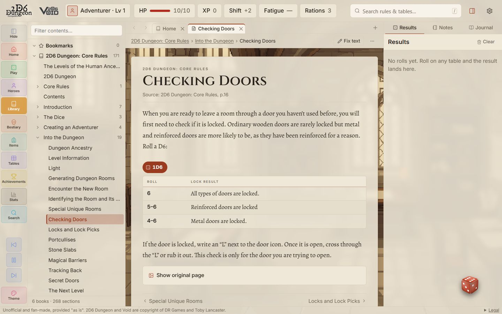

> **Tip:** Type in **Filter contents...** at the top of the tree to narrow it to matching names. Press Escape in the box to clear it. Use the arrow keys to move through the tree: Up and Down move, Right opens a group, Left closes it.

## Read a section

A section page shows the book name, the title, and the source page ("Source: ... p.16"). Under the text you will find:

- **Show original page** (when the book has page scans), which opens a picture of the printed page.
- **Referenced by**, a list of other sections that mention this one.
- Links to the **previous** and **next** section at the bottom.

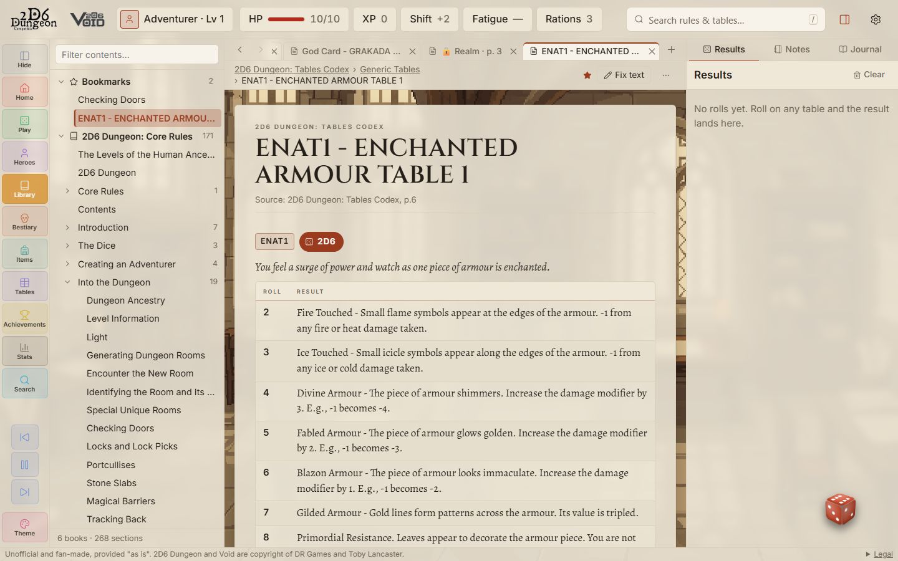

## Tables inside the text

Many sections hold a table. A table with a code shows the code (for example ENAT1) and a dice button such as **2D6** above it.

1. Press the dice button.
2. The row that came up is highlighted in the table.
3. The result also appears as a card under the table and in the Results panel on the right.

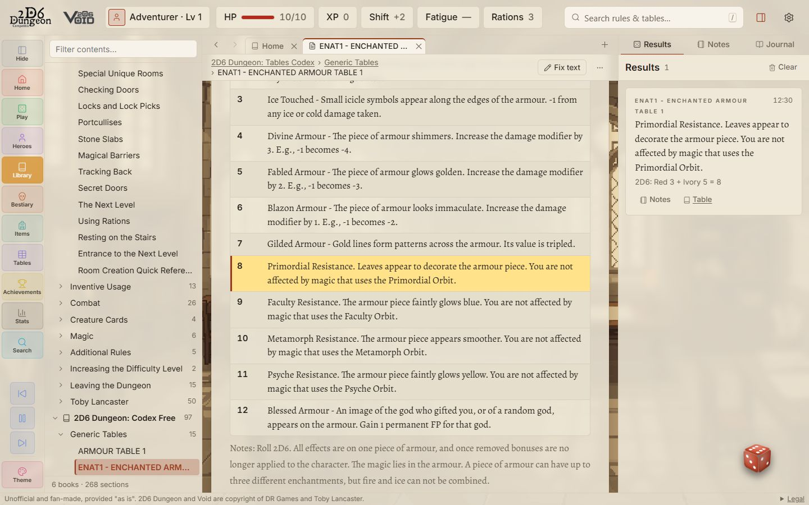

A table that has no dice badge is for reading only. See [Dice and rolls](dice-and-rolls.html) for how rolls and the Results panel work, and [Tables](tables.html) for a page that lists every table.

## Cross-links and "Referenced by"

When the text of a section names another table, by its code or title, the first mention is underlined. Press it to open that section.

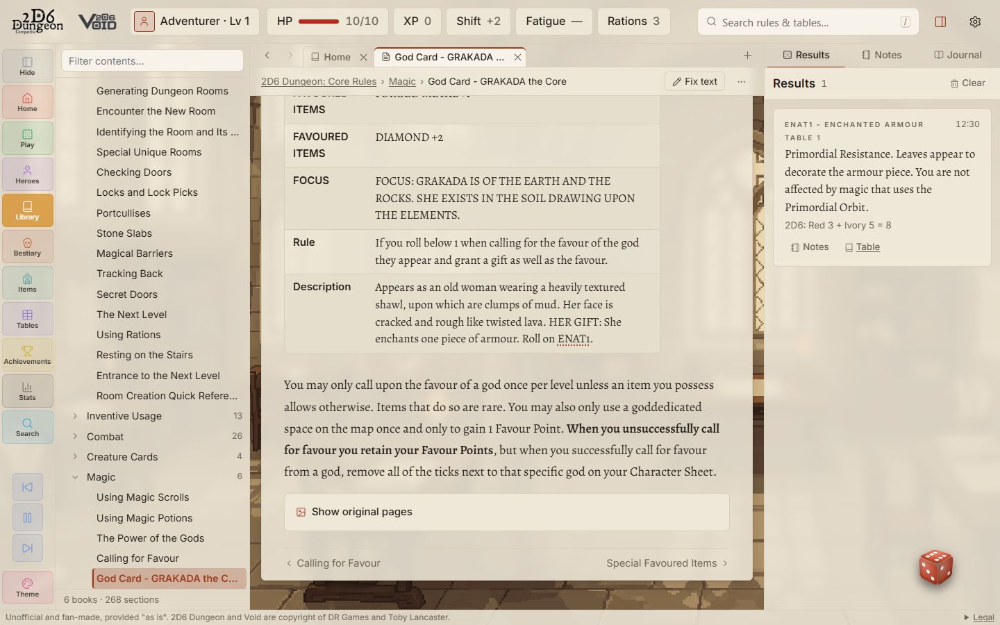

At the bottom of a section, **Referenced by** lists the sections that mention it. Press it to open the list, then press a name to go there.

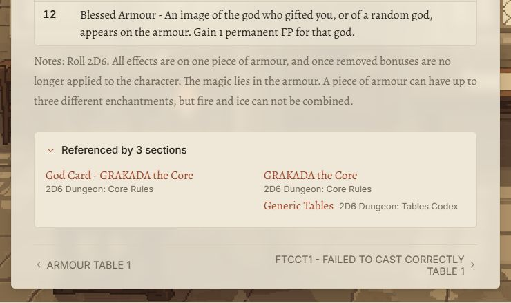

## Bookmarks

1. Open the section you want to keep.
2. Press the **...** button (Page tools) at the top right of the page.
3. Choose **Bookmark**. A message confirms it, and a star appears next to the page tools.
4. Open the **Bookmarks** group at the top of the tree to see your list. Press a name to open it.
5. To remove one, open the page again, press **...**, and choose **Remove bookmark**.

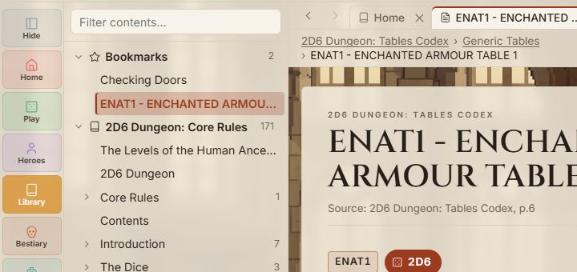

## The page tools menu

The **...** button on a section page opens a menu.

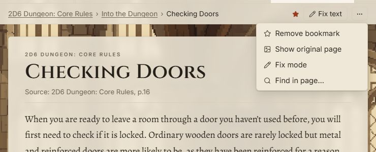

- **Bookmark** or **Remove bookmark**, as above.
- **Show original page** opens and scrolls to the page picture. It only appears when the section has one.
- **Fix mode** lets you correct typos. See below.
- **Find in page...** asks for a word. Press **Find** and the page scrolls to the first match and flashes it. If nothing matches you get a short message.

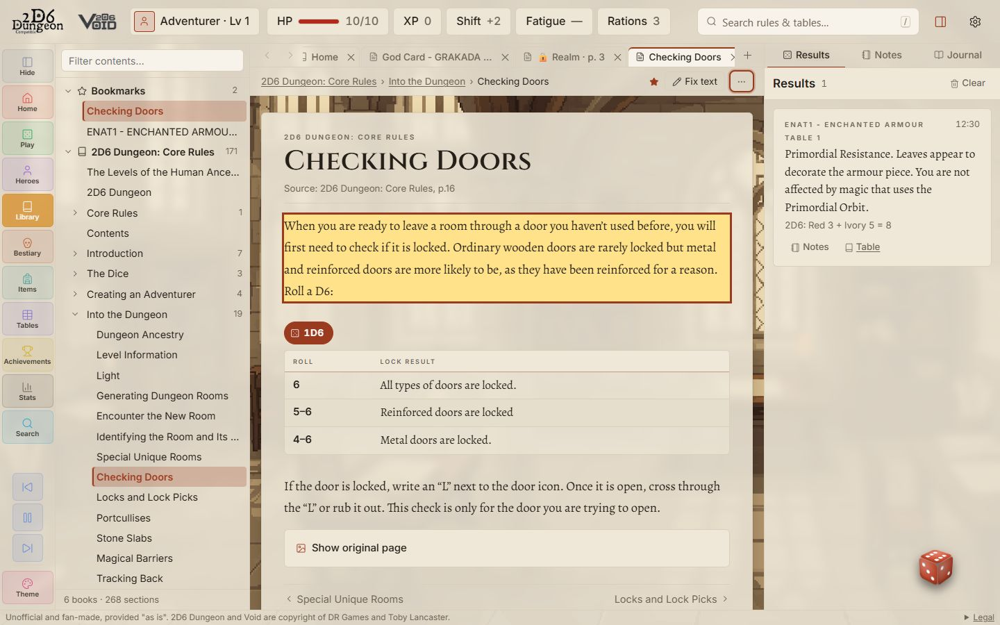

## Fix mode

Sometimes the text of a section has a typo from the book scan. Fix mode lets you correct it on your device.

1. Open the section.
2. Press **Fix text** at the top right, or choose **Fix mode** from the page tools menu.
3. A banner says "Fixing text". Page scans appear beside the text so you can compare, when the section has them.
4. Press the word or cell you want to change and type the correction. Press Enter, or press somewhere else, to save it.
5. The banner counts your fixes ("1 fix saved on this device").
6. Press **Done** when you finish.

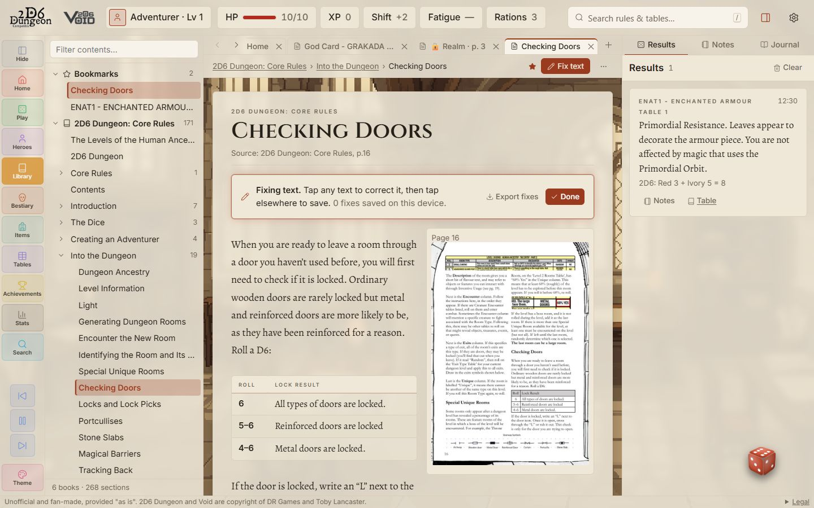

To take fixes back: press Fix mode again on the same page and press **Undo this page's fixes**. The button shows once the page has a saved fix and you have entered Fix mode.

**Export fixes** downloads your corrections as a file, for people who want to send them on. You never need it to keep your own fixes.

> **Note:** Fixes are kept on this device only. Clearing your browser data removes them.

## Search

Search looks through the play tools and the whole library at once.

1. Press **/** or **Ctrl+K**, or press **Search** on the left rail.
2. Type a word. Matches appear as you type, with the matching words highlighted.
3. Use the Up and Down arrow keys to pick a result.
4. Press **Enter** to open it in a new tab. Press **Ctrl+Enter** to open it in the current tab. Escape closes the search.

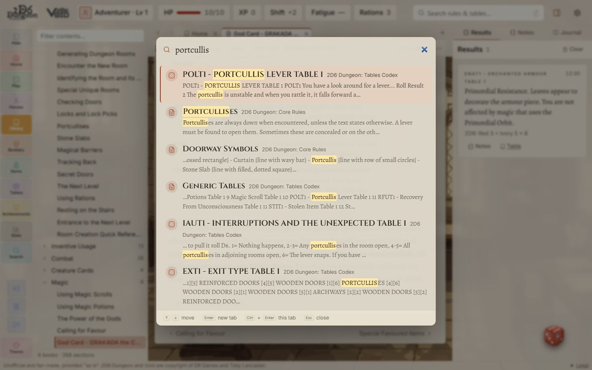

You can search by table code. Typing ENAT1 finds that table first. Play tools match by name too: typing "Bestiary" lists the tool.

## Locked books

Books you have not unlocked appear at the bottom of the tree with a padlock and a page number, for example "Realm - p. 3". Their titles and text are never shown.

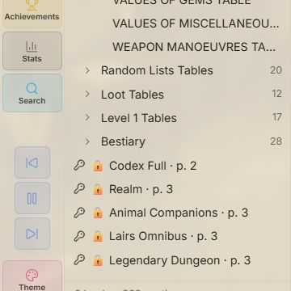

Press one and you get a page that says to open your PDF, with an **Unlock...** button. It takes you to Settings. See [Books settings](settings-books.html). If you search for a table code from a locked book, the result shows the padlock instead of a title.

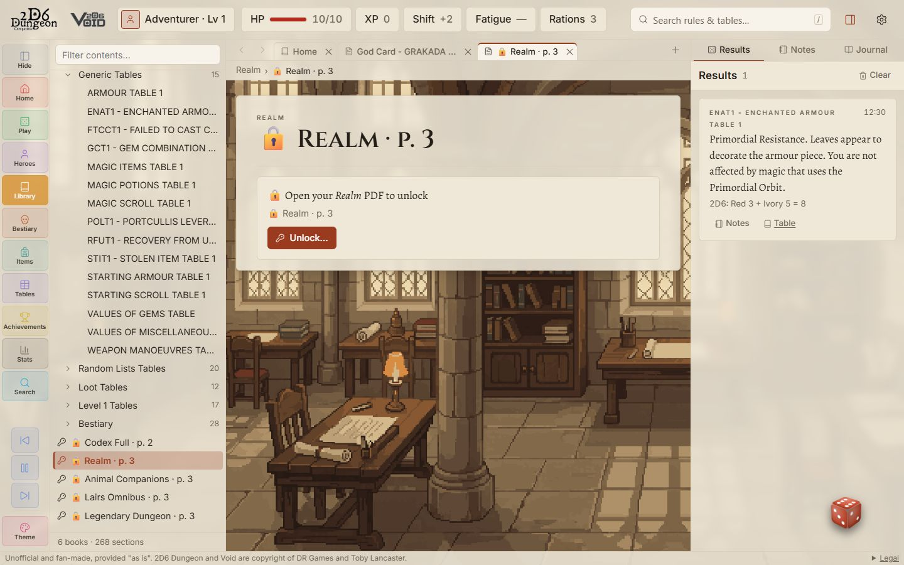

## Tips

- Clicking in the tree never replaces your current tab. Hold Ctrl and click any link to open it in a new tab.
- The tree remembers which groups you left open.
- The tree footer shows how many books and sections you have.
