The dungeon map draws itself while you play [Start Game](dungeon-start-game.html). You never draw anything: each room appears on the map as you roll it, with its doors, exits and name. You can look at the map in two places. There is a small copy beside the steps in Start Game, and a large one on the **Map** page.

## Open the map

- **Map page:** the **Play** rail, then **Map**. Or press **Map page** under the small map in Start Game.
- **Beside Start Game:** the small map on the left of the steps. On a narrow window it folds into a **Map** bar you can open and close.
- **Its own window:** press **New window**. See [A second window](#a-second-window).

Until you roll the entrance room the map is empty and says "No rooms yet — start in Start Game." with an **Open Start Game** button.

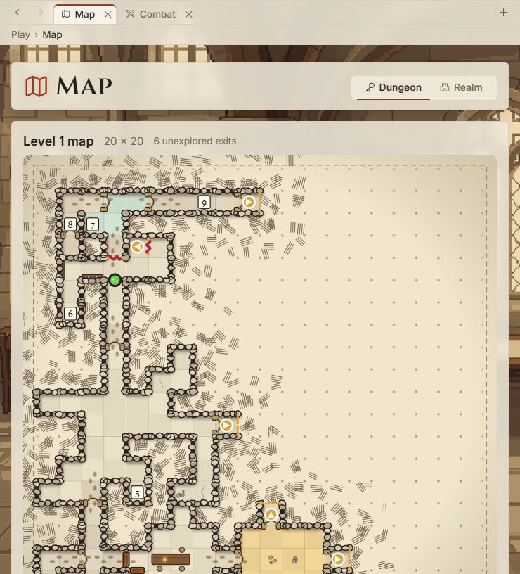

## Reading the map

- **Header:** "Level N map", the grid size (for example 20 × 20) and how many exits are still unexplored.
- **Rooms** are placed beyond the exit you chose, and squeezed to fit, the way you would draw them on paper. Each has a number. Corridors are narrow strips.
- **Exits** are drawn on the wall they sit on. Unexplored exits glow. The colour key under the map names each kind: **Archway**, **Wooden**, **Metal**, **Reinforced**, **Portcullis**, **Curtain**, **Stone slab**. A red mark means **Locked**.
- **Footprints** run through the passages you have walked through, and a green token marks where the party is.
- **Room dressing** (tables, benches and similar furniture) is picked from the room's name, so a room of one kind looks different from another.
- **Room reference** lists every room by number and name. A room sealed behind a secret door is marked "(sealed)".

## Picking the next exit

1. Tap a glowing exit on the map. The line under the map says which one you picked: "Next room goes through the wooden south of ...".
2. Tap the same exit again to clear your choice. If you choose nothing, the tool uses its suggestion.
3. Roll the next room in [Start Game](dungeon-start-game.html). The room goes through the exit you picked.

Picking an exit on the map or on the chips in Start Game is the same choice; both views update. You cannot tap exits while a roll is in progress.

## Tapping a room: the room card

Tap a room to open its card. On the Map page it appears beside the map; in Start Game it appears under the small map.

1. The title shows the room number and name, and the line under it shows the kind, size and table code, for example "Entrance room · 4 × 3".
2. For a rolled room the card also shows that room's table row, so you can read what the room holds without leaving the map.
3. Type in **Your notes** to leave yourself a note: loot left behind, a locked chest, who is still there. It saves as you type.
4. A room with notes gets a small pencil marker on the map.
5. **Put the stairs down here** marks the room as the way down (**Remove the stairs** undoes it). See [Start Game](dungeon-start-game.html).
6. Press the **×** to close the card, or tap the room again.

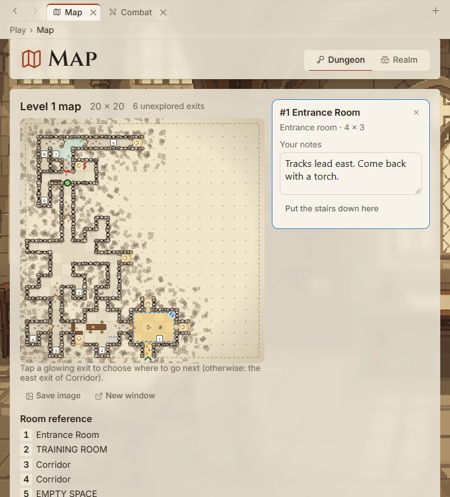

The Notes panel on the right side of the app edits the same room notes. See [Notes and Journal](notes-and-journal.html).

## Save image and New window

- **Save image** downloads the map as a picture named for the level, such as `dungeon-level-1-map.png`.
- **New window** opens the map by itself in a separate browser window. Keep it on a second screen or beside the game. It stays live: when you roll a room in the main window it redraws, and tapping an exit in it chooses that exit in the main window too. If your browser blocks pop-ups, the app tells you to allow them.

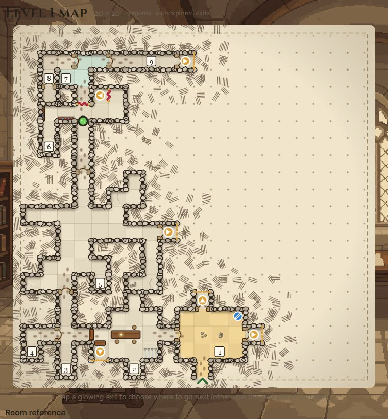

## Tile sets and views

How the map looks is separate from the colour theme. Choose it in **Settings**, then **Map**, under **Map tiles & view**. Each card previews a small sample dungeon in that style, and the picked one is outlined.

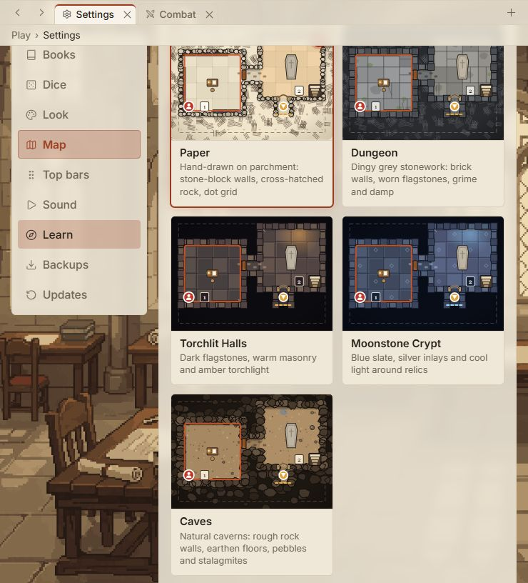

### Tile sets

Pick one under **Tile set**.

| Tile set | Look |
|---|---|
| Paper | Hand-drawn on parchment: stone-block walls, cross-hatched rock, dot grid. This is the default. |
| Dungeon | Dingy grey stonework: brick walls, worn flagstones, grime and damp. |
| Torchlit Halls | Dark flagstones, warm masonry and amber torchlight. |
| Moonstone Crypt | Blue slate, silver inlays and cool light around relics. |
| Caves | Natural caverns: rough rock walls, earthen floors, pebbles and stalagmites. |

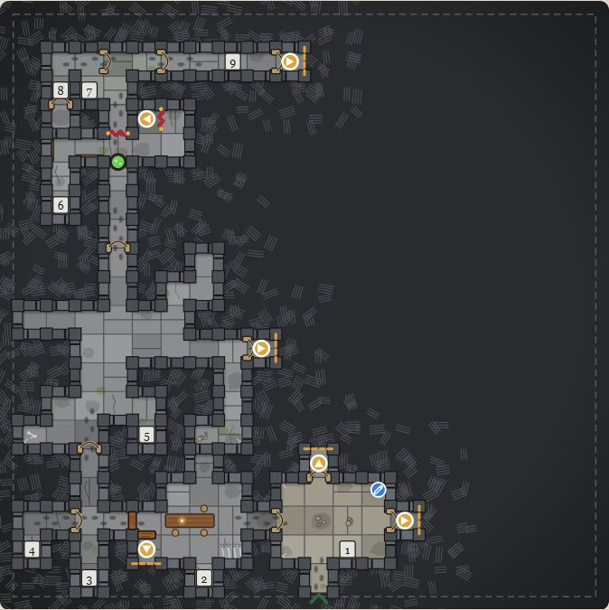

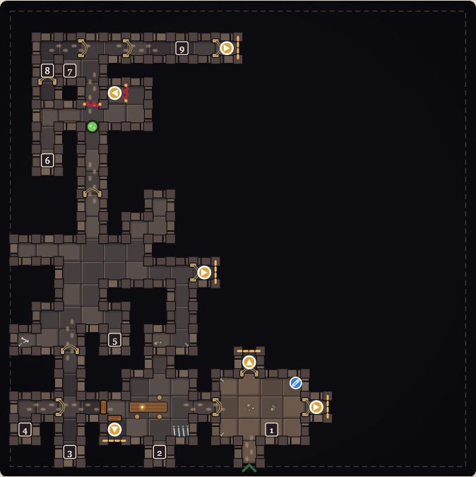

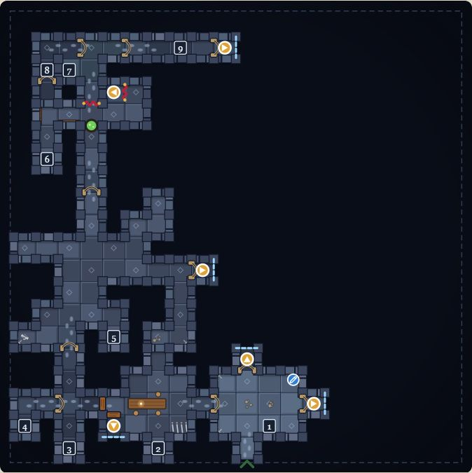

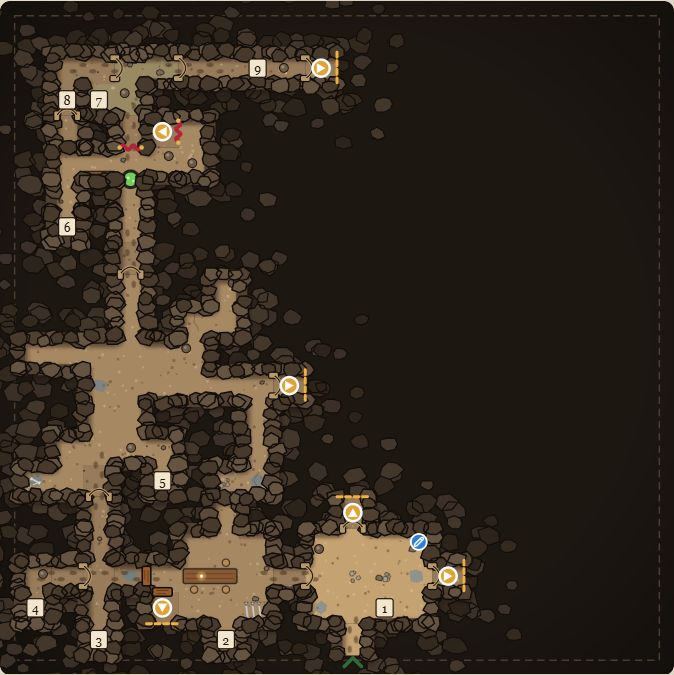

The Paper tile set is the one in the first picture on this page.

### Top-down and Isometric

Pick one under **View**.

- **Top-down:** flat, like drawing on paper. The easiest to read.
- **Isometric:** a 3D look. Back walls stand up and the front walls are cut away so you can see into the rooms.

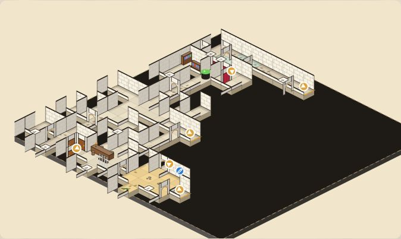

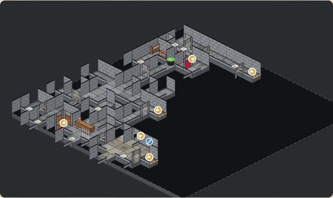

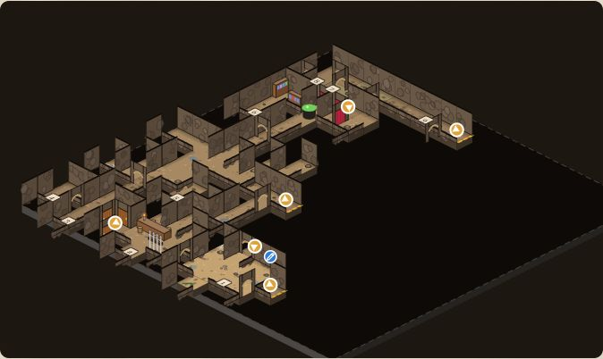

In the isometric view two extra buttons appear next to **Save image**: **⟲** turns the map a quarter anticlockwise and **⟳** a quarter clockwise, so you can look at a room from another side. The turn is remembered.

The map fits itself to the space it has. There is no zoom or panning; use the **Map page** for the largest view.

## The Realm tab

The Map page has two tabs at the top: **Dungeon** and **Realm**. **Realm** shows the plots of your realm instead of the dungeon. Tap a plot for its details, or press **Open in Realm** to jump to it. With nothing explored it says "No plots on the map yet — explore them in Realm." with an **Open Realm** button. See [Realm](realm.html).

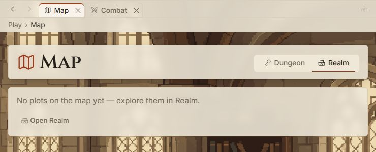

## Tips

- The map and room notes are saved with the rest of the level, so they are still there after a reload.
- Going down a level starts a new, empty map. Save the old one first with **Save image** if you want a record.
- If an exit has nothing beyond it (it would run into other rooms), the tool marks it as blocked when you try to roll through it. Pick another exit.
- 2D6 Void has its own map. See [Void map](void-map.html).
