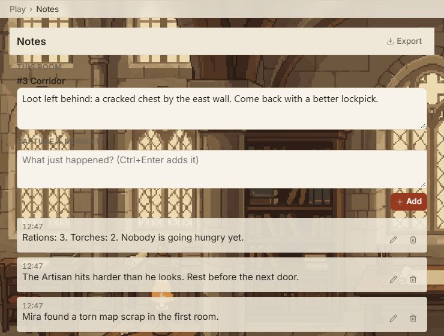
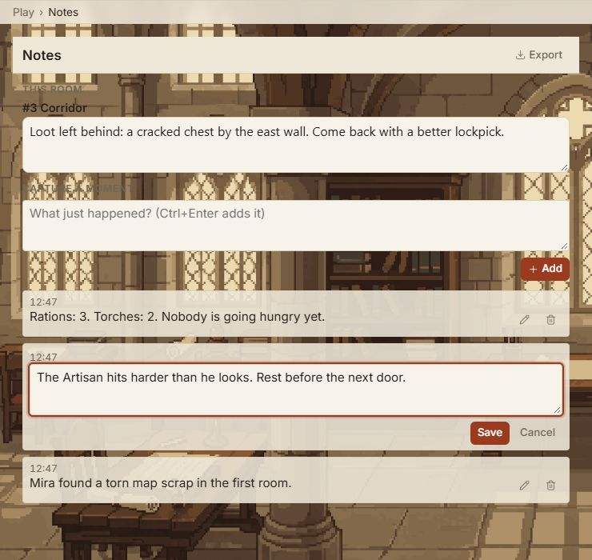
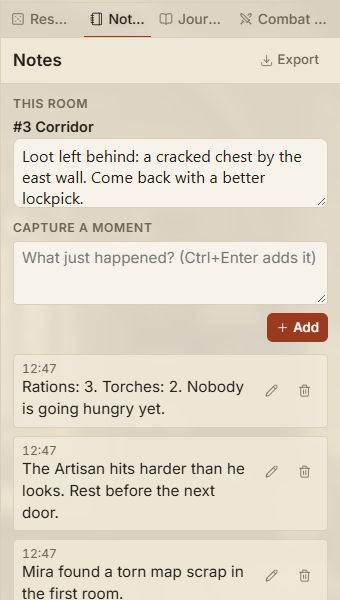
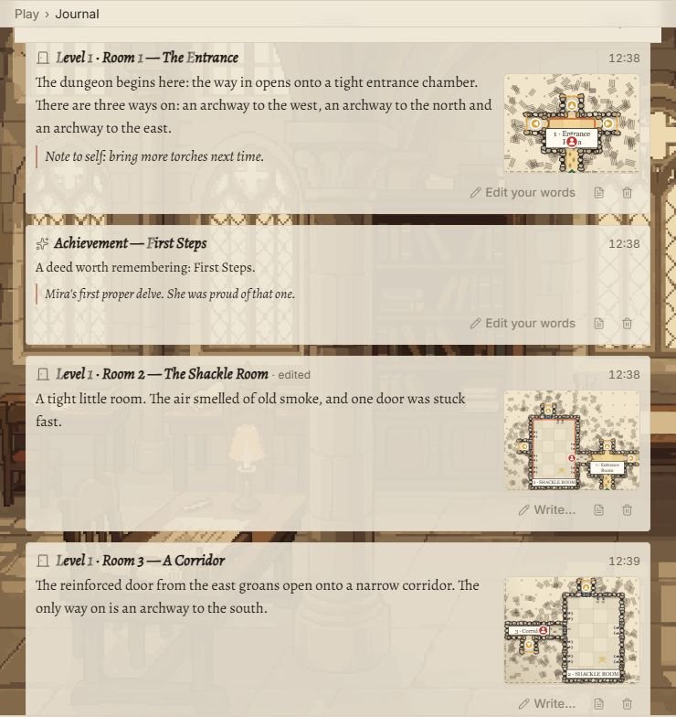
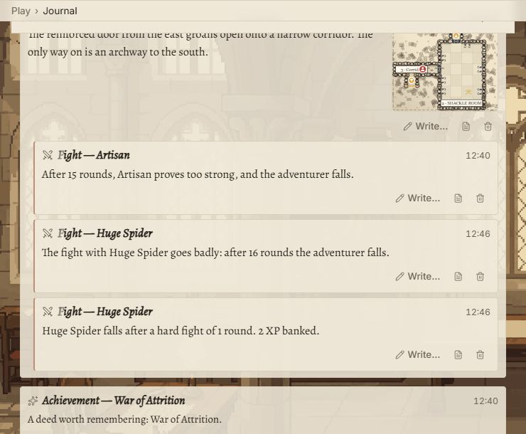
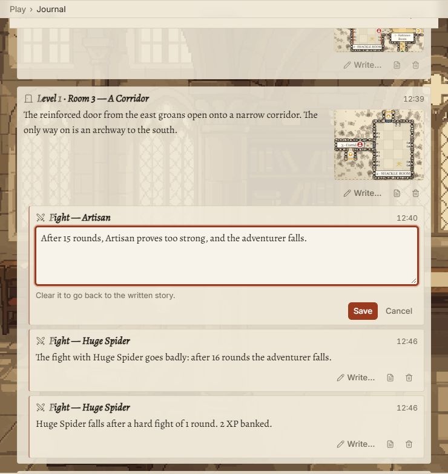
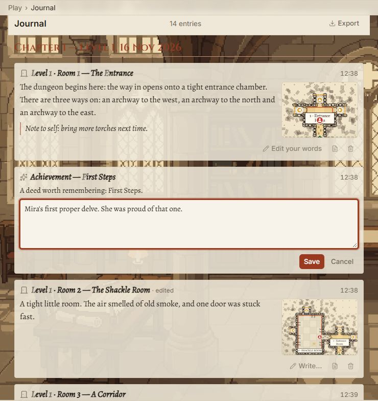

The app keeps two records of your game. **Notes** is where you write things down: a locked chest you want to come back to, who is still alive in a room. **Journal** writes itself as you play, turning each room, fight and level into a short story you can edit and print.

Both live in the side panel (the tabs on the right, next to Results) and also as full pages under **Play**. They show the same data, so use whichever fits your screen. Each character has their own notes and journal.

## Notes

### Step by step

1. Open **Notes**: pick the **Notes** tab in the side panel, or choose **Play**, then **Notes**.
2. Under **This room**, type anything about the room you are in. It is saved as you type.
3. Under **Capture a moment**, type a line about what just happened.
4. Press **Add**, or press Ctrl+Enter (Cmd+Enter on a Mac). The note lands at the top of the list with the time on it.

### This room

This box is the same note you see when you tap a room on the map, so you can use either place. It follows the room you are exploring. If you have finished the room and not rolled the next one yet, it keeps showing that room and adds "last room" to its name. Before you have rolled any room it says "No room yet."

> **Note:** "This room" belongs to the dungeon map. Notes you type here are saved with the room and are not part of the session log below.

### The session log

The log lists your captured notes, newest first. A note from today shows just the time (14:05). An older one also shows the day (3 Nov 14:05).

- **Edit**: press the pencil on a note, change the text, then press **Save** (or Ctrl+Enter). **Cancel** (or Esc) keeps the old text. If you save an empty note it is deleted.
- **Delete**: press the bin icon and confirm.

### Send a roll to your notes

Every roll in the Results tab has a **Notes** button. Press it and the result is added to the log as one line ("Table name: result"). You will see "Added to Notes" and a dot appears on the Notes tab. Use this to keep the odd result you want to remember.

### Export

Press **Export** at the top of Notes to download your session log as a file named `session-notes-` plus today's date. It is a plain data file (JSON), handy as a backup or to paste from.

## Journal

### What gets written for you

You do nothing to start it. The journal adds an entry when:

- **You roll a room.** The entry shows the room's name, how you came in, the exits, anything you met, and any door you tried (locked, picked, stuck). It also carries a small map picture of the room.
- **A fight ends.** You get who you fought, how many rounds, the XP and any loot you noted. If you were in a room when the fight ended, the fight appears indented inside that room's entry.
- **You go down a level, rest on the stairs, find an exit shaft, or gain a character level.**
- **You unlock an achievement.** See [Achievements](achievements.html).
- **You play the Realm.** Plots you explore and each month's events get entries too (see [Realm](realm.html)).

Entries are grouped into **chapters** ("Chapter 1 — Level 1, 16 Nov 2026"). A new chapter starts when you begin a new dungeon. If you have a realm, the chapter title uses the realm date instead of today's date. The journal keeps your newest 500 entries.

Open it with the **Journal** tab or **Play**, then **Journal**. It scrolls to the newest entry when it appears, so it reads like a book from top to bottom.

### The room picture

A room's picture is a slice of your map. While you are still exploring the room it keeps updating. When you press **Finish room**, it is frozen, so later rooms and locks you open elsewhere do not change it. Tap the picture to open the Map page, centred on that room if it is still on your current map. See [Map](map.html).

> **Note:** If you press **Undo turn** on a room, its journal entry is removed too, unless you have already edited it or written your own words on it.

### Fights inside a room

A fight you finish while a room is in progress sits inside that room's entry, as in the picture. A fight fought between rooms gets its own entry.

### Edit the story

The written story is made from the facts of the room or fight, so it stays correct if the facts change. You can change the wording:

1. On the entry, press the page icon (its tooltip says "Edit the story").
2. Rewrite the text. Press **Save** (or Ctrl+Enter).
3. The entry now says "edited" and keeps your text. **Cancel** (or Esc) leaves it alone.

To go back to the written story, edit it again, **clear the box completely**, and save. If you save the text without changing it, the entry stays the written story.

### Write… in your own words

Instead of replacing the story, add to it. Press **Write…** on any entry, type, and press **Save**. Your words appear in italics under the story. The button then reads **Edit your words**, and saving an empty box removes them.

### Delete an entry

Press the bin icon on an entry and confirm. A fight that was shown inside a deleted room becomes an entry of its own.

### Export as a printable page

Press **Export** at the top of the journal. You download a single web page (`journal-` plus today's date, ending `.html`) with your chapters, stories, your own words and the room pictures. Open it and print it, or save it as a PDF. If the journal is empty you will just see "The journal is empty."

## Tips

- Notes and the Journal are saved automatically in the browser and are included in a backup. See [Backups](settings-backups.html).
- Clearing play data in Settings does not remove a character's notes or journal.
- Both tabs show a dot when something new has been added while you were looking elsewhere.
- Ctrl+Enter saves, Esc cancels, in every edit box on both tabs.
- Rolled room descriptions from your books are used to write the journal story. Edit the story if you do not want that text in what you print or share.
