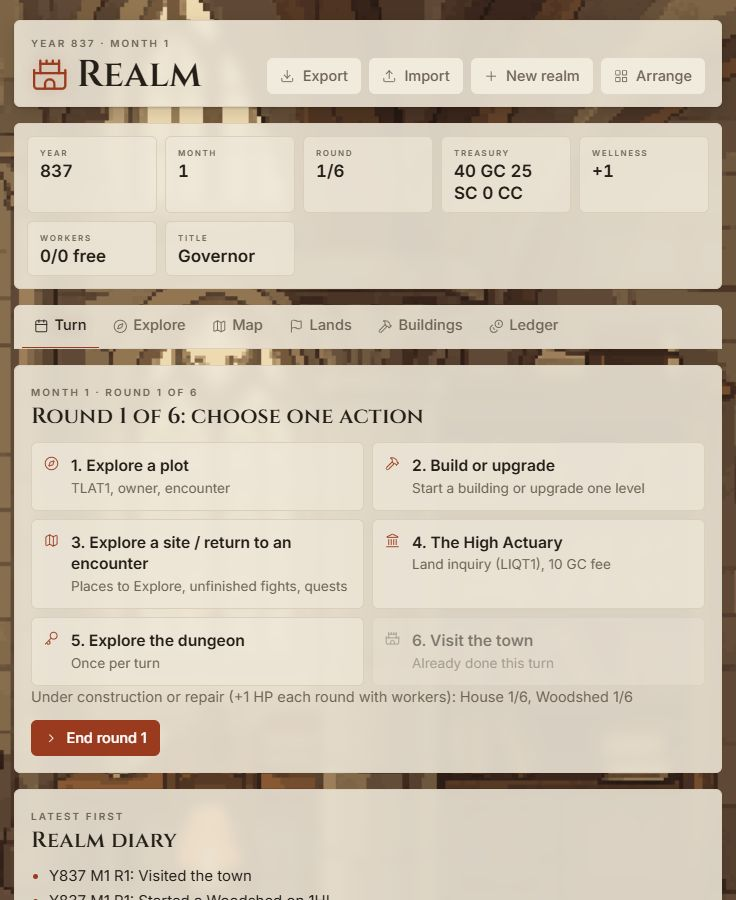
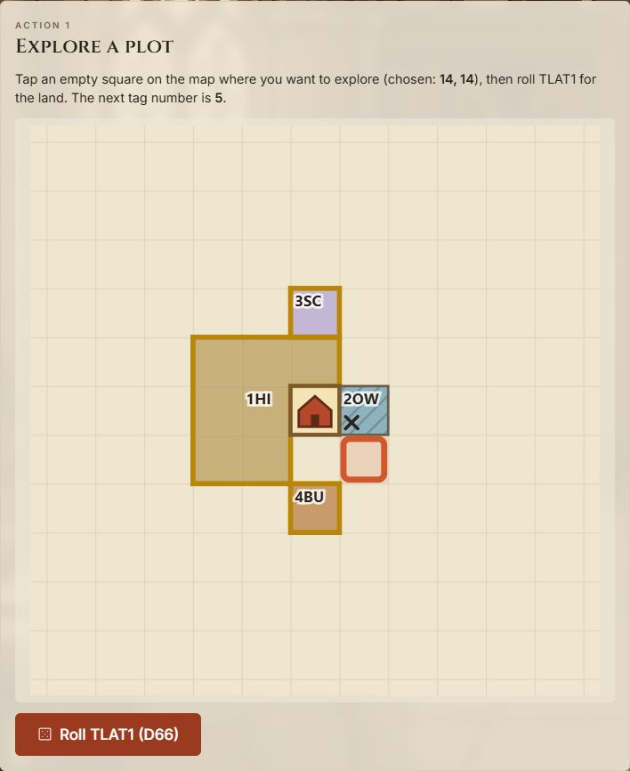
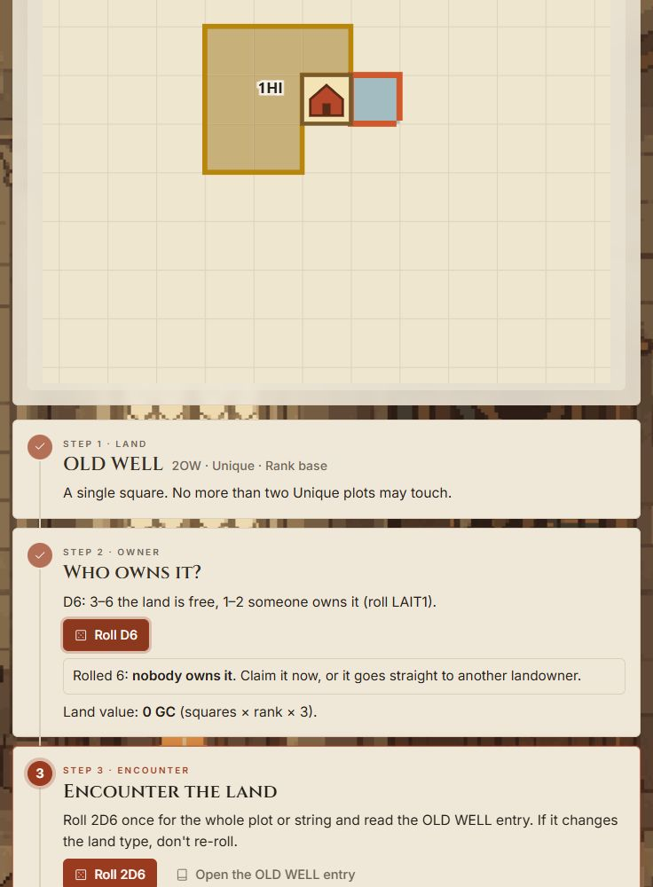
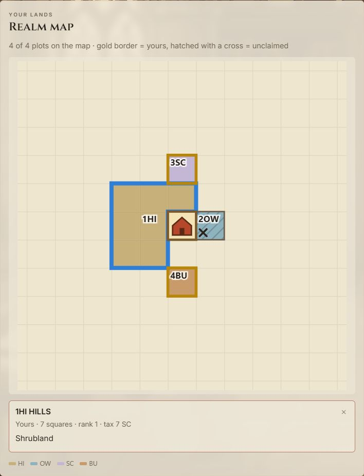
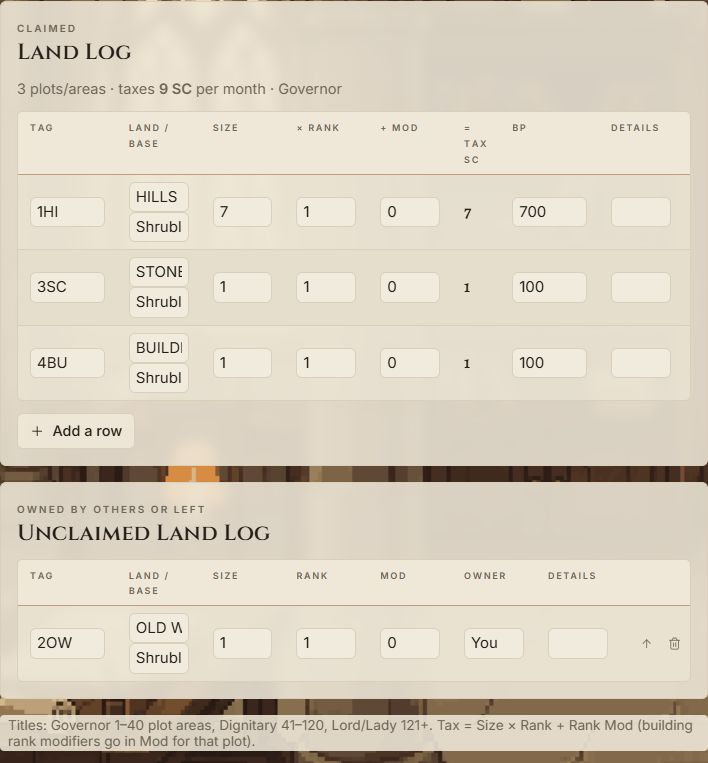
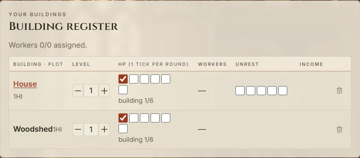
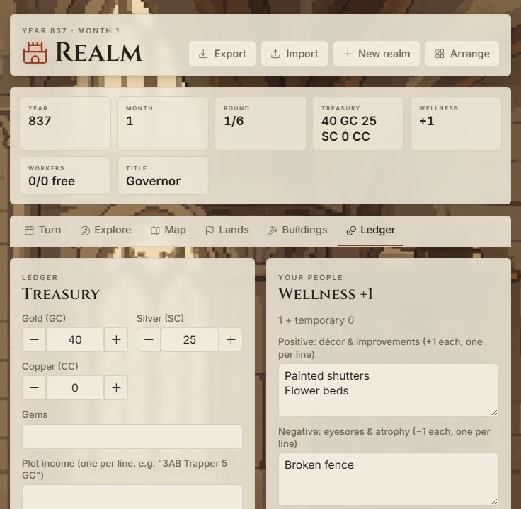
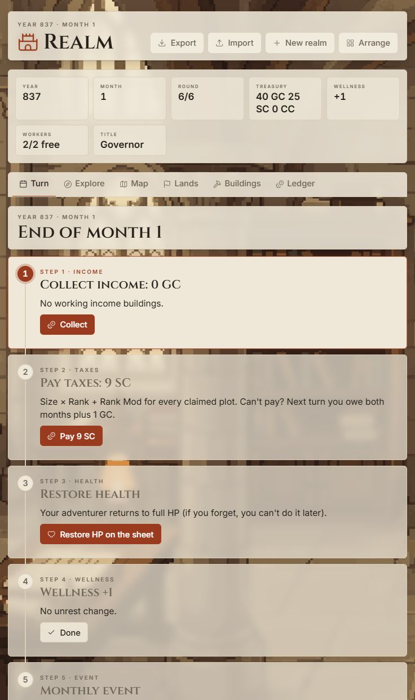

The Realm tool is the bookkeeping desk for the Realm expansion. It walks you through the monthly turn, helps you explore plots of land, draws them on a realm map, tracks your buildings, and keeps your treasury, wellness and favour in one place. You use it whenever you play the Realm side of 2D6 Dungeon.

The tool does the arithmetic and the dice. The rules themselves stay in your book, and the tool links to the book's entries where you need to read them.

## Before you start

- The tool only appears once you unlock the Realm book from your own PDF. See [Books](settings-books.html). The books are sold by DR Games at <https://drgames.co.uk/dr-games-online-shop/>.
- Open it from the **Play** rail, then **Realm**.
- Everything is saved on your device, per character. Closing the tab or reloading keeps your realm. Use **Export** now and then to keep a copy (see [Export, Import and New realm](#export-import-and-new-realm)).

## The screen

The top of the page shows your realm at a glance: **Year**, **Month**, **Round** (out of 6), **Treasury** in gold, silver and copper, **Wellness**, free **Workers**, and your **Title**.

Under that are six tabs: **Turn**, **Explore**, **Map**, **Lands**, **Buildings** and **Ledger**. The last tab you used is remembered.

## Step by step: a month in the Realm

1. Open the **Turn** tab. You are in round 1 of 6.
2. Choose **one action** for the round (see [The six actions](#the-six-actions)). Do what it asks, in its own tab or on another page.
3. Press **End round 1**. The round counter moves to 2.
4. Repeat until you have ended round 6.
5. The Turn tab now shows **End of month**: a checklist of income, taxes, health, wellness and the monthly event. Work down it (see [The end-of-month checklist](#the-end-of-month-checklist)).
6. Press **Start month 2**. You are back in round 1.

> **Note:** The tool does not stop you taking more than one action in a round. It leaves that to you and your book.

## The six actions

Each action is a big button on the Turn tab.

| Button | What it does |
|---|---|
| **1. Explore a plot** | Switches to the Explore tab. If you have no plot in progress, it rolls the land table straight away. To choose where the plot goes first, open the Explore tab yourself (see below). |
| **2. Build or upgrade** | Switches to the Buildings tab. |
| **3. Explore a site / return to an encounter** | Adds a line to the Realm diary. Play the site or the unfinished encounter yourself. |
| **4. The High Actuary** | Asks for your land inquiry modifiers, takes the 10 GC fee from the treasury, then rolls the land inquiry table. The result appears in the Results panel. If you cancel the question, no fee is taken and nothing is rolled. |
| **5. Explore the dungeon** | Takes you to the Dungeon page. It can be used once a month: the button greys out until the next month. |
| **6. Visit the town** | Adds a line to the diary. Once a month, like action 5. |

Under the buttons, the tool lists buildings that are still being built or repaired, with their progress, so you do not lose track.

The **Realm diary** below keeps the latest lines first (what you explored, claimed, built and paid).

## Explore a plot

This is the biggest part of the tool. The Explore tab walks you through the steps in order.

### Pick a square and roll the land

1. Open the **Explore** tab.
2. Tap an **empty square** on the map. It gets a red outline and the text says which square you chose. Tap it again to unpick it.
3. Press **Roll TLAT1 (D66)**. The land is rolled, given the next **tag** (for example `3MA`: plot number 3, Marshland) and shown as Step 1.

> **Tip:** If you skip step 2, the button reads **Roll TLAT1 (D66) without placing it**. You still get the land, but it is not drawn on the map.

### Work through the four steps

1. **Land.** The land name, tag and type (Unique, Area or String) are shown.
   - A **Unique** plot is one square and is placed on the chosen square.
   - An **Area** asks you to press **Roll D6 extra squares**. The squares are placed touching each other around your chosen square. If they do not all fit, the note says how many did.
   - A **String** asks you to press **Roll D6+2 string length**. The tool walks the string across the map for you, one D6 per step, and lists each step under the map.
   - Not happy with the placement? Press **Re-roll the placement**.
   - For 5 or more squares the step reminds you to roll the "five or more" table after the encounter.
2. **Owner.** Press **Roll D6**. On a 3 to 6 the land is free. On a 1 or 2 someone owns it and the tool rolls the landowner table for you (with the rank 3 or higher adjustment when it applies). For free land it also shows the **Land value**.
3. **Encounter.** Press **Roll 2D6** once for the whole plot. The tool reads the matching row from the book and shows it. Use **Open the (land) entry** to read the whole entry in your book. If the plot is big enough, a **FIVEPT1** button rolls that table.
4. **Record.** Fill in what you want to keep:
   - **Base land / notes**, for example the base land and size.
   - **Rank** and **Rank mod**.
   - **Owner**.

   Then choose one of three buttons:
   - **Add to my Land Log**: the plot is yours. You land on the Lands tab.
   - **Add to Unclaimed Land Log**: someone else owns it, or you left it.
   - **Discard**: throw the plot away without recording it.

> **Note:** The Owner box starts out as "You" when the land was free. If you press **Add to Unclaimed Land Log** for free land you did not take, clear that box first, or the unclaimed row will say "You".

Claimed plots and encounter results are also written to your [Journal](notes-and-journal.html).

## The realm map

Open the **Map** tab to see everything you have placed. The realm is a 25 by 25 grid with your homestead (the little house) in the middle. The view zooms in on the explored area so it stays readable.

- A **gold border** means the plot is yours.
- **Hatching with a cross** means it is unclaimed.
- Each land type has its own colour; the legend under the map names them.
- Building **badges** (for example "House L1") appear on the plot card for the plot that has them.
- **Tap a plot** to open its card: tag, land, who owns it, number of squares, rank, the tax if it is yours, your notes, and the buildings on it. Tap the small x to close it. The chosen plot gets a blue outline.

> **Note:** Plots you recorded without a square on the map are in your logs but not drawn. The note above the map tells you how many are placed.

The same map is also shown on the [Map page](map.html).

## Lands and titles

The **Lands** tab holds two logs.

- **Land Log** (yours): tag, land and base, size, rank, a rank modifier, the **tax** it works out to, **BP** (building points left) and details.
- **Unclaimed Land Log**: the same, with an Owner column.

All the boxes are editable: click and type. The tax updates as you change size, rank or modifier. Each row has two icon buttons:

- The arrow **moves the plot** between the two logs (**It's mine now** or **Move to unclaimed**).
- The bin **removes the row**, after you confirm.

**Add a row** adds a blank plot by hand.

The line above the log shows how many plots you hold, your monthly taxes, and your **Title**. The Title follows the number of plots you hold. It is shown in the summary bar too, and the note at the bottom of the tab lists the thresholds.

## Buildings

The **Buildings** tab has the register and two ways to add a building.

### The register

Each row shows the building and its plot, then:

- **Level**: use the minus and plus buttons. Raising it adds a diary line.
- **HP (1 tick per round)**: a row of tick boxes. Box 1 is ticked when you start the building. Each round you end, one more is ticked, but only if the building has the workers it needs. When all are ticked, the row says **complete**. You can also tick boxes by hand.
- **Workers**: how many are assigned, out of how many it needs. Free workers come from your finished Houses and Manors. The line above the table shows **Workers assigned**.
- **Unrest**: boxes for Houses and Manors. When they are all filled the tool tells you the building is destroyed.
- **Income**: what a finished, fully staffed building earns each month.
- The bin **removes the building**, after you confirm. Its plot gets its building points back; the gold you paid is not refunded.

### Start a building from a card

1. Choose the **Building** and the **Plot** (one of your claimed plots, or the Homestead). A short summary appears: cost, size, build time, workers and any warnings, such as not enough free workers or not enough building points.
2. Press **Pay and start building**.
3. A box asks for the cost in GC. It is filled in from the card; change it if base land or discounts apply. Confirm.
4. The gold comes off the treasury, the plot loses the building points, and the building is added to the register with its first HP box ticked.

If you are short of free workers, the tool asks before it goes ahead. Houses, Manors, Shrines and Wells do not need workers to be built.

### Add a building by hand

Use **Add a building by hand** for something not on a card. Give it a name, its HP, the workers it needs, a plot and a note, then press **Start this building**. Pay its cost yourself from the [Ledger](#the-ledger).

> **Tip:** Once the Realm book is unlocked, the **Building cards** section at the bottom opens a reference for every card. Its text comes from your own book.

## The ledger

The **Ledger** tab is your money and your people.

- **Treasury**: gold, silver and copper. Use the minus and plus buttons or type. **Gems** is a free text line. **Plot income** is one line per source; the tool adds up any "N GC" it finds and counts it at month end. **Move coins from the character sheet** takes the coins from your [sheet](dungeon-sheet.html) into the treasury.
- **Wellness**: type one line for each positive thing (décor and improvements) and one for each negative (eyesores and atrophy). Each line is worth one point. **Temporary modifier** adds a note with a value and a number of turns left; the turns count down each month.
- **Kaladear**: six favour boxes and a **Corruption** counter. Each point of corruption crosses out a box. **Ask Kaladear for favour (D6 ≤ FP)** rolls the die and tells you whether the favour was granted.
- **Gifts & threats**: a row for each landowner, with a counter for gifts and one for threats, and a notes box for land inquiries. You carry these into the High Actuary's modifiers by hand.

## The end-of-month checklist

After you end round 6, the Turn tab turns into the checklist. Steps are numbered, and each one turns green when done.

1. **Income**: shows what you will collect. Press **Collect** to add it to the treasury.
2. **Taxes**: shows the total for your claimed plots. Press **Pay N SC**. The tool pays in silver first, then breaks gold, then copper. If the treasury cannot cover it, nothing is taken and a message explains what you owe next month. Add that to the treasury by hand when you pay it.
3. **Health**: press **Restore HP on the sheet** to heal your adventurer to full.
4. **Wellness**: shows your wellness and tells you if a House or Manor gains or loses unrest. Press **Done**.
5. **Event**: press **Roll RMEVT1** for the monthly event. The result appears in the Results panel and goes into the Journal.
6. **Buildings**: appears only when you own a Tavern, a Scriptorium or an Engraver's Workshop that is built to the right level. It gives you a button for each of their monthly rolls.
7. **Year end**: appears in month 12. It tells you about any title retainer and has **Roll YEEVT1** for the yearly event.

Finally press **Start month N**. In month 12 the button starts month 1 of the next year, adds any title retainer to the treasury, and counts down temporary wellness modifiers.

## Export, Import and New realm

These three buttons are at the top right.

- **Export** saves your realm to a file.
- **Import** loads a realm from a file you exported before. It replaces the current realm.
- **New realm** asks you to confirm, then clears everything. Export first if you want to keep it.

For all your characters and settings at once, see [Backups](settings-backups.html).

## Tips

- Pick a square on the map before you roll TLAT1, so the plot is placed for you.
- Every roll the tool makes is also listed in the Results panel. See [Dice and rolls](dice-and-rolls.html).
- If a table or entry shows a padlock, that book is not unlocked yet. See [Books](settings-books.html).
- Each character has their own realm. Switching characters switches realms. See [Characters](characters.html).
