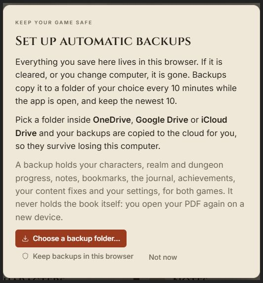
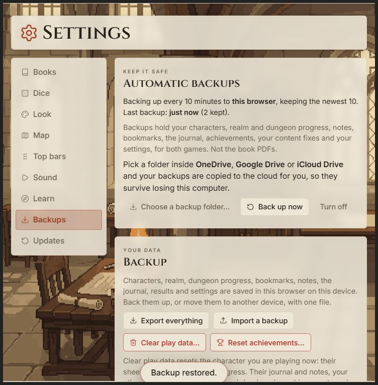
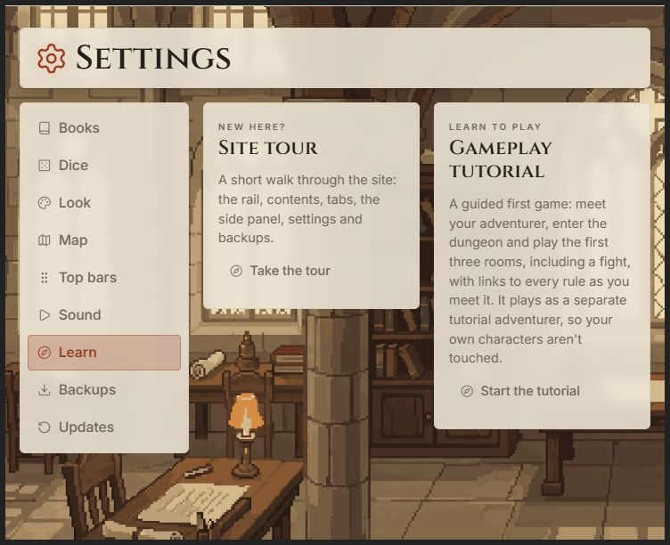

Everything you save in the Companion (characters, progress, notes, the journal) lives in your own browser or desktop app. There is no account and no server holding your game. That is why backups matter. This page covers **Backups**, **Learn** and **Updates** in Settings, and ends with how to move to another device.

## Backups

Choose **Backups** in the Settings side menu. It has two cards: **Automatic backups** and **Backup**.

### What a backup holds

A backup holds your characters, realm and dungeon progress, notes, bookmarks, the journal, achievements, your text fixes and your settings, for both games. It never holds the books: you unlock those again from your PDFs on each device (see [Books and unlocking](settings-books.html)). It also leaves out your own music songs and the choice of backup folder, because those belong to one device.

### Set up automatic backups

The first time you open the Companion, after the site tour, a window called **Set up automatic backups** asks where backups should go. You can also set it up any time from Settings → Backups.

1. Press **Choose a backup folder…**.
2. Pick a folder. The app makes a folder called "2D6 Companion backups" inside it and writes its backup files there.
3. The card now reads "Backing up every 10 minutes to *your folder*, keeping the newest 10. Last backup: just now."

While the app is open it backs up every 10 minutes and keeps the newest 10 files, deleting the oldest. If nothing changed since the last backup, it skips that round, so an idle app never pushes your good copies out. It also tries one last copy when you hide or close the tab. Files are named like `2d6-companion-backup-2026-11-16-143015.json`.

> **Tip:** Pick a folder inside **OneDrive**, **Google Drive** or **iCloud Drive**. Your backups are then copied to the cloud for you, and they survive losing this computer.

Choosing a folder works in Chrome and Edge. Other browsers cannot save to a folder on their own. There you are offered **Keep backups in this browser** instead.

### The Automatic backups card

The buttons change with the state of backups:

- **Choose a backup folder…** (or **Change folder…** when one is set) picks the folder.
- **Keep backups in this browser** keeps the same rolling 10 copies inside the browser instead of a folder. The card shows how many are kept, for example "Last backup: just now (2 kept)". Browser copies are lost if you clear the browser's site data, so a folder is safer.
- **Back up now** makes a backup straight away. The card says "Backed up."
- **Turn off** stops automatic backups. The card then says "Automatic backups are off."
- **Reconnect** appears in a warning if your browser needs your OK to use the folder again after a restart: "The browser needs your OK to use the backup folder again after a restart." Press it and allow access.

If the folder has gone, the card says "The backup folder isn't available any more. Choose it again."

### Export, import and clear

The **Backup** card works on one file that you keep yourself.

<em class="cap">The message at the bottom appears after a backup is restored.</em>

**Export everything**

1. Press **Export everything**.
2. Your browser downloads a file named like `2d6-companion-backup-2026-11-16.json`. It holds both games.
3. Keep the file somewhere safe. If any item is too big to fit, the app tells you which ones were left out.

**Import a backup**

1. Press **Import a backup** and choose a backup file (from Export everything, or from your backup folder).
2. Confirm "Replace this device's characters, realm, progress and settings with the backup?"
3. The app reloads and shows "Backup restored."

Importing replaces what is on this device, so export first if you want to keep the current state. If the file is not a Companion backup, you get "That file isn't a 2D6 Companion backup." and nothing changes.

**Clear play data…**

1. Press **Clear play data…** and confirm.
2. The character you are playing now is reset in the game you have open: their sheet, realm and dungeon progress. The app reloads and shows "Play data cleared."

It keeps their journal and notes, your other characters, bookmarks, achievements and settings. It cannot be undone, so export first if you want a copy.

**Reset achievements…** clears all achievements and their progress on this device, after a confirmation. See [Achievements](achievements.html).

## Learn

Choose **Learn** in the side menu. It has two cards.

### Take the site tour again

The tour is a short walk through the site, not the game. It runs by itself the first time you open the Companion.

1. Press **Take the tour**.
2. Press **Next** to go through the 10 steps: Welcome, the rail, contents and search, tabs, the side panel, your dice, Settings, the two games, backups and the finish. Each step outlines the part of the screen it talks about. Use **Back** to go back a step.
3. The backups step has a **Set up backups** button.
4. Press **Skip tour** at any time, or **Finish** on the last step.

For a look at what each part does, see [The interface](interface.html).

### Start the tutorial

**Start the tutorial** begins a guided first game: you meet a tutorial adventurer, enter the dungeon and play the first three rooms, including a fight, with links to every rule. It uses a separate tutorial character, so your own characters are not touched. In 2D6 Void it is a tutorial survivor, and the button stays off until the Void book is unlocked. See [Getting started](getting-started.html).

## Updates

Choose **Updates**. The card shows which version you have, for example "Version 0.1.0", and how the app is running.

1. Press **Check for updates**. It says "Checking for updates…" and then "You have the newest version." or "Version *x* is available."
2. If an update is available, press the button next to it. What it says depends on how you run the app:
   - **Desktop app (installed):** **Download and install**. A progress bar shows the download. When it is done, press **Restart and install**, or let it install the next time you close the app.
   - **Portable desktop app:** **Download from GitHub**. Download the new file and use it in place of the old one. Your saves stay where they are.
   - **Running from a git clone:** **Update now**. When it says "Updated to version *x*", stop the app and start it again as the message shows.
3. **What's new** opens the release notes on GitHub.

The switch **Check when the app opens** is on by default. The app checks at most once a day and always asks before anything is downloaded. When it finds an update, a window offers **Download and install** or **Later**. Switch it off to only check by hand.

In a plain web browser the card may say "This copy can't check for updates by itself." That is normal there.

## Moving to another device

Use this to move your characters and settings to a new computer, phone or browser. It works between any two copies of the Companion.

1. **On the old device:** open Settings → Backups and press **Export everything**. A `.json` file downloads.
2. **Move the file** to the new device, for example by cloud storage, a USB stick or email to yourself.
3. **On the new device:** open the Companion, then Settings → Backups and press **Import a backup**. Choose the file and confirm. The app reloads with "Backup restored."
4. **Unlock your books again.** The backup holds no book text. Go to Settings → Books and unlock each book from your PDFs. See [Books and unlocking](settings-books.html).
5. **Set up backups again** from Settings → Backups, and re-add any songs you uploaded under Sound. The backup folder and your songs belong to one device, so they are not copied.

If you set up a backup folder in the cloud (OneDrive, Google Drive or iCloud Drive), the files are already available on the new computer. Choose the newest one in step 3.

## Tips

- Automatic backups only run while the app is open. A backup folder in the cloud is the best protection against losing a device.
- Backups are not a way to keep two devices in step. Importing replaces everything on the device you import into.
- Clearing your browser's site data erases your saves and your unlocked books. Export a file first.
