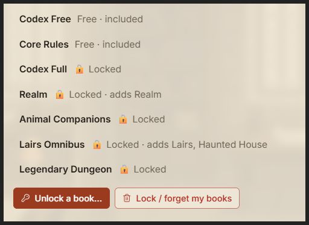
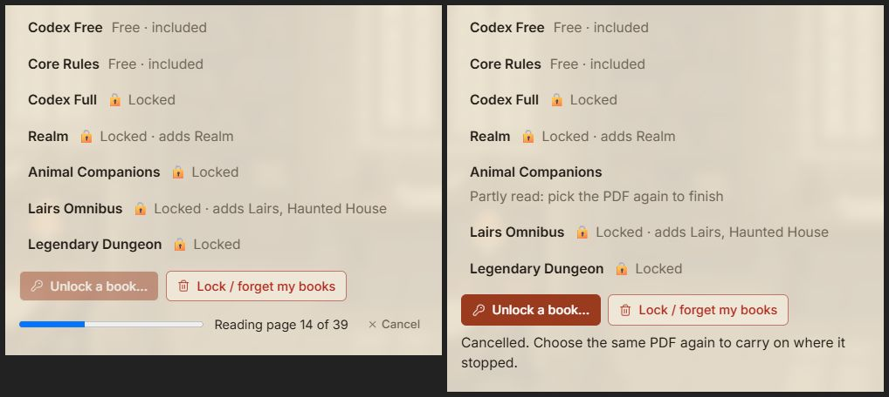
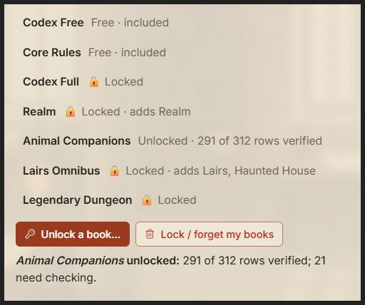
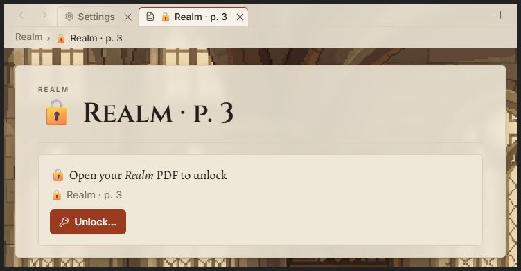
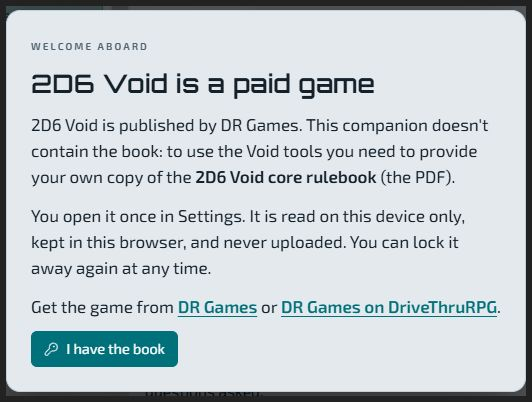
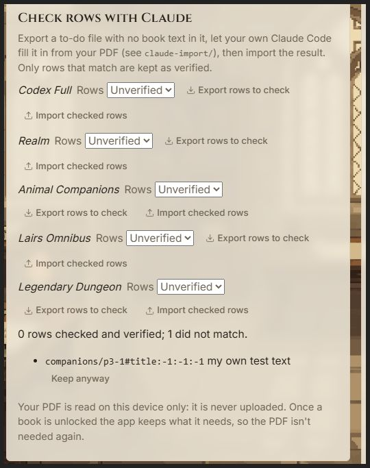

The Companion does not contain the paid books. It reads the PDF you own, on your own device, and keeps the tables it needs. This page covers what is free, which book opens which tool, and how to unlock, check and lock a book. All of it lives in **Settings → Books**.

If you do not own the books yet, you can buy them from the [DR Games shop](https://drgames.co.uk/dr-games-online-shop/). The printed books are the best way to support the game. The PDFs are what the Companion reads.

## What is free and what needs a PDF

| Book | Cost in the Companion | What unlocking it adds |
|---|---|---|
| Core Rules | Free, included | Already in the [Library](library.html) |
| Codex Free | Free, included | The free part of the Tables Codex, already in the Library |
| Codex Full | Needs your PDF | The full Codex: its pages and tables |
| Realm | Needs your PDF | The [Realm](realm.html) tool, plus the book's pages |
| Animal Companions | Needs your PDF | The book's pages and tables |
| Lairs Omnibus | Needs your PDF | The [Lairs](lairs.html) and [Haunted House](haunted-house.html) tools, plus the book's pages |
| Legendary Dungeon | Needs your PDF | The book's pages and tables |
| 2D6 Void (core rulebook) | Needs your PDF | The whole of 2D6 Void: [Start Game](void-start-game.html), [Combat](void-combat.html), [Character sheet](void-sheet.html) and [Hulk map](void-map.html) |
| PAL-BOT and Space Pirates | Needs your PDF | The expansion's pages and tables. Both need the Void core book too |

Once a book is unlocked, its pages and tables turn up in the Library, [Tables](tables.html), [Bestiary](bestiary.html) and [Items](items.html) wherever the book has them.

2D6 Dungeon works without any unlock: Core Rules and Codex Free are always there. Realm, Lairs and Haunted House are hidden from the tool lists until their book is unlocked. If you open one from a link, the app takes you to Settings with the message "Unlock Realm in Settings → Books to use Realm."

## Step by step: unlock a book

1. Open **Settings** (the cog at the top right) and choose **Books** in the side menu.
2. Find your book in the list. A locked book reads "Locked". Realm and Lairs Omnibus also say what they add, for example "Locked · adds Realm".
3. Press **Unlock a book…**.
4. Pick the PDF on your computer or phone. You do not say which book it is: the app recognises it.
5. Watch the progress line under the buttons. It first says "Checking the file", then "Reading page 16 of 39", with a **Cancel** button.
6. When it finishes, a line tells you the result, for example "Animal Companions unlocked: 291 of 312 rows verified; 21 need checking." The book's status in the list changes to "Unlocked".

<em class="cap">Left: reading a book. Right: after Cancel. The book is marked "Partly read" and the PDF can be picked again.</em>

### Good to know while it reads

- **It takes a while.** The app reads every page, and reads the pictures of tables with text recognition. A short book took under a minute on the test computer. A 200-page book took around ten minutes. Keep the tab open until it finishes.
- **You can stop and carry on.** Press **Cancel**, or close the tab, and the pages already read are kept. The book shows "Partly read: pick the PDF again to finish". Press **Unlock a book…** and pick the same PDF, and it carries on from where it stopped.
- **You only do this once per device.** After a book is unlocked the app keeps what it needs, so you do not need the PDF again, even after you close the browser. A different browser, a private window or another device needs its own unlock.
- **Your PDF never leaves your device.** It is read on this device only and is never uploaded.
- **Unlocking can fail.** The app tells you why: "That PDF isn't a supported edition. Nothing was read from it.", "That's the free version of the book. Its tables are already included, so there is nothing to unlock.", "This device is out of storage space for the book." or "The PDF could not be read." If this browser cannot save books (some private modes), the Books card says so and **Unlock a book…** is greyed out.

## Locked placeholders

Where a table, page or tool comes from a book you have not unlocked, the app shows a placeholder instead of the content. It only names the book and the page.

- In the Library contents list, the entry reads "🔒 Realm · p. 3" (book and page).
- Opening it shows "Open your Realm PDF to unlock" and an **Unlock…** button.
- **Unlock…** takes you straight to Settings → Books, with that book highlighted and the line "Open your Realm PDF to unlock" above the buttons. Then follow the steps above.

## 2D6 Void

2D6 Void is a paid game, and its tools need your copy of the **2D6 Void core rulebook** PDF. PAL-BOT and Space Pirates are expansions: they add to the core book but do not replace it.

Until the core book is unlocked on this device:

- Every Void screen except Settings sends you back to Settings, which opens on **Books**.
- The top of the Books card says "2D6 Void needs your core rulebook" and has an **About 2D6 Void** button that shows the introduction again.
- The first time you enter Void without the book, a window titled "2D6 Void is a paid game" appears. **I have the book** only closes it. It does not unlock anything, and it does not come back by itself. Use **About 2D6 Void** to see it again.
- The gameplay tutorial for Void is switched off (Settings → Learn), with a note to unlock the rulebook first.

Unlock the core book exactly as above, with the Void core PDF (it reads about 220 pages, so allow a good ten minutes). When it finishes, the Void book shows "Unlocked" and the Void tools open. The "needs your core rulebook" note may stay on the screen until you reload the page.

## Rows that are not verified

When the app reads a table from your PDF, it checks each cell against a fingerprint of the original. Cells that match are **verified**. Cells that text recognition could not read with certainty stay **unverified**. The result line and the book's status count them: "291 of 312 rows verified".

An unverified cell is shown with a faint highlight and a small picture button. To check it:

1. Click the highlighted cell (or press its small picture button).
2. A box opens below it: "Not verified against the book. Compare it with the page:", with a cut-out of the page image saved on your device, next to the text.
3. Compare, and press **Esc** to close the box.

If the app cannot find where the cell sits on the page, the box says "No picture for this cell" instead.

To correct a wrong cell yourself, open the page in the [Library](library.html) and use **Fix text** at the top of the page. Your corrections are stored on this device and included in [backups](settings-backups.html).

## Check rows with Claude (optional)

If many rows are unverified, your own copy of Claude Code can read them from your PDF for you. Nothing is sent to anyone except what you give your Claude Code yourself.

1. In Settings → Books, unlock the book first. The checking needs the book's key on this device. If it is not unlocked, you get "Unlock this book from its PDF first".
2. Further down the Books card, in **Check rows with Claude**, find your book. Choose **Unverified** (only the cells that could not be checked) or **All** in the "Rows" box.
3. Press **Export rows to check**. A file called `book-todo.json` downloads. The message says it holds no book text. It only lists where each cell is on the page.
4. In the project's `claude-import` folder you will find `README.md`, `PROMPT.md` and `crop.mjs`. Put them in one folder with your PDF and `book-todo.json`, and install the two helper packages the README names.
5. Start Claude Code in that folder and tell it to follow `PROMPT.md`. It reads each cell from your PDF and writes `book-pack.json`.
6. Back in the app, press **Import checked rows** for the same book and choose `book-pack.json`.
7. Read the result line, for example "0 rows checked and verified; 1 did not match." Rows whose text matches become verified. Rows that did not match are listed with the text Claude gave. **Keep anyway** stores a row as it is, still marked unverified.

The pack has to be for the same book and edition, or the app says "That pack is for a different book or edition. Nothing was changed."

## Lock / forget my books

To take the books off this device, press **Lock / forget my books** and confirm. The app warns: "This deletes the unlocked text and page images saved on this device. You can unlock them again from your PDFs." Afterwards it says "Books locked. Their saved text and page images were deleted from this device." and every addon book shows "Locked" again. Core Rules and Codex Free stay.

## Tips

- Unlocking is stored in your browser (or the desktop app), so clearing the browser's site data locks the books too. [Backups](settings-backups.html) never contain book text, so on a new device you unlock again from your PDFs.
- If you move to another device, see [Moving to another device](settings-backups.html).
- Free books never need unlocking, and the free PDF of a book is refused with a note saying so.
