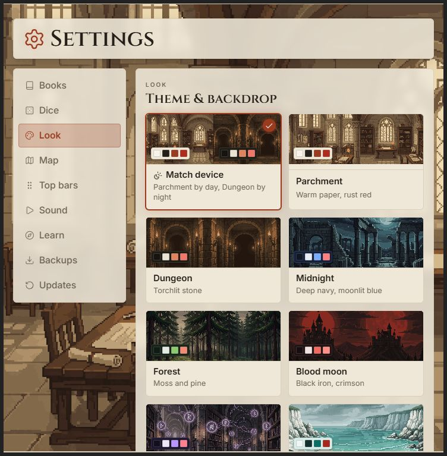
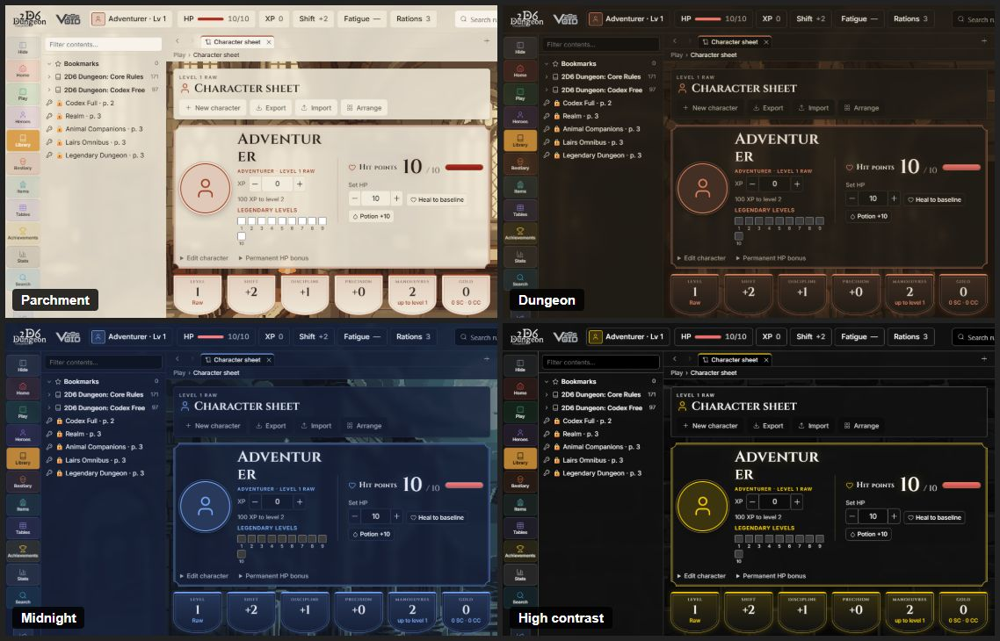
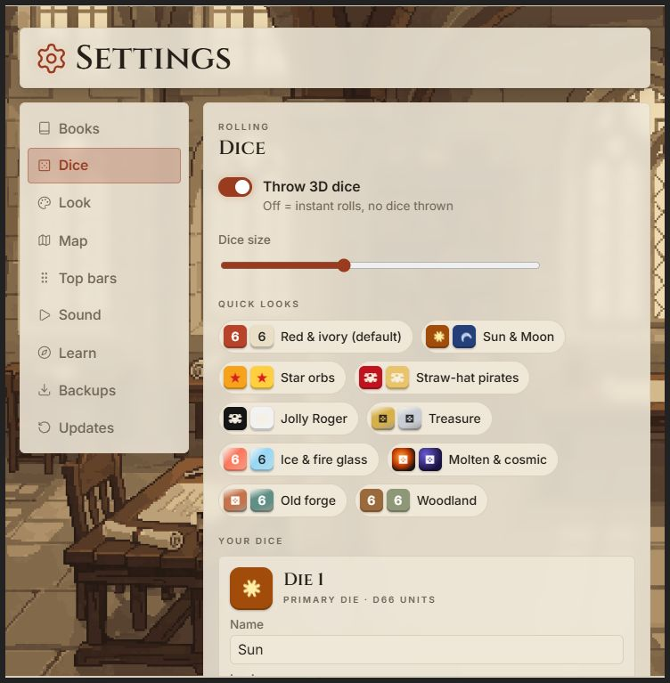
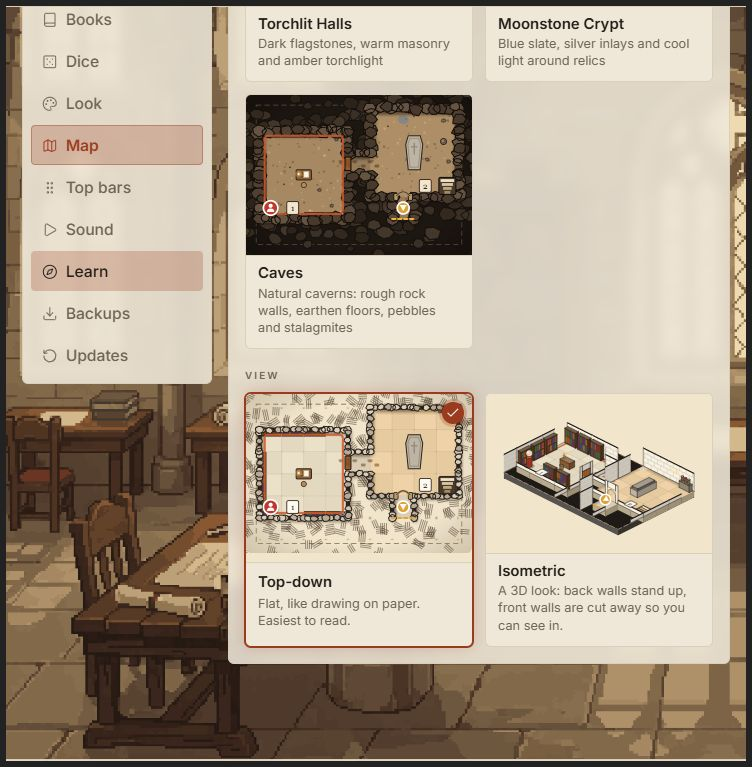
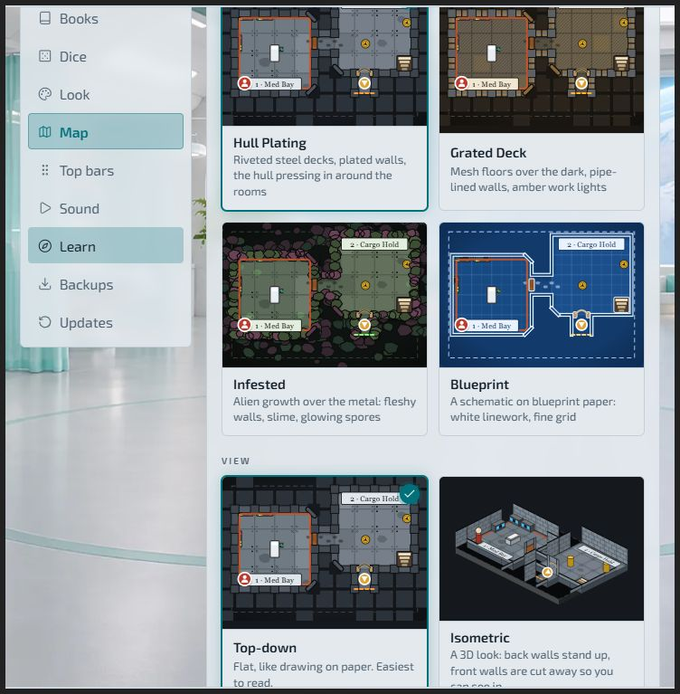
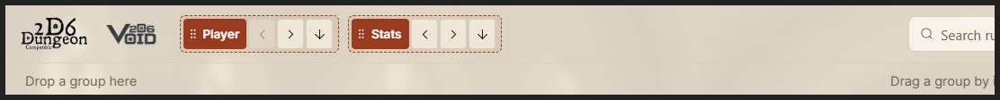
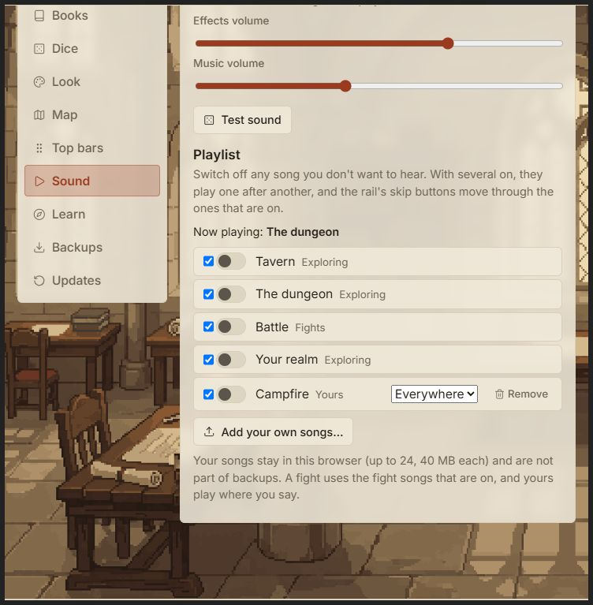

Settings is where you make the Companion look and sound the way you like. Open it with the cog at the top right. A side menu on the left switches between sections. This page covers five of them: **Look**, **Dice**, **Map**, **Top bars** and **Sound**. Books, backups and updates are on [Books and unlocking](settings-books.html) and [Backups, tour and updates](settings-backups.html).

Each game keeps its own theme, text size, fonts, dice and map style, so 2D6 Dungeon and 2D6 Void can look different. The sound switches, the backdrop and transparency switches, and the music playlist are shared by both games.

## Look

Choose **Look** in the side menu. It has three cards: Theme & backdrop, Display and Fonts.

### Colour themes

1. Press a theme tile. It applies at once. A tick marks the one in use.
2. To follow your device instead, pick **Match device** (the first tile). The app then switches between a light and a dark theme when your device does.

Dungeon themes: Parchment, Dungeon, Midnight, Forest, Blood moon, Arcane, Sea glass, Bone and High contrast. Void themes: Deep Space, Hull Steel, Neon, Reactor, Biohazard, Brass, Clean Lab and High contrast. High contrast is black with bright yellow (Dungeon) or bright cyan (Void), for easier reading.

The same screen in four themes:

> **Tip:** The **Theme** button at the bottom of the left rail opens the same list in a small pop-up, so you can change theme without opening Settings.

### Backdrop and transparency

Two switches sit under the tiles:

- **Backdrop image** shows the painted scene behind the panels. Switch it off for a plain gradient in the theme's colours.
- **Reduce transparency** makes the panels solid instead of frosted glass. If your device already asks for reduced transparency, the panels are solid whatever this switch says, and the switch tells you so.

### Text size and fonts

- **Display → Text size** is a slider from 14 to 24 pixels (17 by default). It scales the whole app: book text, tables, panels and buttons.
- **Fonts** has a tile for each font pack: Dungeon, Sci-fi, Classic, Modern, Literary, Humanist, Plex, Atkinson Hyperlegible and OpenDyslexic. The last two are made for easier reading. Press a tile to use it.
- To change just one part, open **Customise** and pick a font for **Headings**, **Book text** or **Interface**. Leave a part on "Follow the pack" to keep the pack's choice. **Back to the pack** drops your changes.

## Dice

Choose **Dice** in the side menu. These settings change how the on-screen dice look and behave. They do not change any odds.

1. **Throw 3D dice** is on by default. Switch it off for instant results with no dice thrown across the screen.
2. **Dice size** is a slider. Drag it to make the thrown dice bigger or smaller.
3. Under **Quick looks**, press a preset to set both dice at once. Dungeon has Red & ivory (default), Sun & Moon, Star orbs, Straw-hat pirates, Jolly Roger, Treasure, Ice & fire glass, Molten & cosmic, Old forge and Woodland. Void has its own, such as Hologram & plasma (default), Plasma core, Neon grid, Circuit board and the Light blade ones.
4. Under **Your dice**, fine-tune each die. Each die card has a **Name** (it is shown in roll results), a **Look**, and a **Colour**.
5. Press **Test 2D6** or **Test D66** to throw the dice and see the result. The line under the buttons reads, for example, "D66: 33 (Gold 3 tens, Red skull 3 units)".

### The three dice

- **Die 1** is the Primary die. It is also the units die in a D66. The books mention the Primary die for things like room width and manoeuvre dice.
- **Die 2** is the Secondary die. Die 1 and Die 2 are thrown together for every D6 and 2D6 roll. They may look the same.
- **Tens die** is only used as the first digit of a D66. If you give it the same look as Die 1, it is thrown in a contrasting colour or partner skin so you can always tell them apart.

The Look list has plain colours you can tint (Classic, Smooth, Glass and so on), and fixed-colour looks such as Gold, Lava, Wood or Pirate skulls. A look you can tint shows a **Colour** row with swatches and a colour picker. A fixed look says "This look has its own fixed colours."

Other buttons: **Swap dice 1 and 2** and **Reset dice** (back to the default dice and size).

> **Tip:** The gear in the floating dice panel opens these settings too.

## Map

Choose **Map**. It sets how the dungeon map (or the Dark Hulk map in Void) is drawn. It is separate from the colour theme. Every choice is shown as a live preview of a sample map.

1. Under **Tile set**, press the style you like. Dungeon has Paper, Dungeon, Torchlit Halls, Moonstone Crypt and Caves. Void has Hull Plating, Grated Deck, Infested and Blueprint.
2. Under **View**, choose **Top-down** (flat, like drawing on paper, easiest to read) or **Isometric** (a 3D look: back walls stand up, front walls are cut away so you can see in).
3. A short message confirms the choice, for example "Map view: Isometric". Open the [Map](map.html) to see it (Void: [Hulk map](void-map.html)).

## Top bars

Choose **Top bars**. At the top of the screen, the character name and the stats (HP, XP, Shift, Fatigue) are two groups, called **Player** and **Stats**. You can put each one on the top bar beside the game logos, or on the bar below it, in any order. If both are on top, the lower bar goes away.

1. Press **Arrange the bars**. Each group shows a grip with its name and some small arrows.
2. Drag a group by its grip, or use the arrows to move it earlier or later, or to the other bar.
3. Press **Done** (or Esc). **Reset** puts the character and stats back where they started.

You need a window at least 900 pixels wide. On narrower screens the bars keep their compact phone layout, and **Arrange the bars** tells you to widen the window.

## Sound

Choose **Sound**.

1. **Sound effects** turns on the dice, blows, doors and locks, and soft clicks.
2. **Music** turns on the quiet music. It changes only for a fight or a deeper level.
3. Drag **Effects volume** and **Music volume** to taste.
4. Press **Test sound** to hear an effect and check your volume.

The rail on the left has three small buttons for music: previous song, pause, and next song. They are greyed out while music is off ("Music is off in Settings").

### The playlist

Below the sliders, the **Playlist** lists every song. A line above it says what is playing ("Now playing: ..." or "Nothing is playing.").

- Each song has a switch. Switch off any song you do not want. With several on, they play one after another, and the rail's skip buttons move through the ones that are on.
- Each built-in song is tagged **Exploring** or **Fights**. A fight uses the fight songs that are on. Dungeon has Tavern, The dungeon, Battle and Your realm. Void has Ship bay, The Dark Hulk, Fight!, The Null Void and The AI Hive.

### Add your own songs

1. Press **Add your own songs…** and pick one or more audio files (MP3, M4A, OGG, WAV, FLAC or Opus). You can pick several at once.
2. Each new song appears in the list tagged **Yours**.
3. Use the box beside it to say where it plays: **Everywhere**, **Exploring** or **Fights**.
4. Use its switch to turn it off, or **Remove** to delete it.

You can keep up to 24 songs of 40 MB each. They stay in this browser (or the desktop app) and are not part of [backups](settings-backups.html), so add them again on a new device. If a file cannot be added, a note under the list says why.

## Tips

- Everything here is remembered between visits, and a [backup](settings-backups.html) carries your look, dice and sound settings (but not your own songs) to another device.
- Not sure what a dice look does? Press **Test 2D6** after you change it. It throws with your current dice.
- Switch **Throw 3D dice** off if you would rather have the result straight away.
