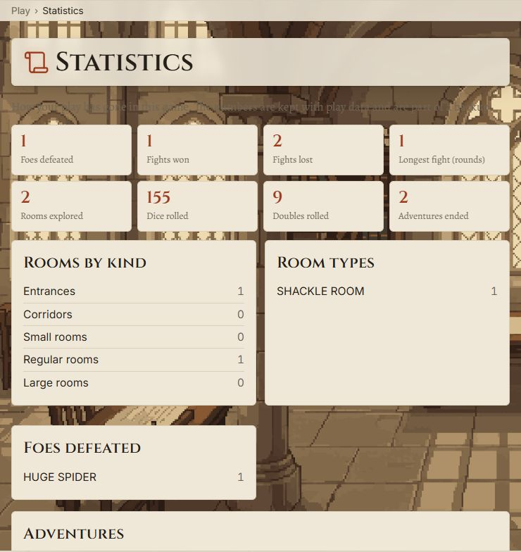
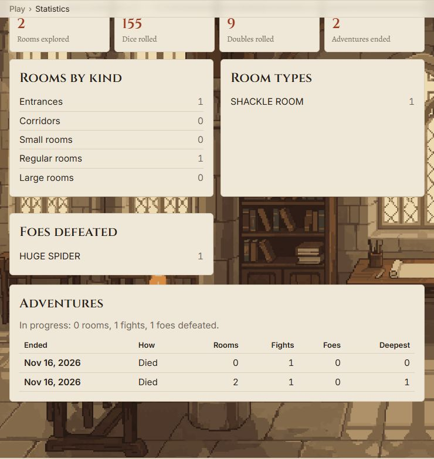

Statistics is a scoreboard for your play: how many foes you have beaten, which rooms you have explored, how the dice have fallen, and how each adventure ended. It is read-only. It counts by itself while you play.

## Step by step

1. Press **Stats** in the left rail.
2. Read the tiles at the top for your totals.
3. Scroll for the lists (Rooms by kind, Room types, Foes defeated) and the **Adventures** table.

## The tiles

| Tile | What it counts |
| --- | --- |
| Foes defeated | Every foe in a fight you won |
| Fights won / Fights lost | Fights that ended in victory or defeat |
| Longest fight (rounds) | The most rounds in a fight you won |
| Rooms explored | Rooms you finished with **Finish room** |
| Dice rolled | Every die rolled, in either way of rolling |
| Doubles rolled | Rolls of two dice that came up the same |
| Adventures ended | How many adventures have ended (see below) |

> **Note:** A room only counts when you press **Finish room**. A room you have rolled but not finished is not counted yet. Dice and doubles count whatever you are rolling for: any roll in the app, from combat to tables. A roll of two dice with matching faces is a double.

## The lists

- **Rooms by kind**: how many entrances, corridors, small, regular and large rooms you have explored.
- **Room types**: the type your book's room table gave each room, counted by name. It stays empty if you never roll on that table.
- **Foes defeated**: each creature by name, most defeated first.

Each list shows its top ten. Until you have something to show, a list says things like "No foes defeated yet."

## Adventures

An adventure is one delve, from your first room or fight until it ends. Statistics treats these as endings:

- a fight you lose (an enemy takes you to 0 HP), or
- a Recovery from Unconsciousness result that says the adventure is over, or
- in 2D6 Void, launching the Escape Pod (shown as "Escaped").

Leaving the Dungeon by an exit shaft does **not** end an adventure, because your progress carries on.

The **Adventures** section shows a line for the one in progress ("In progress: 3 rooms, 2 fights, 4 foes defeated"). Under it is a table with one row for each finished adventure: **Ended** (date), **How** (Died or Escaped), **Rooms**, **Fights**, **Foes** and **Deepest** (the deepest level reached). The latest twenty are kept, newest first.

> **Tip:** If a companion takes the blow that would have killed you, the lost fight's adventure is reopened and the "Adventures ended" tile goes back down by one. That happens when you press the companion's "takes the killing blow" button in Combat. See [Combat](dungeon-combat.html).

## Whose numbers are these?

- **Per game.** 2D6 Dungeon and 2D6 Void each keep their own Statistics. Switch games to see the other set.
- **Lifetime, not per character.** The totals do not reset when you switch or create a character. Every character in a game adds to the same totals.
- The adventure table shows the results one adventure at a time.
- Statistics only count what happens from now on. Rooms and fights from before this page existed are not added.
- They are not editable and have no reset button. They are saved with your other data, are included in a backup, and survive **Clear play data**. See [Backups](settings-backups.html).

## Tips

- Use [Achievements](achievements.html) for goals to chase. Use Statistics for how things are going.
- The Journal has the story of each fight and room. See [Notes and Journal](notes-and-journal.html).
- If you lose a fight, the tiles for fights lost and adventures ended both go up, but foes defeated does not. Foes are only counted on a win.
