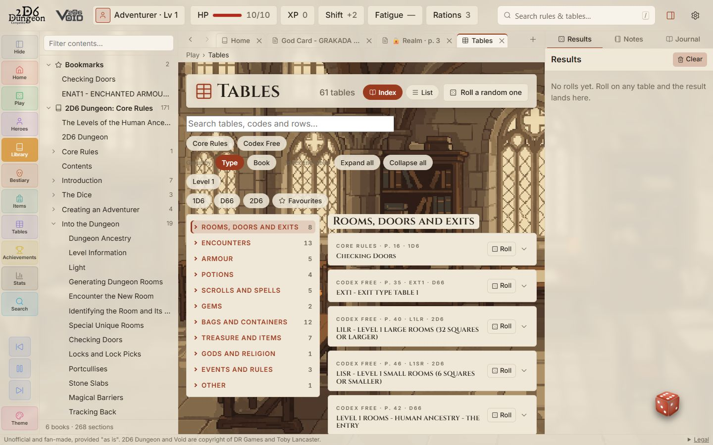
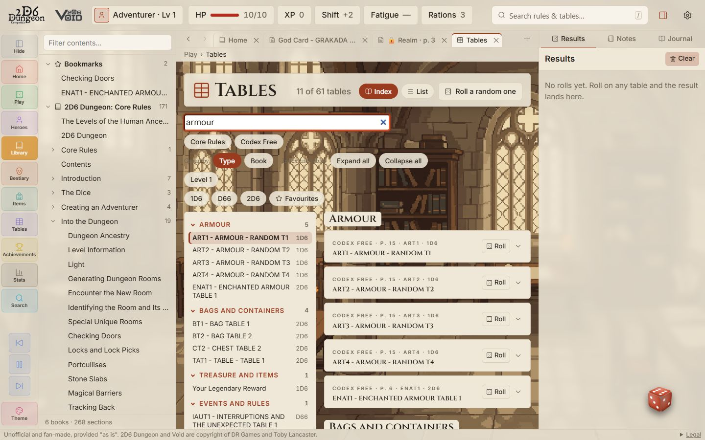
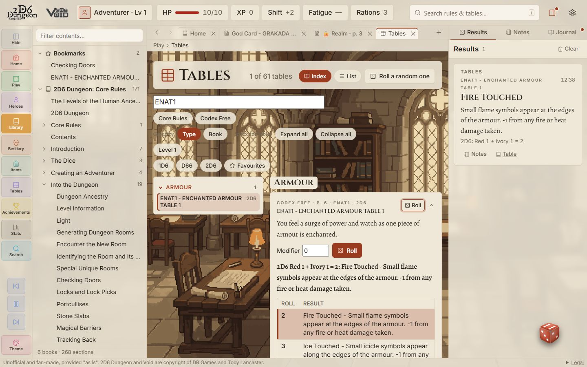
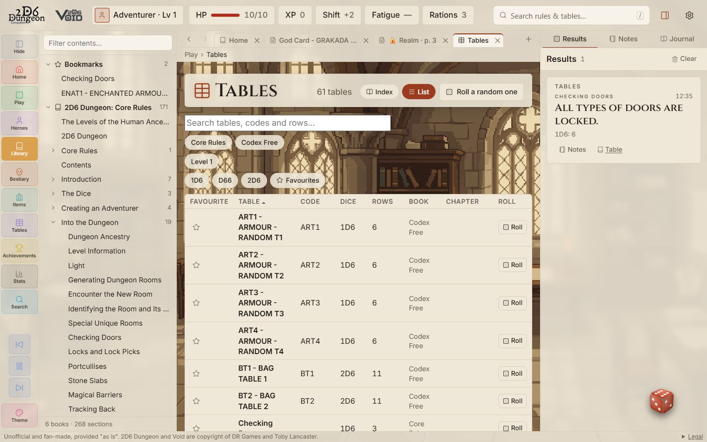
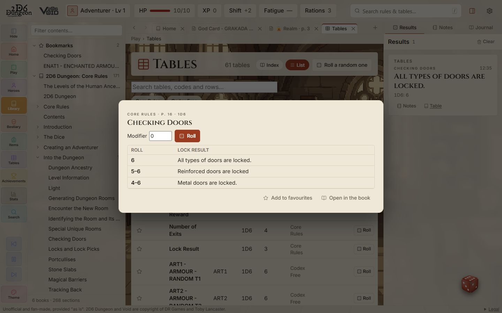

The Tables page gathers every table from the books you have open. Use it when you know what you want to roll but not which book it is in. You can read a table in full, or roll it straight away.

## Before you start

Only tables from open books appear. The Core Rules and Codex Free are open from the start. Others appear once you unlock them in [Books settings](settings-books.html). If nothing is open you will see a message pointing there.

## Step by step

1. Press **Tables** on the left rail.
2. The header shows how many tables you have. The page opens in **Index** view: a list of groups on the left, the tables themselves on the right.
3. Press a group name (for example "Armour") to open it, then a table name to jump to it.
4. Press the arrow on a table to open it and read its rows.
5. Press **Roll** to roll it. The row that came up is highlighted, and the result shows under the table's heading.

## Search

Type in the search box. It looks at table names, codes and the rows inside them. The count at the top changes ("11 of 61 tables"), and every matching group opens.

## Filters

- **Book** buttons: only that book's tables. Press again to clear.
- **Level**: only tables for that dungeon level.
- **1D6, D66, 2D6**: only tables that use that roll.
- **Favourites**: only tables you starred.

Filters combine with the search.

## Group by

In Index view, **Group by** switches the left list between **Type** (rooms, encounters, armour, and so on) and **Book**. **Expand all** and **Collapse all** open or close every group and table.

## Roll one table

1. Open the table, or find it by search.
2. If you need a modifier, type it in **Modifier** (for example 1 or -1).
3. Press **Roll**.
4. The result shows under the table's name, and as a card in the Results panel marked "Tables".

You can also press **Roll** beside a table's name without opening it. The result appears under the name.

> **Note:** The roll uses your dice settings. See [Dice and rolls](dice-and-rolls.html).

## Roll a random one

Press **Roll a random one** at the top. It picks a table from whatever is currently shown (so filters apply), rolls it, and scrolls to it. The button is greyed out when nothing shown can be rolled.

## List view

Press **List** for a sortable table of all tables.

1. Press a column heading to sort by it. Press again to reverse.
2. Press the star at the left to mark a favourite.
3. Press a table name to open it in a window, or press **Roll** to open it and roll at once.

## Favourites and the book

Press **Add to favourites** (or the star) to keep a table handy. Use the **Favourites** filter to see only those. **Open in the book** takes you to the table's section in the library; see [The library and search](library.html).

## Tips

- Your view (Index or List), group choice, sort and favourites are remembered.
- The **Top** button appears after you scroll a way down and jumps back up.
- The Results panel keeps a history of every roll. See [Dice and rolls](dice-and-rolls.html).
