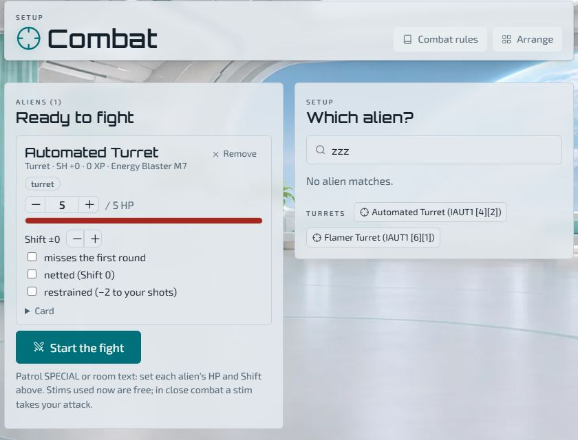
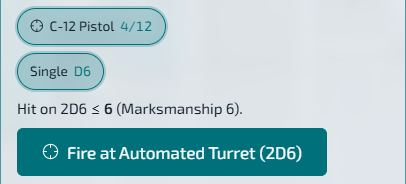
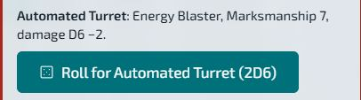
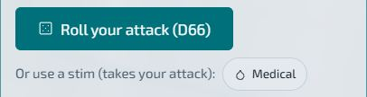
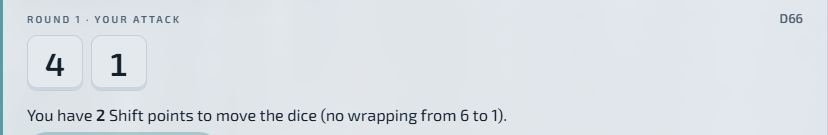
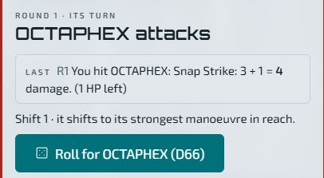
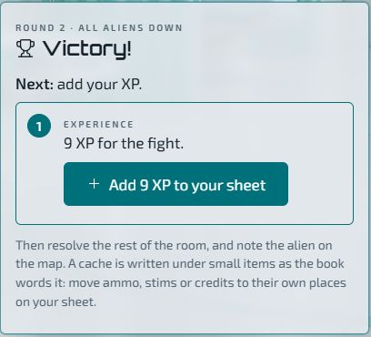
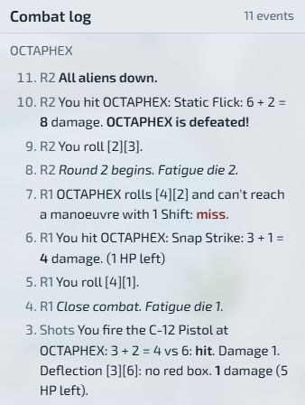

Combat runs a whole fight against one or more aliens, from the first shot to the loot. It does the dice for you, applies your armour and stims, tracks both sides' HP and ammo and keeps a log. You make the choices a player makes: which alien, which weapon, which manoeuvre.

2D6 Void is a paid game and the alien cards come from your own copy of the book, so this page explains the tool and does not repeat what is on the cards. See [Settings: Books](settings-books.html) if you have not unlocked Void yet.

## Before you start

- **Make a survivor** on the [Character sheet](void-sheet.html). Combat uses its HP, manoeuvres, armour, guns and stims. Without one, the setup page shows "Create your survivor on the Character sheet first" and **Start the fight** stays disabled.
- **Open your Void book** so the alien cards are available. Without them the list says "No alien cards yet", though you can still add a turret.
- Fights that come from a room in [Start Game](void-start-game.html) arrive ready-made: press **⚔ Fight …** there, and Combat opens in a new tab.

## Step by step

1. Open **Play** in the left rail and choose **Combat**.
2. Pick the alien (see [Setting up a fight](#setting-up-a-fight)).
3. Tick the room's conditions if any apply, then press **Start the fight**.
4. Throw something first if you want (**Before the fight**), then press **Go to the ranged phase**.
5. In the ranged phase, fire when it is your turn and press **Roll for …** when it is the alien's.
6. In close combat, press **Roll your attack (D66)**, pick a manoeuvre, then press **Roll for …** for each alien's attack.
7. When every alien is down, add the XP and the loot to your sheet, then **Continue playing**.

## Setting up a fight

<em class="cap">Setup, with an Automated Turret added from the presets. The search box is showing no matches, which is why the alien list is empty.</em>

**Which alien?** Type in the search box to find an alien card by name, or type a level such as `L3` to list that level's aliens. Click one to add it. Add as many as the room has: they all fight together. Under the search box are two **Turrets** presets, for fights against an automated turret.

If a room in Start Game sent you here, a card says **A fight is waiting** with the alien's name. **Add to the fight** moves it into the list; **Dismiss** drops it.

**Ready to fight.** Every alien you add gets a card where you can:

- change its HP with the **−** and **+** buttons (useful when a room or patrol gives it extra);
- change its **Shift** the same way;
- tick **misses the first round**, **netted (Shift 0)** or **restrained (−2 to your shots)** when something in the room has done that to it;
- open **Card** to read its card text;
- **Remove** it.

An alien your armour completely cancels shows a **Too powerful** note with an **It dies** button.

**The room.** Below are checkboxes for the fight's conditions: **The room touches the outer hull** (no ranged fire, except weapons marked with *), **Reinforced room ***, **You are surprised**, **It attacks first**, **Stealth Shield**, and two optional rules, **Outnumbered** (each extra alien +1 Shift) and **Armour Checks**. Tick what applies before you start. They change how the fight runs: for instance, if you are surprised, there is no ranged phase.

Press **Start the fight**.

## Before the fight: a thrown weapon

If you carry a throwing weapon, you get one throw before the shooting starts. It does not use your shot or your attack. The card offers **Metal Pipe**, **Spiked Metal Pipe**, **Mag Grenade**, **Oil Bomb** and **Diffusion Grenade**, a **Damage modifier** stepper, and **Throw at … (D66)**. Press **Go to the ranged phase** when you are done (or if you do not want to throw).

## The ranged phase

The tool looks at your Marksmanship and the best Marksmanship among the armed aliens, works out who shoots and in what order, and says which "case" you are in. Turns come up in that order, so you do not have to remember it. A turret fight is a simple exchange of shots until one of you is down. **Retreat** gives the turret one last shot and ends the fight, with the room out of bounds.

### Your shot

1. Pick the gun with the weapon chip (for example **C-12 Pistol 12/12**; the numbers are loaded and capacity) and its setting chip (for example **Single**, or **Burst** for guns that have one).
2. The card tells you what you need: "Hit on 2D6 ≤ N", built from your Marksmanship, the gun's setting and any modifiers from stims or a restrained alien.
3. Press **Fire at … (2D6)**. The tool rolls the shot. If it hits, it rolls the damage, then the alien's **Deflection** roll against the red-boxed numbers on its card, and takes the result off its HP.
4. If the gun is empty or not allowed (the hull, for example), the card says why, and **Skip the shot** or **Charge without firing** is offered. **Reload (n spare)** appears when you have spare rounds.
5. In a shootout where you may close in, **Shoot and charge** fires and then goes to close combat; **Charge without firing** goes straight in.

### Its shot

Press **Roll for … (2D6)**. The tool rolls the alien's shot against its Marksmanship, then your own **Deflection** roll: only the yellow dice on your armour count against shots. Whatever gets through comes off your HP. With several armed aliens, each one fires in turn.

The **Combat log** records every roll, hit, miss and Deflection (see [The log](#the-log)).

## Close combat

Once the shooting is over, close combat begins and the **Fatigue die** starts: it climbs each round and adds to Shift.

### Your attack

1. Press **Roll your attack (D66)**. The two dice show.
2. The tool lists the manoeuvres on your sheet that are within reach. Exact matches are marked **exact**; the rest show how much **shift** they need. You have a number of Shift points to move the dice, and cannot wrap round from 6 to 1.
3. Click a manoeuvre to perform it. The tool rolls the manoeuvre's damage (adding your Shift on an exact match), subtracts the alien's interrupt if its dice match, and reduces its HP.
4. If nothing is in reach, it is a miss. **Don't hit** lets you pass if you choose not to take a manoeuvre.

<em class="cap">The two dice and what you can do with your Shift. The manoeuvre list under them is cropped out: it comes from your own sheet.</em>

Special rolls are handled: a double 1 is an automatic miss, and a double 6 is a Prime Attack where you can pick any manoeuvre.

Instead of attacking you can use a stim from the row under the button (for example **Medical**). It takes your attack for the round.

### The alien's attack

Press **Roll for … (D66)**. The alien shifts to its strongest manoeuvre it can reach, and your armour then deflects it if its dice match, by position. The tool applies the result to your HP and shows it in **Last** at the top of the card.

If you have several aliens, **Target** on an alien's card chooses which one your next attack goes to.

## Ending a fight

When the last alien is down, the **Victory!** card walks you through what is left.

1. **Add N XP to your sheet.** Aliens killed only by shots or throws give no XP.
2. Each alien's cache is a step with a button that rolls its table and writes the result under small items on your sheet.
3. Press **Continue playing** to go back to the Start Game tab, or **Stay on Combat**.

If you go down, the **You've fallen** card has an **RFUT1 (recovery)** button.

**End fight** (top right) stops a fight early, and **New fight** appears after a fight is over to start again. Your gun's ammo and HP stay on your sheet.

## The log

Press **Combat log (N)** under the fight to open the log in the right-hand panel. Every roll is there, newest first, with the round and what happened.

## Tips

- You can change your own HP in the **You** card during a fight (**−** and **+**), for example for a hazard in the room.
- Stims used in setup are free. In close combat a stim takes your attack.
- After a fight, the tool ends the effects that last only for a fight.
- Rules that are interpreted from the book have a small book icon and a short note, so you can see where the tool made a call.

## Common questions

**There is no alien card for the one I want.** Open the book that has it in [Settings: Books](settings-books.html), or add a similar alien and change its HP and Shift by hand.

**Start the fight is greyed out.** You need a survivor first.

**The fire button is greyed out.** The gun is empty, or the room does not allow ranged fire. The card above the button says which.
