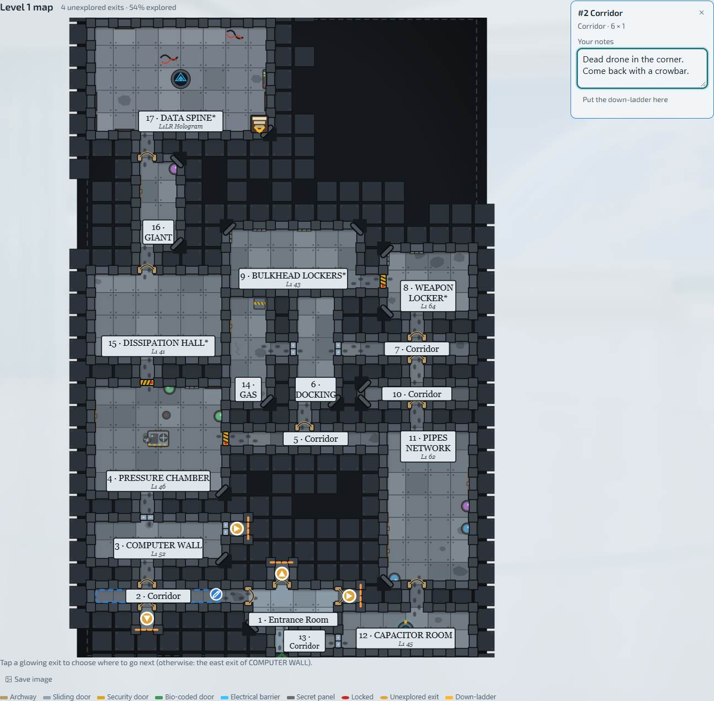
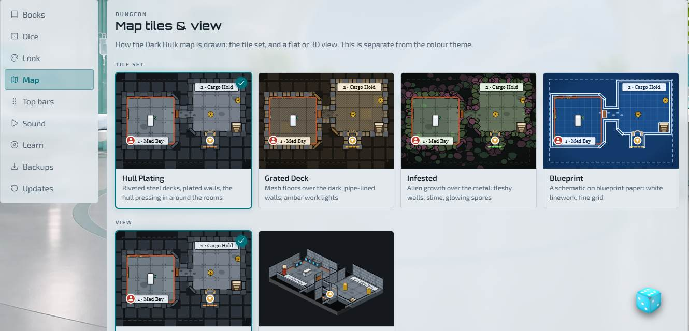
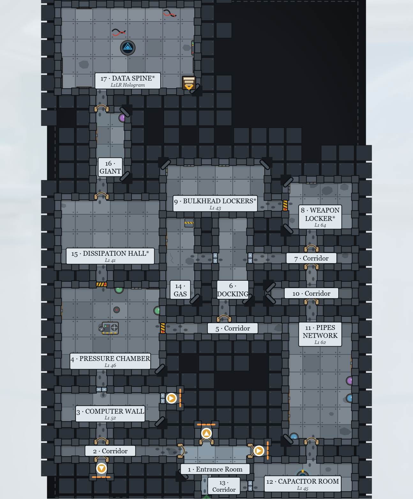
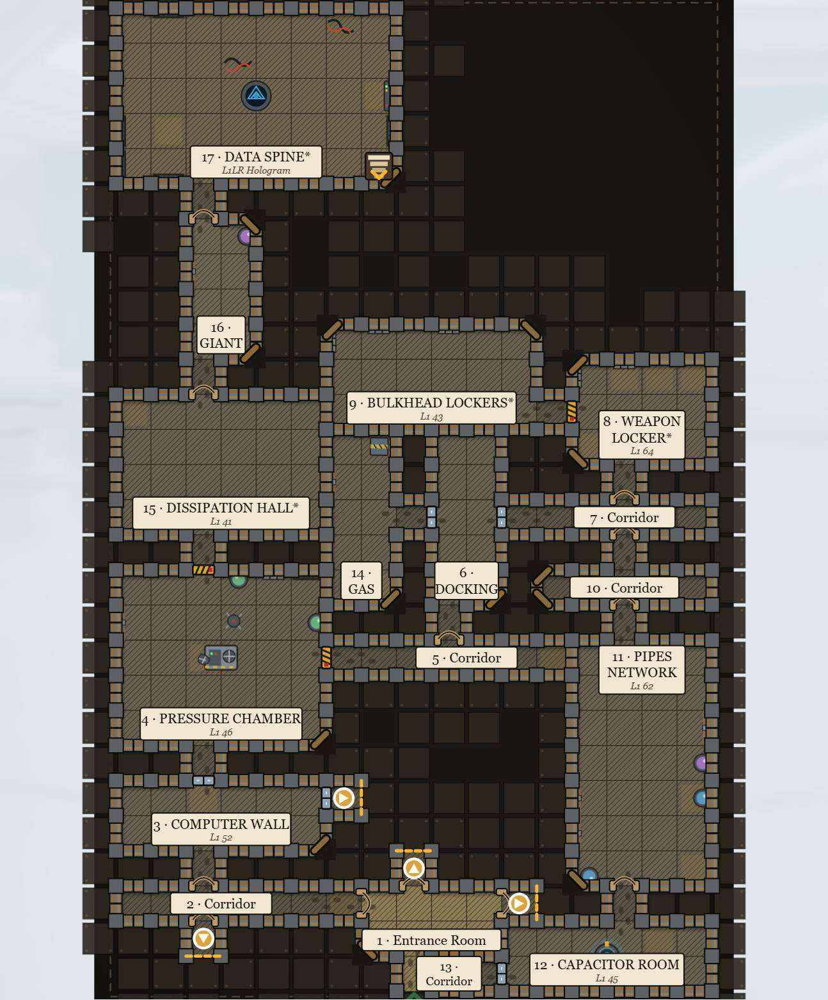
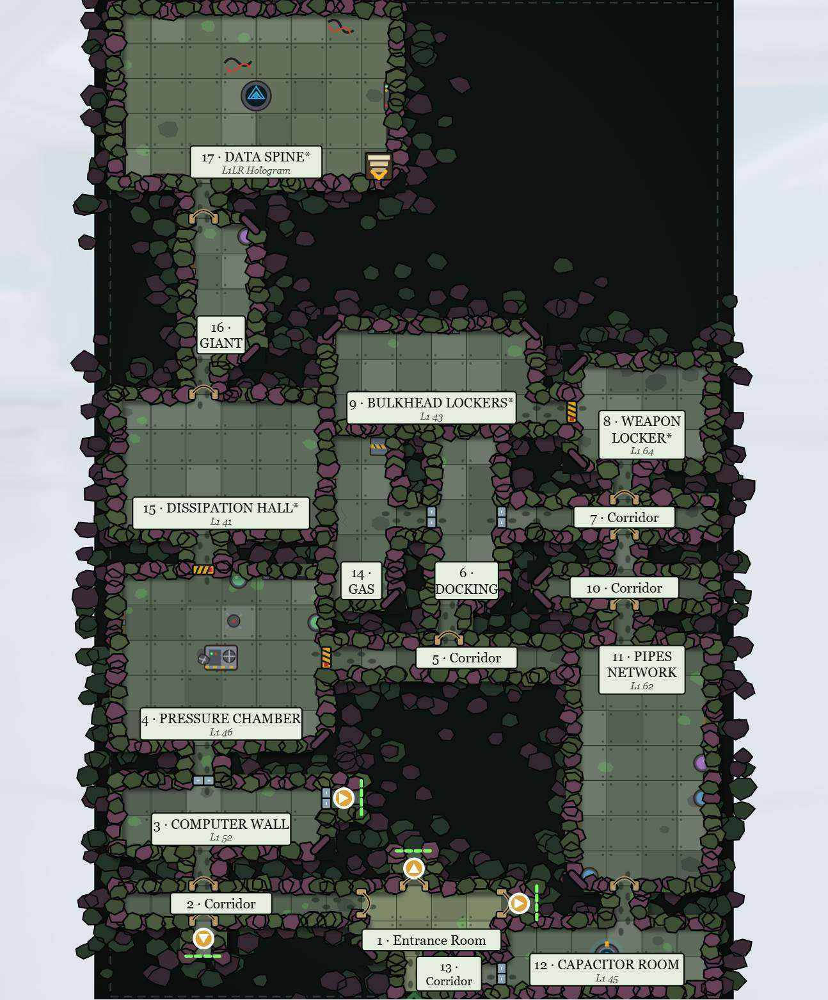
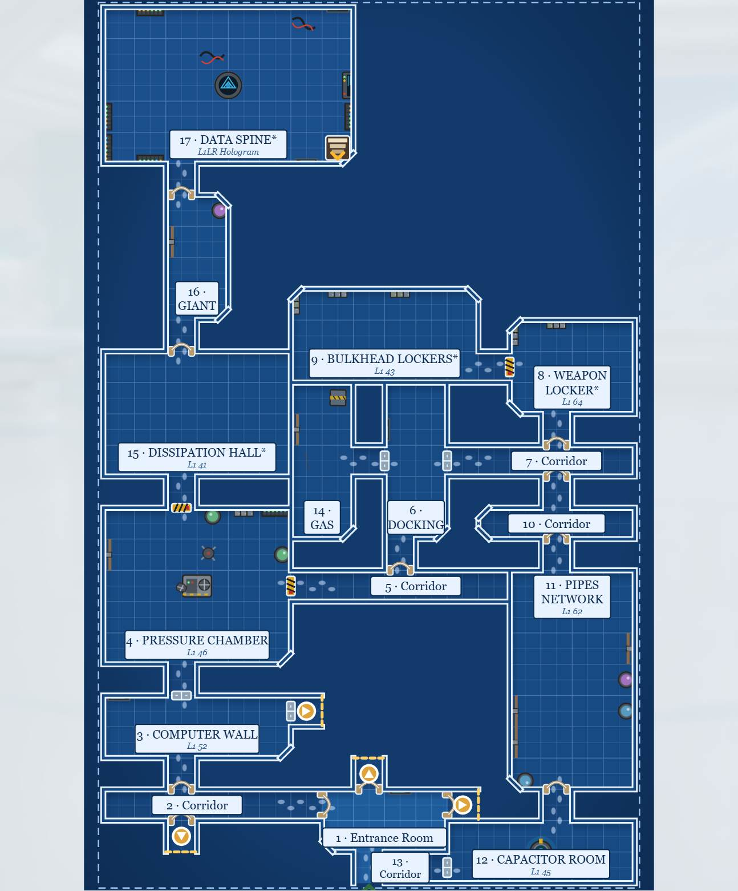
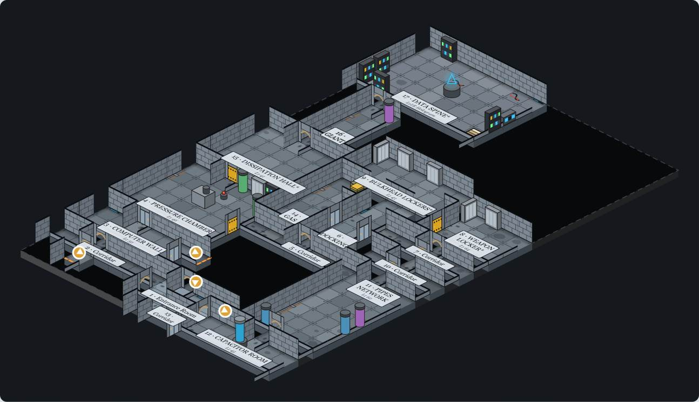

The Hulk map is the level you are exploring, drawn full size. You never draw it yourself: [Start Game](void-start-game.html) adds each room and exit as you roll them, and this page shows the result. Use it to see where you have been, pick which exit to try next, and jot notes on rooms.

Open **Play** in the left rail and choose **Hulk map**, or press **Map page** under the small map on the Start Game tab. You need 2D6 Void unlocked first: see [Start Game](void-start-game.html) and [Settings: Books](settings-books.html).

## Before you start

Begin a level in [Start Game](void-start-game.html). Until you press **Enter level**, this page only shows "No rooms yet: begin in Start Game" with an **Open Start Game** button.

## What you see

<em class="cap">A level 1 map about half explored. Room #2, a corridor, is selected and has a note typed in.</em>

- **Level N map**, with a count of **unexplored exits** and the **% explored**. The percentage is drawn floor out of the whole hull grid, so it is the same number Start Game uses to decide when a down-ladder is allowed.
- Every room carries its number, in the order you entered them, and its name. The small italic line under a name is the table roll that produced the room.
- Exits are drawn on the room walls and coloured by type. The legend under the map names them: **Archway**, **Sliding door**, **Security door**, **Bio-coded door**, **Electrical barrier**, **Secret panel**, **Locked**, **Unexplored exit**, **Down-ladder**.
- A glowing arrow is an exit you have not gone through yet. A red mark means you checked the lock and it is locked.
- The room you are still working on in Start Game is outlined until you press **Finish room**.

## Step by step

### Choose the next exit

1. Look for a glowing arrow on the map.
2. Click it. It highlights, and the line under the map tells you which exit is chosen.
3. Go back to [Start Game](void-start-game.html). The same exit is now the one in "Next room through". Picking an exit there picks it here too.

If you pick nothing, the app uses the first open exit it finds and says which one in the hint under the map. Click a chosen exit again to unpick it.

### Keep notes on a room

1. Click a room (not an exit arrow). A card opens with its number, name, type and size.
2. If your Void book is loaded, the card also shows that room's row from its table.
3. Type in **Your notes**: loot left behind, a locked locker, a body by the door. Notes save as you type.
4. Click the **x** on the card to close it, or click the room again.

On rooms that are finished, the card also has **Put the down-ladder here** (or **Remove the down-ladder** if it is already there). That is the same switch as the button in Start Game, handy when you want to move it.

> **Note:** The room card shows the rules row for that room from your own copy of the book. The wiki does not show book text, so the picture above is of a corridor, which has none.

### Save the map as a picture

Press **Save image**. Your browser downloads a PNG named `dark-hulk-level-N-map.png`. Good for pasting into a session log.

### Keep it open beside the game

On the Start Game tab, the **Map page** button opens this map in its own tab. Put it in a second pane or on a second screen if you like. Both views read the same saved level, so a room added in one shows up in the other straight away.

## Map styles

Settings has two choices for how the Hulk is drawn: the **tile set** (the look of the floors and walls) and the **view** (flat or 3D). They are separate from the colour theme and apply to every level.

To change them: open **Settings**, choose the **Map** tab, then click a tile set card and a view card. A small preview of two sample rooms is on every card, and a tick marks the one in use. Your choice is remembered on this device.

### Hull Plating (the default)

Riveted steel decks and plated walls, the hull pressing in around the rooms.

### Grated Deck

Mesh floors over the dark, pipe-lined walls, with amber work lights.

### Infested

Alien growth over the metal: fleshy walls, slime and glowing spores.

### Blueprint

A schematic on blueprint paper: white linework and a fine grid. The easiest one to print.

### Top-down or Isometric

- **Top-down** is flat, like drawing on paper. It is the easiest to read.
- **Isometric** is a 3D look: back walls stand up and front walls are cut away so you can see in. Furniture and room dressing are drawn in 3D, too.

<em class="cap">Isometric view with Hull Plating. Any tile set works with either view.</em>

## Tips

- The map is only as detailed as your rolls: corridors and small rooms are plain, while rooms the book names get furniture that matches.
- If a roll puts a room where it will not fit, the map draws what does fit and the exit is marked blocked. Pick another exit.
- The map belongs to the level, not the survivor. Descending to the next level starts a fresh map. The old one is gone unless you saved it with **Save image**.
- Changing the **Level** drop-down in Start Game, or choosing **Restart this level**, also starts a fresh map (the app asks first).
- On the Start Game tab, the **Swap the map and steps** button puts the map on the other side of the screen.
