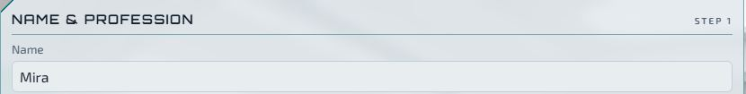
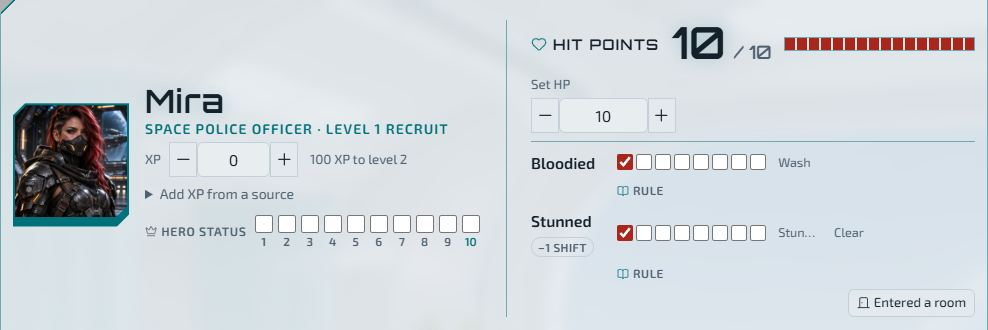
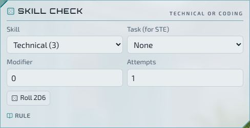
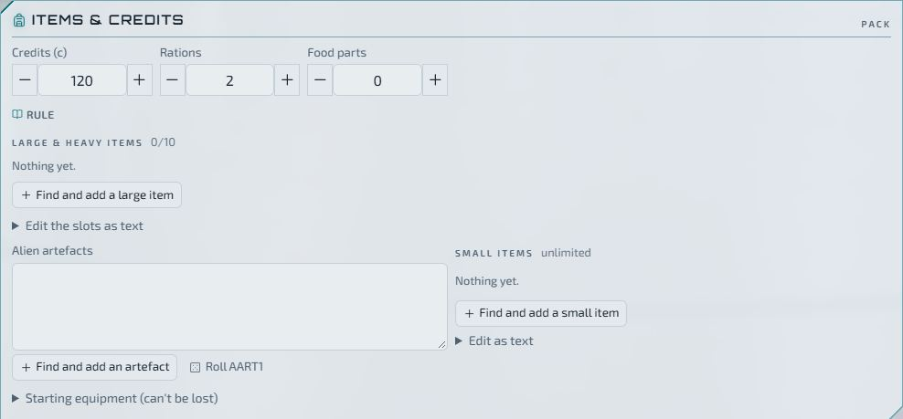
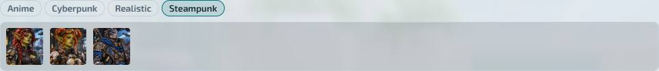
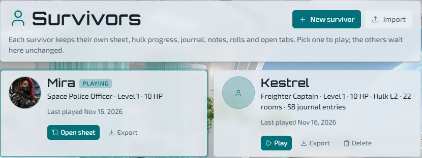

The Character sheet is your survivor on one screen: who they are, how hurt they are, what they carry and what they can do. [Start Game](void-start-game.html) and [Combat](void-combat.html) both read it and write to it, so HP, rations, ammo, stims and XP stay in step without you retyping them. Everything saves on this device as you type.

2D6 Void is a paid game. The sheet works with the names and numbers of your own copy of the book, and this page describes the tool, not the book. Unlock Void first: see [Settings: Books](settings-books.html).

## Before you start

You need Void unlocked on this device. The first time you open the sheet you are in **Character creation**, which is the next section.

## Creating a survivor

The first time (or any time you press **New survivor**), the sheet shows four steps on one page.

1. **Name & profession.** Type a name. Choose one of the three professions with the radio buttons. Each shows its special skill and how far it goes (the title of its top level and its top HP), taken from your book.
2. **Melee weapon & manoeuvres.** Pick your weapon (it is fixed for the whole adventure), then tick **two** level 1 manoeuvres. The counter reads "0/2 chosen"; once you have picked two, the others are greyed out.
3. **Starting armour.** Pick one of the starting pieces. They all have a yellow die, which also blocks ranged attacks.
4. **Starting equipment.** Shows what every survivor starts with. Press **Create survivor**. The button stays disabled until you have picked two manoeuvres.

A message confirms "Mira is ready: Space Police Officer, level 1", and the sheet opens. The very first time, the app also offers a guided first game: **Start the tutorial** walks you through making a survivor and entering the Dark Hulk with a separate tutorial survivor, or press **Not now**.

> **Note:** All survivors start with the same basic scores, set by the book. They grow as you level up and complete tasks.

## The sheet at a glance

The top bar shows your survivor all the time, whichever tab you are on:

Click a chip to change that number in a small pop-up (HP, XP, rations, and so on). Bloodied and Stunned only show while they are above zero.

### The band: name, XP, HP, Bloodied and Stunned

- **XP** has **−** and **+** buttons (10 at a time), and the line next to it says how much more you need for the next level. Press **Add XP from a source** to see buttons for the usual ways of earning it: they add the right amount for your current level in one click.
- **Hero status** is a row of ten boxes, one for each Dark Hulk level you have finished. Going down a ladder in Start Game ticks it for you, and escaping from Level 10 ticks the last.
- **Hit points** shows HP out of your baseline, a red bar and **Set HP** with **−** and **+**. At 0 HP an **Unconscious** notice appears, with a **Roll RFUT1** button for what happens next.
- **Bloodied** and **Stunned** are two rows of eight boxes. Tick or untick boxes by clicking them.
  - **Wash** clears Bloodied.
  - **Stun…** asks "Stunned for how many rooms?" and ticks that many. **Clear** removes it. While Stunned, a **−1 Shift** tag shows.
  - **Entered a room** ticks one Bloodied box, unticks one Stunned box and ends room-long effects, and tells you what changed. [Start Game](void-start-game.html) does this for you every time you roll a room, so use the button only when you are playing from the book.

### The stat tiles

The tiles show your **Level** and title, **Shift**, **Technical**, **Coding**, **Marksmanship** and **Manoeuvres** (slots and the highest manoeuvre level you can use). They are worked out from your level, your profession and any permanent bonuses you have added. Under them, **How these are worked out, and permanent bonuses** has boxes for bonuses from items and enhancements (for Technical, Coding, Shift and HP baseline).

## Levelling up

Raise **XP** with the **+** button, by typing, or from a combat or a side quest. When it reaches the next threshold the sheet levels you up on its own and tells you what changed, for example "Level up! Guardian (level 2): +12 HP (baseline 22). You may swap one manoeuvre."

The tool then does three things:

1. Your title changes and your HP baseline rises. The gain in HP is added to your current HP.
2. The **Manoeuvres** tile may show more slots or a higher maximum manoeuvre level.
3. You may swap one manoeuvre. Under **Melee**, **×** forgets a manoeuvre, and **<weapon> manoeuvres you can learn** lists the ones you may now add.

Taking a manoeuvre that shares a dice set with one you already know is blocked, with a message, so forget the old one first.

## The cards

Under the band are the cards you use most. They are always on screen.

### Melee

Your weapon's name, the manoeuvres you know with their dice and damage, and the list of ones you can learn. **Melee damage bonus** is for permanent bonuses that add to all manoeuvres.

### Ranged

Each gun you carry has its own block: the type, ammo (**−**/**+** and a typed field), **Spare rounds**, **Weapon spares** and a **Reload** button. **Find and add a weapon** opens a list from your book. You may carry 3: two small and one large. The row of boxes under **Ranged hits** counts how many different enemies you have hit; press **Hit a new enemy** to tick one. When the last box is ticked, the bar clears, your Marksmanship goes up (to a maximum of 10) and you earn XP, and the sheet tells you.

### Armour

Each piece you wear shows its dice and its modifier. Up to three pieces, one per body part. Click a yellow die to toggle whether it also blocks ranged attacks. **Find and add armour** opens the armour list, the backpack button takes a piece off (into your large items) and the bin discards it.

### Stims & gases

Your injectors (up to 5) are listed with **Use**. **Find and add a stim** opens the list; **Roll STIT1** rolls the stim table; an empty injector has a **Make…** drop-down and a **Fill** button, for a stim you make at a Stim Dock. The six gas cartridges have a counter each, and **Roll GACT1** rolls for them. **Active effects** lists what is in play now, with **Combat over** to end the effects that only last a fight.

### Skill check

Pick **Technical** or **Coding**, optionally a **Task** (for the Specific Task Experience row), a **Modifier** and how many **Attempts**, then press **Roll 2D6**. The result goes to the Results panel. A pass on a task ticks its row.

### Task experience

The six Specific Task Experience rows each have four boxes. Tick one per successful task. The fourth tick gives +1 to the matching skill (to a cap of 10) and clears the row.

## Items, Story and Rest

The panel at the bottom has three tabs.

- **Items.** **Credits (c)**, **Rations** and **Food parts** have counters. **Large & heavy items** shows how many of your 10 slots are used (armour you take off lands here). **Find and add a large item**, **Find and add a small item** and **Find and add an artefact** open pickers from your book, or type your own into **Edit as text**. **Roll AART1** rolls the artefact table. Small items are not limited.
- **Story.** Access codes, side quests (**Find and add a quest**, then **Done** for XP), the enhancements list (up to six) and a notes box.
- **Rest.** A **Camo Tent used this level** counter and the buttons **Camo Tent rest**, **Eat a ration**, **Eat two food parts**, **Don't eat**, **Rest**, **Rest with cloth** and **Start next Hulk level**, for when you play from the book. If you use Start Game, it does these for you at the ladder. This tab also lists your profession's crafts with a **Craft** button for each.

## Portraits

Every survivor has a portrait. Click it, or open **Edit survivor** and press **Choose a portrait**. Four art styles are tabs at the top of the gallery: **Anime**, **Cyberpunk**, **Realistic** and **Steampunk**. Click a picture to use it.

**Upload picture** lets you use your own image (it is shrunk and kept on this device only). **Remove picture** goes back to the initial letter. **Edit survivor** also lets you change the name, profession and melee weapon.

## Survivors: more than one

Each survivor keeps their own sheet, Dark Hulk progress, journal, notes, rolls and open tabs. The **Survivors** page lists them all. Open it with the **Crew** button in the left rail.

1. Press **New survivor** (here or on the sheet) to make another. You are taken to the creation steps.
2. To switch, press **Play** on the one you want. The app opens that survivor's sheet; everything they had open comes with them.
3. The survivor you are playing shows a **Playing** badge and an **Open sheet** button instead.
4. **Export** downloads a survivor as a file, to back up or move them to another device, and **Import** reads one back in. **Delete** is only offered for survivors who are not the one playing.

The sheet's own header has **New survivor**, **Export**, **Import** and **Arrange** too. **Arrange** turns on a mode where you can move and resize the sheet's cards; press it again to finish.

## Tips

- Combat and Start Game change the sheet for you: HP, ammo, stims, Bloodied and Stunned, rations, XP. Your top-bar chips update live.
- If you want to run a room or a fight by hand, you can: every counter is editable.
- **Export** is the safe way to back a survivor up before you clear your browser's data.
- The small book icon next to **Rule** lines opens the book's own note for that area (when your book is open).
