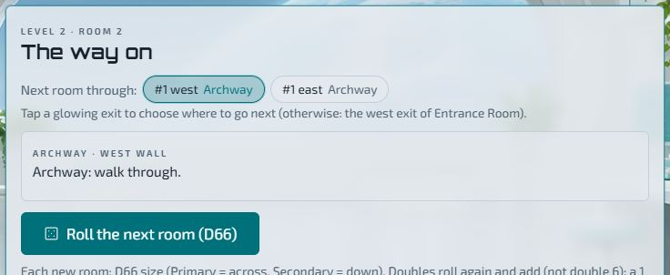
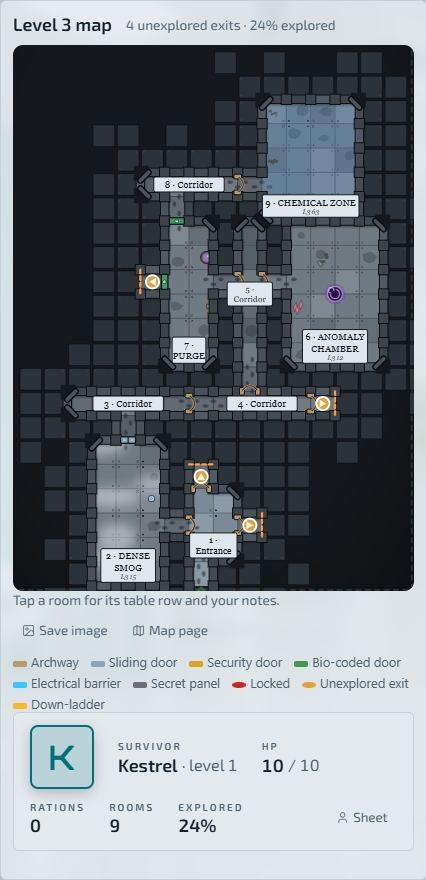
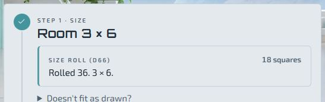
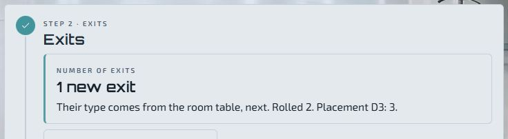
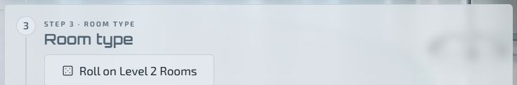
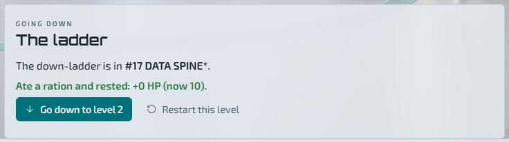
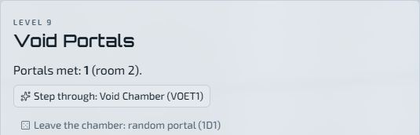

Start Game is the heart of 2D6 Void in the app. It runs the Dark Hulk exploration for you, one room at a time: it rolls the room's size and places it on a hull-sized grid, then asks you for the rolls the book calls for (room type, exits, encounter), draws everything on the map and keeps your survivor's counters moving. You do the playing; the tool does the bookkeeping.

2D6 Void is a paid game, and the app has none of its content until you unlock it from your own copy. This page explains what the buttons do, not what the book says. Where it says "the book", it means your own copy of the 2D6 Void rulebook.

## Before you start

**Unlock Void.** While Void is selected, every screen except Settings sends you back to **Settings** until the core rulebook PDF is opened on this device. Open **Settings**, choose the **Books** tab, press **Unlock a book…** and pick your 2D6 Void PDF. The step-by-step is on [Settings: Books](settings-books.html). Your PDF is read in your browser and never uploaded.

**Optional expansions.** *PAL-BOT* and *Space Pirates* are separate books. Opening them adds their rules, tables and alien cards to the app, and Start Game and [Combat](void-combat.html) pick them up automatically. You can play without them. Details are on [Settings: Books](settings-books.html).

**A survivor.** You can run a level without one, but the tool does much more with a survivor: it ticks Bloodied and Stunned, takes damage off your HP, spends rations and uses your Technical and Coding scores for doors. Make one on the [Character sheet](void-sheet.html) first.

**A tool for each job.** Start Game is for rooms and doors. Fights happen in [Combat](void-combat.html). Notes and the picture of the whole level are on the [Hulk map](void-map.html) page.

## Step by step

1. Open **Play** in the left rail and choose **Start Game**.
2. Pick the **Level** (1 to 10) in the top right. The first time, leave it on 1. The **Level N intro** button next to it opens that level's intro in the book.
3. Press **Enter level N**. The tool draws the entrance room on the map. There are no aliens in the entrance room, and the card shows what the level intro gives you there.
4. Press **Finish room 1** when you have taken what the entrance offers.
5. **The way on** card appears. It lists every unexplored exit as a chip, for example "#1 north Archway". Click a chip, or click a glowing exit on the map, to choose where you go next. Press **Roll the next room (D66)**.
6. Work down the new room's steps (below), then press **Finish room N**.
7. Repeat from step 5 until you have found the way down, rested and gone down (see [Going down](#going-down)).

The page has two halves. The map is on the left, filling in as you go, with your survivor's HP, rations and Bloodied and Stunned counters under it and a **Sheet** link to the full sheet. The steps for the room you are in are on the right. **Swap the map and steps** switches the sides, and you can drag the divider between them to resize (double-click it to reset). **Save image** and **Map page** under the map belong to the [Hulk map](void-map.html).

## The steps of a room

Every room you roll shows its steps as numbered cards. The one you should do now is highlighted. Most rooms have these.

### Step 1: Size

The tool rolls a D66 for the room's size (and rolls again where the book says to) and shows the dice, the size in squares and what kind of room it is: a corridor, a small, regular or large room. If the room does not fit where you are going (the hull, or another room is in the way), the tool draws the biggest room that does fit and says so.

If you disagree with the shape the grid forced on a room, open **Doesn't fit as drawn?** and pick **Corridor**, **Small**, **Regular** or **Large**. A room squeezed too thin is turned into a corridor by the tool; this button is for the rare case where you want to correct it.

### Step 2: Exits

Press **Roll number of exits**. The tool rolls how many exits the room gets, rolls where the first one goes and places them clockwise around the walls, never on the wall you came in by and never on the hull. If fewer fit, it tells you. Rolling again (**Re-roll number of exits**) replaces the exits it drew.

Corridors and small rooms always have archway exits. For other rooms, what kind of exit it is comes from the room type you roll next.

> **Tip:** On Level 9 a small room first needs a resize roll before the normal room table, so on that level the card order is different. The tool puts the cards in the right order for you.

### Step 3: Room type

Press **Roll on Level N Rooms**. The tool rolls the table for the level and for this kind of room. Special rooms that can only be met once are re-rolled for you if you already met them, and rooms that only appear after part of the level is explored are re-rolled if it is too early. The re-rolls are listed, so you can see what happened. The result stays on the card and in the Results panel; **Re-roll** is there in case you rolled by mistake.

Once enough of the level is explored, a line appears saying that a boss room has not been met yet, with a **Make this the …** button for each. Use it when your book tells you the boss room must be the last room. It marks the room as the one with the down-ladder.

If a level's room table is not in the library (for example, a book you have not opened), the card says so, and **Rolled it in my book** lets you roll on paper and carry on.

### Step 4: Encounter

The room's own text appears here, with a button for each thing it asks of you. Which buttons you get depends on the room:

- **⚔ Fight …** for an alien named in the room. It opens [Combat](void-combat.html) in a new tab with that alien waiting, so you press **Add to the fight** there.
- A table code, for example **IAUT1** or **MELT1**, rolls that table for you. The result lands in the room's card and in the Results panel.
- **Gain Stunned 3**, **Gain Bloodied**, **Remove Stunned** and similar buttons appear when the room's text says something happens to your survivor and the app cannot be sure it applies. Press one to update your sheet. When the text states it plainly, the app updates your sheet itself and tells you in a short message.
- **Encounter resolved** (or **Nothing here** when the room has nothing for you) closes the step.

> **Note:** Do creatures first, then the other tables, loot and events. The tool highlights the button to press next in that order.

The small **Other rolls** drop-down at the bottom of the step holds rolls that only apply sometimes: **Patrol** (this level's patrol table), **Alarm Check**, and on Level 9 **A Void Portal is here**.

### Finishing a room

**Finish room N** stays greyed out until the steps are done. If it says "Roll the exits first" or "Deal with the encounter first", do that. If you really want to skip ahead, **Do it anyway** (the small link next to it) lets you. **Undo turn** takes the room back off the map, for fixing a mistake. It asks first. It is not in the book.

Each time you start a room, the tool also ticks one Bloodied box and unticks one Stunned box on your sheet, where that applies, and tells you.

## Doors and exits

After you finish a room, the way on is a door of some kind. The coloured chips and the map legend tell you which. The panel under the chips handles it.

- **Archway.** Walk through. Nothing to do.
- **Sliding door, Security door, Bio-coded door.** Press **Check the lock (D6)** the first time. If it is not locked, the way is open. If it is locked, a red mark appears on the map and the panel changes:
  - A locked sliding door offers **Crowbar (2D6)**, which uses your Technical score (it comes from your sheet, or type it into the **Technical** box if you have no survivor), **Mag Grenade (used up)** if you have spent one on it, **Lock Breaker** and **Wait for a patrol**.
  - A locked security door offers **Hack, attempt N (2D6…)**, which uses your Coding score, counts your attempts, and rolls the failure table for you. If you get locked out, **Use the access code** opens it.
  - A locked bio-coded door offers **Try a limb (D6, 4–6 opens)** with a checkbox for meeting more than one of that alien. Cutting a limb makes you Bloodied, and the tool ticks that for you.
  - **Lock Breaker** is the Freighter Captain's craft. It opens any door.
  - **Wait for a patrol** rolls this level's patrol table. Levels with no patrol table do not have the button.
- **Electrical barrier.** **Pass through (nD6)** rolls the damage and takes it off your sheet. **Electric Discharge Stim** (it is used up) and **Diffusion Grenade (takes it down)** are the ways around it. The tool does not remember the barrier when you backtrack, so apply any further damage by hand.
- **Secret panel.** One-way. You cannot come back through it.
- **What kind of exit is this?** If the room did not say, five buttons let you set it: **Archway**, **Sliding door**, **Security door**, **Bio-coded door**, **Electrical barrier**.

Until the way is open, **Roll the next room (D66)** says "Open the way first". **Do it anyway** overrides it.

If you have explored less than half the level and run out of exits, **Add a secret panel (one-way)** appears. The tool puts it on the room with the most space around it.

## Between rooms

Under **The way on** are three small buttons.

- **Backtrack a room.** You walk back through a room you already explored. No new aliens, but Bloodied and Stunned tick for the room.
- **Camo Tent (0/1 used).** Pitch the Camo Tent. The tool restores HP on your sheet, clears Stunned and eats a ration if you have one. The counter shows how many uses this level gives (one, or two on Level 10); the button greys out when they are gone.
- **Alarm Check.** Rolls 2D6 plus your Technical score and tells you **Undetected** or that you were heard, in which case a patrol comes and attacks first. It does not appear on Levels 9 and 10.

## Going down

Once at least half the level is explored, a **Last room: put the down-ladder here** button appears under **Finish room N**. Press it on the room you want, then finish the room. (The ladder can also be moved from the room's card on the [Hulk map](void-map.html).)

Back on **The way on**, a **The ladder** card appears.

1. Tick **Use a cloth or bandage** if you are using one.
2. Choose **Eat a ration and rest**, **Two ration parts** or **No ration**. Your sheet is updated: HP, rations and the cost of going without.
3. Press **Go down to level N**. It is not available until you have chosen how to rest; **Do it anyway** overrides.

Going down ticks that level on your Hero Status tracker, resets the level's effects, starts a fresh map and sets the next level's entrance directly below the ladder you used.

**Restart this level** throws the map away and starts the level again (it asks first). Changing the **Level** drop-down does the same for the level you pick.

## Level 9: the Null Void

Level 9 has Void Portals, and no patrols and no Alarm Check.

- When a room puts a portal in it, press **A Void Portal is here** (inside **Other rolls**, or beside the encounter buttons when the room names one). The tool numbers the portals in the order you meet them.
- A **Void Portals** card lists the portals you have met.
- **Step through: Void Chamber (VOET1)** sends you into the Void Chamber and rolls its table. The chamber is drawn on the map but does not count toward % explored.
- **Leave the chamber: random portal (1Dn)** rolls which of your portals you come out of and tells you the room.

## Level 10: the chain

Level 10 is not rolled room by room. The rooms come in a fixed order, each with one archway exit, so the tool uses different buttons.

- **Go on to the next room of the chain** replaces **Roll the next room (D66)**. It places the next room with its fixed size.
- Small rooms ask for a roll on their own table (**Roll on L10SR**).
- The named special rooms have a **Read …** button that fills in the room.
- When the last room is done, **Launch the Escape Pod** is enabled. Pressing it ticks the last Hero Status box and shows **Escaped**; **Start a new expedition** then clears the Dark Hulk for a new run.

The Camo Tent gives two uses on this level.

## Tips

- Everything saves as you go, on this device. You can close the tab and come back to the same room.
- Each room you finish is written to your [Journal](notes-and-journal.html).
- You can leave a half-played room to look at your sheet, your map or Combat. The steps wait for you.
- If a roll looks wrong, use **Re-roll** on that card, or **Undo turn** to take the whole room back.
- The Results panel on the right keeps every table roll with its book text, so you can reread one.
- Hide the left contents and right panel (the buttons at the top left and top right) for a wider map and steps.

## Common questions

**It says "Open the way first" and will not roll.** The chosen exit is a locked door. Check the lock, open it, or pick another exit.

**It placed an exit somewhere odd.** Exits go clockwise from a rolled start, one per wall, only where the square past the exit is free. If a wall is full, that exit is dropped, and the card says so.

**A roll gave me a room I already met.** Special rooms that only appear once are re-rolled for you. The card lists the re-rolls.

**The map is blank on the Hulk map page.** Press **Enter level** here first.
